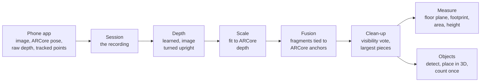
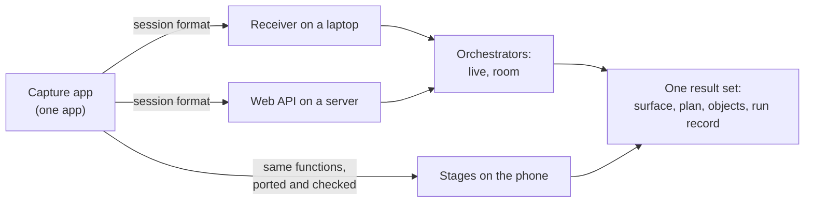

# Design: turning the research repository into product code

Design first drafted for the owner's review on 8 November 2026. The shared-pipeline move (phases 0–3 and 5) finished on 11 November; [section 15](#status-11-november-2026) records what was done and what is left. This document defines the structure, rules and order of the move.

Revised 9 November with [SceneView/Open3Dmap reuse decisions](research/products/sceneview_open3dmap_review_2026-11-09.md#reuse-and-licence-decisions-9-november-2026). The proposed next step is the shared-pipeline move through phase 3 in section 11. New methods follow its output-preservation check; they need not wait for the later interface and Android moves. This remains a recommendation for the timing the owner has reopened.

Revised 10 November with the [RTAB-Map](research/camera_tracking_and_slam/rtabmap.md) and [surface-grouping](research/surface_denoising/surface_grouping.md) reviews. The layers, stages and migration order stay as they are. Section 7.14 records where the later trials land.

It is written for three readers: the project owner, the manager who reads the repository, and whoever writes the product code next. It assumes no knowledge of the code. Terms are explained where they first appear and listed at the end.

## Contents

1. [The proposal in brief](#1-the-proposal-in-brief)
2. [Where the project is](#2-where-the-project-is)
3. [What the code looks like today](#3-what-the-code-looks-like-today)
4. [Where it is going: the solution in the field](#4-where-it-is-going-the-solution-in-the-field)
5. [Target architecture](#5-target-architecture)
6. [Proposed folder structure](#6-proposed-folder-structure)
7. [Key design choices](#7-key-design-choices)
8. [How the code should read](#8-how-the-code-should-read)
9. [Stage READMEs: the reproducible reference](#9-stage-readmes-the-reproducible-reference)
10. [Translation map: today's code to its new home](#10-translation-map-todays-code-to-its-new-home)
11. [Migration plan](#11-migration-plan)
12. [Risks](#12-risks)
13. [Decisions needed](#13-decisions-needed)
14. [Terms used](#14-terms-used)
15. [Review of the move, 9 November 2026](#15-review-of-the-move-9-november-2026)

## 1. The proposal in brief

- The research has settled on one processing chain. ARCore (Google's phone tracking library) gives the camera path. A learned depth model gives the shape of the scene. ARCore's own depth readings give the real size. Frames are fused into one surface, the surface is cleaned, and then it is measured and searched for objects.
- **Update, 12 November 2026.** The owner decided the product will not use ARCore ([PROJECT_PLAN decision 10](PROJECT_PLAN.md#owner-decisions-in-force)).
  - The camera path will come from an open visual-inertial tracker, Basalt first.
  - Real size will come from depth triangulated along that path.
  - The code still reads ARCore's records. Section 7.15 lists the five changes that remove them.
- That chain runs on about 2,800 lines of Python in 18 files, spread over `src/live` and five experiment folders. The repository holds 36,200 lines of Python outside tests. The other 92% is experiments, scoring and tools.
- The proposal is one product package, here called `sitescan` (the name is a decision for the owner). It holds only the adopted chain. Each step of the chain (a *stage*) is one folder of plain functions, with a README that shows how to run it in under 15 lines.
- Two *orchestrators* sit on top of the stages: code that decides which stage runs, on which frame, in what order. One is the live processor, the other the offline room build. Both call the same stage functions. A command line, the phone receiver and later a web API sit on top of the orchestrators.
- Research keeps its place. `research/`, `learning/` and `research/experiments/` stay. Experiments import the product package; the package never imports an experiment.
- The phone app moves to its own `android/` folder. The phone recording format stays the one boundary between the phone and the processing, wherever the processing runs.
- The move goes one stage at a time. Before anything moves, today's outputs on a short test recording are saved (*golden outputs*), and each moved stage must reproduce them.
- After the shared stages move, trial fast frame selection: group consecutive similar views, then process the sharpest eligible frame in each group. Section 7.12 defines the rule and its speed checks.

## 2. Where the project is

### The chain the evidence supports



| Stage | Method in use | Evidence measured in this project | Status |
|---|---|---|---|
| Capture | FYLD capture app on a Redmi Note 11 Pro. Every frame is saved on the phone first, then sent over Wi-Fi | 1,194 frames at 29.9 fps, no drops, on a 40 s walk | Working |
| Camera path | ARCore | Tracked 891 of 891 frames on a 15 s walk. Not yet checked against tape measures | Working, unscored |
| Depth | Depth Anything V2 Metric Indoor Small on the CPU, image turned upright first | Turning the image upright cut the error against ARCore depth from 0.080 to 0.058 AbsRel (mean relative error) on 20 frames | Working. The live path still feeds sideways images |
| Scale | Median ratio of ARCore depth to learned depth in each cell of an 8 × 6 grid over the image | 0.044 AbsRel on held-out ARCore pixels, against 0.065 with one scale per frame | Room build only. Live uses one scale per frame |
| Fusion | Open3D TSDF volumes (a voxel grid that averages depth maps into one surface), in fragments of 10 keyframes, each tied to an ARCore anchor. 2 cm voxels, depth 0.1–4.0 m | On the ICL synthetic room with its true camera path, the live surface sat 52 mm from the reference model on average at 2 cm voxels. Real walks unscored | Working |
| Clean-up | Visibility vote at a 0.5 share, then the 50 largest pieces of at least 5,000 points | 15 October walk: 676,855 points down to 554,067 in 2.6 s | Room build only |
| Measure | Dominant plane and grid footprint | Not scored | Built |
| Objects | YOLO26x boxes placed in 3D from the depth, matched within 0.35 m | Live replays overcount: 14–15 chairs where far fewer exist | Early trial |

The PC replays the 15 October walk at 1.70 updates per second on a 32-thread desktop CPU. The owner's floor is 1 per second.

### What is still open

- **Far depth.** ARCore depth stops at about 2.5 m, so beyond that the scale is a guess. Multi-view stereo between keyframes is the next trial. Without ARCore (section 7.15), triangulated depth must give the scale at every distance.
- **Counting.** It overcounts. It waits on stable geometry and a labelled inventory.
- **Accuracy.** No agreed targets and no independent measurements of a real site.
- **Tracker route.** Decided on 12 November: an open visual-inertial tracker, Basalt first ([PROJECT_PLAN decision 10](PROJECT_PLAN.md#owner-decisions-in-force)). ARCore stays only as a comparison on recordings. Basalt has run on public data, not yet on a Redmi recording; the Redmi is not yet calibrated.

These open questions decide where the structure must stay easy to change: the scale stage (far depth) and the objects stage (counting). A new method there should be one new function beside the old one, chosen by a setting.

## 3. What the code looks like today

### By the numbers

| Measure | Value |
|---|---|
| Python outside tests | 36,221 lines: `experiments/` 25,884, `src/` 5,440, `tools/` 2,898, `archive/` 1,999 |
| Python tests | 20,862 lines. 999 tests in the default run |
| Code the live product uses | About 2,800 lines in 18 files, across `src/live` and five experiment folders |
| Imports that load code by folder path (`importlib` or `sys.path`) | 294 in 130 files. 35 of them are in `src/`, reaching into `experiments/` |
| `raise` statements outside tests, in `src/`, `experiments/` and `tools/` | 943, one per 36 lines |
| Tests whose name is about rejecting or failing on input | 368 of 1,020 (36%). `pytest.raises` appears 462 times |
| Task numbers in code comments and docstrings | 171 |
| Python environments | 5 (`.venv`, `.venv-colmap`, `.venv-sfm`, `.venv-yolo`, `.venv-lingbot`), 13 requirements files, 4 Dockerfiles. No root `pyproject.toml` or lock file |
| Markdown files in git | 232 |
| Last commit | 15 October 2026. 85 paths changed or added since |

### Six problems, each with an example

**1. The product code lives inside the experiments.** Folder names such as `05_birds_eye_mapping` start with a digit, so Python cannot import them the normal way. `src/live/processor.py` loads them by string:

```python
footprint_owner = importlib.import_module("research.experiments.05_birds_eye_mapping.measure")
localisation = importlib.import_module("research.experiments.06_object_recognition.pilot.localisation")
```

and `src/live/stream.py` edits `sys.path` to reach the session readers. An editor's "go to definition" cannot follow these. Renaming an experiment folder breaks the live processor, and nothing warns until it runs.

**2. Two orchestrators that overlap but do not share.** `src/walkthrough` (about 3,600 lines) is an offline six-layer runner built to test each layer with known-correct inputs. `src/live` (about 1,850 lines) replaced it for real walks but still borrows its depth code. To run the depth model on one image, the live code goes through four modules and builds a dummy calibration to satisfy a record type:

```python
# the model ignores calibration; the record only satisfies the frame contract
frame = ColourFrame("live", None, Calibration(w, h, 1.0, 1.0, w / 2, h / 2, "x-right_y-down_z-forward"), colour)
prediction = next(iter(predict(iter([frame]), run=None)))
```

The room build borrows the live processor's map step by faking its `self`:

```python
"map": LiveProcessor._map(SimpleNamespace(_cameras=cameras), surface)
```

**3. Live and offline have drifted apart.** The room build turns images upright, fits the 8 × 6 scale grid, drops ARCore depth older than 0.1 s and runs the clean-up. The live processor does none of these. Each improvement went into whichever orchestrator was being tested, not into a shared stage. The best version of the chain exists only offline.

**4. Trial code and adopted code share modules.** `src/live/clean.py` holds the two adopted clean-up steps and six filters that the trials ruled out. Its docstring says the thresholds are "first trial settings proposed by Claude, not tuned on data and not owner-ruled", yet two of its settings are now owner rulings. A reader cannot tell which functions matter.

**5. Checks everywhere.** Record types check their own fields when created: `Calibration` tests six conditions. A reader of the project's own recorded depth checks for symbolic links. The depth step checks the count and order of predictions it just asked for. Much of this guards against input that cannot occur, because the program made it. The cost is that the method is harder to find, and changes break rejection tests that say nothing about whether the depth is right.

**6. Documents are lab notebooks.** `src/live/README.md` runs to 200 lines: how the code works, mixed with dated results from nine tasks, commands and output paths. `research/experiments/README.md` still reports depth as "test data ready; no method run". Code comments carry history ("inherited from experiment 03 dataset.py:79") where a reason should be.

The root folder also carries files that belong elsewhere: `HARNESS_WORKFLOW_AUDIT.md` (115 KB), `.coverage`, `demo_outputs/` and `.worktrees/task-44`. `outputs/` has 41 folders, 24 of them named after task numbers, such as `capture_task113_093913`.

### What is good and must survive

- **The phone session format.** `phone_session_v2.md` is one written definition. One shared test fixture is produced by the Java tests and read by the Python tests, so the two sides cannot drift. This is the model for every boundary in the new design.
- **The core functions are small and direct.** `sizing.frame_size` is 10 lines, `Fragments` 83 lines, `largest_pieces` 13 lines. The trouble is where they live and what surrounds them, not their logic. Most of the move is relocation, not rewriting.
- **The live loop design.** `LiveProcessor.add()` only records each frame. `update()` works on the newest one. Frames that arrive during an update are not queued, so results never fall behind the phone.
- **The anchor idea.** Each fragment of surface is stored relative to an ARCore anchor (a point ARCore keeps and corrects). When ARCore corrects its path, the surface moves with it and nothing is fused again.
- **The evidence habit.** Every setting traces to a measured result. The new design keeps this and moves it from code comments to a settings table in each stage README.
- **`research/` and `learning/`.** These stay as they are.

## 4. Where it is going: the solution in the field

### A site visit

1. The field worker carries an Android phone of a model the project has calibrated, with the FYLD capture app installed. The worker does no calibration: the project measures each supported phone model once and ships the numbers with the app.
2. On site they press Record and walk the work area for 1–3 minutes with the phone upright. The app shows whether the tracker is tracking and how much is waiting to send.
3. During the walk the results update at least once a second: the surface so far, the top-down map, the object counts and the areas not yet seen. The worker can go back for a missed corner.
4. After Stop, the result set is:
   - a 3D surface in metres, as a PLY file and an offline viewer;
   - a top-down plan with length, width, observed area, highest point and the parts never seen;
   - an object list with class, 3D position, how many views saw each object, and a count per class;
   - the recording itself, so the walk can be processed again later with a better method.
5. The results attach to the FYLD job beside the existing video risk assessment.

Today steps 1–3 work with a PC on the same Wi-Fi. The measurements and counts in step 4 are not yet accurate enough to hand to anyone, and no accuracy targets exist to judge them against.

### Where the processing runs

| Where | Network | Today | Suited to |
|---|---|---|---|
| A laptop on the same Wi-Fi | Local Wi-Fi. The capture app delivered 10.22 MB/s | Works on a 32-thread desktop at 1.58–1.70 updates per second. A laptop is untested | Trials, now |
| A server in FYLD's cloud, where FYLD already serves models with BentoML | Mobile data. Processing needs the colour images (about 2 MB/s, 16 Mbit/s) plus the camera path. Without ARCore (7.15), the path comes from the open tracker. If the tracker runs on the phone, only its poses are added. If it runs on the server, the lossless grey images (9.2 MB/s) and the motion sensors must be sent too. Whether a mobile uplink sustains either rate is untested | Untested | The product, if live results may lag or the stream is reduced |
| The phone | None | Untested. The depth model is not yet exported for the phone | The product, long term |

The design does not pick one. It makes the choice cheap. The boundary is the recording format, not a function call, so the same orchestrators run behind each option.



## 5. Target architecture

### Three layers

| Layer | Holds | May import | Must not contain |
|---|---|---|---|
| Stages, `sitescan/<stage>/` | The methods: plain functions on arrays and small records | numpy, scipy, opencv, open3d, torch; other stages; `sitescan/types.py` | File reading, network, threads, argument parsing, settings files, experiments |
| Orchestrators, `sitescan/pipelines/` | Which stage runs, on which frame, in what order, with which settings. They keep state between frames | Stages, `sitescan/io.py` | Argument parsing, network code |
| Interfaces, `apps/` | How a person or machine starts an orchestrator: command line, phone receiver, viewer, later a web API | Orchestrators | Any step of the method |

Imports only point down this table. If one orchestrator needs logic that another has, that logic is a stage. `research/experiments/` and `research/evaluation/` sit outside all three and may import any of them.

### Same stages, different orchestrators

A sketch, not final code:

```python
# sitescan/pipelines/room.py: offline, every frame that carries fresh ARCore depth
for frame in session.frames(path):
    if not scale.has_fresh_depth(frame):
        continue
    learned = depth.predict(model, frame.image, frame.pose)
    sized = learned * scale.fit(learned, frame)
    fragments.integrate(sized, frame)
surface = cleanup.clean_room(fragments.surface(), fragments.views())
```

```python
# sitescan/pipelines/live.py: live, the newest frame, once per update
def update(self) -> Update:
    frame = self.take_newest()
    learned = depth.predict(self.model, frame.image, frame.pose)
    sized = learned * scale.fit(learned, frame, previous=self.last_scale)
    self.fragments.integrate(sized, frame)
    return Update(frame.seq, site=mapping.measure_site(self.fragments.surface(), self.cameras))
```

The two differ in which frames they take, what they do when a frame has no ARCore depth, and when they clean up. That is the orchestrator's job. They do not differ in how depth is predicted or scaled. When a pipeline genuinely needs another method, it names a different function from the same stage in its settings, for example `scale.fit_one` against `scale.fit_grid`.

### Shared data shapes

`sitescan/types.py` holds plain dataclasses with no checks inside them:

- `Camera`: fx, fy, cx, cy, width, height, in pixels.
- `Frame`: sequence number, time, colour image (H × W × 3, uint8), camera, pose, ARCore depth if any, tracked points, anchor events.
- `ArcoreDepth`: depth in metres, confidence 0–255, its own camera, its time.
- `SiteMeasure`, `TrackedObject`.

One convention holds inside the package. A pose is a 4 × 4 matrix `world_from_camera` in metres, with OpenCV camera axes (x right, y down, z forward) in ARCore's world (y up). The session reader converts once, on the way in. Today both `world_from_camera` and `world_from_camera_cv` exist and each caller picks one.

A shape goes in `types.py` only if two or more stages use it. Anything used by one stage stays in that stage. This rule is borrowed from the 24H Insights `data_classes/` folder.

## 6. Proposed folder structure

```text
mobile_depth_estimation_tracking/
├── README.md              what the product does, how to install and run it
├── DESIGN.md              this document
├── PROJECT_PLAN.md        research aims, status and next steps
├── pyproject.toml         one package; extras for live, eval and dev
├── uv.lock                exact versions of every dependency
│
├── sitescan/              the product: adopted methods only
│   ├── README.md          catalogue: stage, headline function, input, output
│   ├── types.py           Frame, Camera, ArcoreDepth, SiteMeasure, TrackedObject
│   ├── session/           read phone recordings; replay at recorded speed
│   │   ├── FORMAT.md      the recording format (today phone_session_v2.md)
│   │   ├── read.py
│   │   └── replay.py
│   ├── selection/         proposed: small grey images, ZNCC similarity, sharpness scores
│   ├── depth/             learned depth, image turned upright first
│   ├── scale/             learned depth to metres, from ARCore depth or tracked points
│   ├── fusion/            TSDF fragments that follow ARCore's anchors
│   ├── cleanup/           visibility vote, largest pieces
│   ├── mapping/           dominant plane, footprint, area, height
│   ├── objects/           detect, place in 3D, match, count (marked experimental)
│   ├── pipelines/
│   │   ├── live.py        LiveProcessor: newest frame, once per update
│   │   ├── room.py        build_room: every frame with fresh ARCore depth
│   │   └── selection.py   proposed: shared cluster state; callers set the flush deadline
│   └── io.py              write PLY, JSON and the run record
│
├── apps/                  ways to start an orchestrator; no method code
│   ├── cli.py             sitescan live | replay | room
│   ├── receiver/          TCP receiver for the capture app
│   ├── viewer/            offline HTML viewer (today tools/demos)
│   └── api/               later: web service
│
├── android/               the capture app (Gradle project) and its build record
│
├── tests/                 product tests, one folder per stage
│   └── fixtures/          20-frame public test recording and golden outputs
│
├── research/              everything outside the product; never imported by it
│   ├── experiments/       trials; import sitescan
│   ├── evaluation/        scoring against references: TUM, ICL, ARCore depth, tape
│   └── <topic>/           sources and reviews by topic
├── learning/              chapters from first principles
├── task_list/             task records
│
└── data/  models/  outputs/  third_party/      local only, not in git
```

Each stage folder has the same shape:

```text
sitescan/depth/
├── README.md        the reproducible reference (section 9)
├── __init__.py      exports load_model and predict
├── model.py         load and run Depth Anything V2
└── orientation.py   quarter turns, upright and back, the turned camera
```

| Folder | Holds | Rule for adding to it |
|---|---|---|
| `sitescan/` | Adopted methods only | A method enters when a trial has adopted it. Its evidence goes in the stage README's settings table |
| `apps/` | Entry points | Nothing that a second entry point would also need |
| `android/` | The phone app | A change to the recording updates `FORMAT.md`, the shared fixture on both sides, and the version number |
| `tests/` | Product tests | Behaviour and golden tests of `sitescan/` and `apps/` only |
| `research/evaluation/` | Scoring, reference data readers, stand-in recordings | May import `sitescan`. The product never imports it |
| `research/experiments/` | Trials | May import `sitescan` and `research.evaluation`. May keep its own environment. Results go in its README |
| `research/` topic folders, `learning/`, `task_list/` | Evidence, teaching, records | Unchanged |

Root clean-up: `HARNESS_WORKFLOW_AUDIT.md` moves to `task_list/` or `archive/`; `demo_outputs/` joins `outputs/`; `.coverage` and `.worktrees/` are ignored by git.

## 7. Key design choices

### 7.1 One package, one folder per stage

**Recommendation:** a single installable package with a sub-folder per stage. **Why:** the adopted chain is about 2,500 lines. Separate packages per layer would add install and version work for no gain. Folders give each stage a README and a clear boundary. Modules stay under 300 lines; the hard limit in this repository is 800.

### 7.2 Stage functions take arrays and records, not files

Only `sitescan/session` reads recordings and only `sitescan/io.py` writes results. Every stage function takes numpy arrays and the records in `types.py`. **Why:** a phone port or a web service needs the stage without a file system, and a test can build its input in three lines.

### 7.3 Models are loaded once and passed in

`depth.load_model(path)` returns a callable. Stage functions take it as an argument. **Why:** tests pass a fake model, which the current tests already do. A server or phone can swap the runtime (PyTorch, ONNX Runtime) without touching the stage.

Model weights live in `models/`, which git ignores. A tracked `models/manifest.toml` records each model's name, source, revision, SHA-256 hash and licence. Today the weights sit in two places (`data/models/` and `checkpoints/`), and only the YOLO weights have an acquisition record.

The manifest must distinguish source code, weights and converted artefacts, with the output convention recorded alongside the model. SceneView's relative inverse-depth Small model and our Metric Indoor Small model need different scaling equations. Sharing a family name does not make their outputs interchangeable. Add another runtime only when comparing or deploying that specific model; the move keeps the existing model unchanged.

### 7.4 Settings live in code, with reasons in the README

Each orchestrator has one frozen dataclass (`LiveSettings`, `RoomSettings`) whose defaults are today's measured values. Stage functions take plain keyword arguments with the same defaults. There are no settings files until a second deployment needs different values. The reason for each default goes in the stage README's settings table, not in a comment.

### 7.5 One environment for the product

One Python version (3.12, which all four venvs already use), one `pyproject.toml`, one lock file. uv is recommended because it handles the CPU-only PyTorch download index. Extras: `live` (torch, transformers, open3d, ultralytics, opencv), `eval` and `dev` (pytest, ruff).

That list describes today's research dependencies, not a cleared proprietary distribution. The current YOLO26x loader imports Ultralytics, whose AGPL/commercial choice remains unresolved. Preserve its behaviour as an explicitly experimental reference during the move. Resolve applicable terms or replace the detector before proprietary deployment. SceneView's Apache-2.0 YOLOX implementation is a comparison candidate, not an accuracy-equivalent substitute.

Tools that clash with the product keep their own environment, inside their experiment folder, with their own lock file: COLMAP, LingBot-Map (conda), the four tracker Docker images and Marigold (WSL). The product never needs them.

### 7.6 Errors: check at the edges, trust inside

The edges are where data enters from outside the program: the session reader and receiver (bytes from a phone), command-line arguments, web requests, and model files on disk. These check their input and give a message a person can act on. Inside the package, functions assume their inputs are what the types say.

So: no type checks in dataclasses, no checks on files the program itself just wrote, and no turning exceptions into status records inside a stage. A stage returns `None` only where the orchestrator has a planned fallback, as the scale stage does today (ARCore depth, else tracked points, else the last scale). Otherwise it raises and the run stops with a traceback. A future scale-hold expiry is a method change under section 7.13; it must not be introduced while moving today's fallback.

Data rules are part of the method, not error checks. "Drop ARCore depth older than 0.1 s" stays.

### 7.7 Tests: three lanes

| Lane | What it checks | Example | When it runs |
|---|---|---|---|
| Behaviour (default) | Small made-up inputs with an answer known by hand | A flat wall at 2 m, learned depth reading 1 m: the scale is 2.0 everywhere | Every change; the whole lane under 60 s |
| Golden (`-m golden`) | Real stages on the fixture recording; outputs match the saved ones within a tolerance | Point count after clean-up, map length and width | Before every merge |
| Parity (later) | A phone or server version of a stage against the Python version, same frames | Phone depth against Python depth: AbsRel between them under 1% | Before shipping an on-phone stage |

Rules: one test for each branch, loop or parser. Test what the stage computes, not how it rejects input. No tests of exact error messages, and no tests that a dataclass refuses a string. Expect 10–20 tests per stage. The count is not a goal.

Fixtures: the committed one is a 20-frame stand-in recording made from the public TUM desk data (licence CC BY 4.0), with its golden outputs. A second, local-only fixture is a 20-frame slice of the 15 October walk. It shows a home, so it stays out of git.

### 7.8 Documentation: three kinds, kept apart

| Kind | Where | Contains | Never contains |
|---|---|---|---|
| Product docs | `README.md`, `sitescan/README.md`, each stage README | What the code does now, how to run it, why each default | Dates, task numbers, history of results |
| Evidence | `research/`, `learning/`, each experiment README | What was tried, the numbers, the sources, the dates | Instructions for running the product |
| Records | `task_list/` | What was done, when, and what is left | Anything a reader needs in order to use the code |

Code comments give a reason in one line. A comment links to evidence by file path only when the reason is a measurement. Task numbers do not appear in code.

### 7.9 Run outputs

Every run writes one folder, `outputs/<recording>/<tool>/<yyyymmdd-hhmm>_<label>/` (built 12 November 2026, `sitescan/runs.py`). The recording is a short name from `recordings.toml` (`redmi-20261015-0939`, `tum-desk-20`), which also marks recordings that show a home as private. The tool is what ran: `room`, `replay`, `live`, `compare`, `trajectory` or a trial's name. The label is one to four lowercase words joined by hyphens saying what is different; the time orders runs, so names carry no task numbers or versions. A path under `outputs/` stays within 80 characters.

`run.json` records the command, every setting, the options typed, the git commit with any uncommitted code changes (written beside it as `source.diff`) and untracked code files with their hashes, the runs it read, and, once finished, its status and headline numbers. A result can then be traced to the code that made it. Pages and screenshots made from a run go in its `pages/` and `screens/`. `tools/runs.py` lists and filters runs and writes `outputs/index.html`. Still to do: model hashes in `run.json`, and the research `Run` class, which copies the source tree into each run (the cause of Windows path-length test failures), moving to the same layout with `source.diff`.

### 7.10 Mobile deployment: the recording format is the contract

- **The format carries everything across the boundary.** Today's version 2 carries frames, motion sensors and ARCore's records. When a stage runs on the phone, its output joins the recording as a new optional field, for example learned depth per frame. Each such change bumps the version and updates the spec and the shared fixture on both sides. The v2 spec already works this way.
- **So every on-phone result can be checked on the PC.** The PC replays the recording and runs the Python stage on the same frames. The parity lane compares the two.
- **Order of moving stages to the phone**, smallest port first:
  1. Scale: about 40 lines of arithmetic; a direct port to Kotlin.
  2. Depth model: export to ONNX or LiteRT (TensorFlow Lite). ZipDepth, a smaller candidate (6.1 million parameters, 24 ms per frame on a desktop CPU), exported to ONNX, but its TensorFlow Lite conversion failed. Depth Anything V2 Small has not been tried.
  3. Objects: YOLO on the phone is a known path; Google's ARCore ML sample does it.
  4. Fusion and clean-up last. Open3D, which fuses today, does not publish an Android build (to confirm before planning the port), so this needs other code. RTAB-Map's Android ARCore driver (BSD-3-Clause core) is one candidate; its accuracy and speed on the Redmi are unmeasured.
- **The tracker, once ARCore is gone (7.15).** The open tracker runs on the PC or server from the grey images and motion sensors already in the recording, or on the phone as an Android NDK build of Basalt. Running on the phone, its poses join the recording as a new optional field, like any other on-phone result.
- **Capture without ARCore.** A capture mode that opens the camera with plain Camera2 is the next capture work ([PROJECT_PLAN next steps](PROJECT_PLAN.md#next-steps)). It changes the app, not the format: v2 already allows frames without an ARCore record.
- **One app throughout.** The capture app gains processing behind a setting. There is no second app; the owner ruled this on 14 October.
- **`android/` layout:** the Gradle project, its tests, and `releases.md` with one entry per build (today one README per build in `mobile_deployments/`). APK files are kept as release files, not in git.
- **Python stays the reference.** A phone port is correct when it matches the Python output on the parity fixture, not when its output looks right.

### 7.11 The web API: a thin interface, built when needed

Today's interfaces are command lines and the TCP receiver. When a server is wanted, the API is one web service that accepts an uploaded recording and returns the result set:

| Request | Does |
|---|---|
| `POST /sessions` | Accept a recording, start `pipelines.room.build_room` |
| `GET /sessions/{id}/result` | Return the result set, or "still running" |
| WebSocket `/sessions/{id}/live` (later) | Stream live updates from `LiveProcessor` |

The service calls orchestrators only and holds no method code. FYLD already serves models with BentoML, so BentoML is the natural host; FastAPI is the plain alternative. Either way it is one file in `apps/api/`. It is not built now, because nothing would call it yet.

### 7.12 Fast frame selection: similar views, sharpest frame

**Proposed behaviour after the refactor.** Group consecutive frames by their similarity to a fixed keyframe, then send the least blurry eligible frame in each group to depth prediction and fusion. The aim is less repeated work and better input images. Speed and reconstruction quality must both be measured before adoption. Frame selection stays disabled while the existing stages move and reproduce their golden outputs.

**The rule:**

1. Make one small grey image per incoming frame. Reuse the capture frame's grey image when available. Start the trial at 160 × 120 pixels, preserving the source aspect ratio on other cameras, using OpenCV area resizing. Keep the recorded orientation and the same pixel grid throughout a group.
2. The first frame starts a group and is its fixed *selection keyframe*. This is an image used for comparison; ARCore's anchors and keyframe ids keep their existing meaning.
3. Compare each later frame only with that keyframe using ZNCC (zero-mean normalised cross-correlation). Subtract each image's mean, then divide by the square root of its summed squared values. The dot product of the two flattened, normalised images is the similarity score. Cache the keyframe's normalised vector. A score at or above the chosen threshold keeps the frame in the group. A lower score closes the group and starts another with the incoming frame. Comparing with the fixed keyframe prevents a chain of small changes from joining widely different views.
4. Among frames the pipeline can process, keep the one with the highest variance of Laplacian (VOL): `variance(Laplacian(grey))`, computed on the small grey image before ZNCC normalisation. This is the first sharpness measure to trial. Keep the earlier frame on a tie. The room pipeline requires fresh ARCore depth; live uses its available scale sources. The winner keeps its own image, pose, intrinsics, depth, timestamps and anchor association.
5. Emit the winner when its group closes, then release the previous candidate. At end of input, emit the last group's winner. A group with no eligible frame produces no reconstruction frame. If a grey image has zero variance, ZNCC is undefined: close the previous group and let that frame start a new one, so a blank view is not silently discarded as redundant.
6. Live also closes a group at a time limit, even if the view stays similar. Set that limit from the one-second update budget after allowing for processing time. A frame is emitted at most once. While processing is busy, keep one latest ready candidate rather than a queue of completed groups.

**Speed first.** Use one pass through the stream, one fixed-size image comparison per frame, and one sharpness score per eligible candidate. Keep only the keyframe vector, the current best frame and the latest ready candidate. Memory stays bounded as the recording grows. Decode the full colour image only for a winner when the input allows it. The first version uses NumPy and OpenCV on the CPU; it needs no feature detection, sliding template search, image registration, learned model or comparison with older groups.

Keep the image scoring functions in `sitescan/selection/`. Put the shared grouping state in `sitescan/pipelines/selection.py`; live and room call it with their own eligibility rule and flush timing. The capture app continues recording every frame. Both pipelines consume every anchor event and correction before image selection, including events on frames whose images are not selected.

| Setting or check | Initial plan |
|---|---|
| Small grey image | 160 × 120 on the Redmi; compare with 80 × 60 if resizing and scoring dominate cost |
| ZNCC threshold | Choose by replay; record the value and resulting groups. No threshold is adopted yet |
| Sharpness | VOL on the same small grey image. Try a simple gradient score only if VOL misranks visible blur or costs more |
| Selection time | Target a 95th-percentile cost below 1 ms per incoming frame on one desktop CPU thread, including resizing and scoring. This is a target, not a measured result |
| Total cost | Measure any added image decoding and file reading separately, plus total pipeline time and depth-model calls saved |
| Live delay | Measure selection waiting time, result age and longest update gap; retain at least one update per second |

**Check before adoption.** Replay the same recording with selection off and on, keeping all other settings fixed. Report selected frame ids, group sizes, model calls, stage timings, memory, reconstruction consistency and retained coverage. Inspect low-texture views and blurred transitions. ZNCC measures image similarity, not camera movement or geometric overlap; VOL can rank noise or high-contrast texture above a sharper view. Select the thumbnail size and threshold on trial data, then check a separate recording. Keep selection optional until the results support it.

Tests cover identical views, brightness offsets, a changed view starting a group, the sharpest eligible winner, ties, zero-variance images, final flush, the live time limit and bounded pending work. Include a fixed-keyframe case where adjacent frames look similar but the last differs from the first. Verify that skipped images still deliver anchor corrections and that a winner's image and geometry come from the same frame.

The existing [object appearance comparison](research/experiments/06_object_recognition/experiments/03_appearance/compare.py) uses the same ZNCC arithmetic on masked crops. The selector uses whole grey thumbnails and keeps its scoring independent of that experiment. Method references: [OpenCV's normalised correlation formula](https://docs.opencv.org/4.x/df/dfb/group__imgproc__object.html) and [area resizing](https://docs.opencv.org/4.x/da/d54/group__imgproc__transform.html).

### 7.13 Learning from SceneView and Open3Dmap

The [source review](research/products/sceneview_open3dmap_review_2026-11-09.md) identifies implementation choices within the existing stages. It does not justify another architecture or a dependency on an entire demo application. These rules constrain later trials; they do not add behaviour to the structural move.

| Concern | Design consequence |
|---|---|
| Metric support can disappear or cover too little depth | Compare support/span rejection and expiry of the last valid scale within `scale/`. Leave unsupported distances explicit. Evaluate the held-out error and lost coverage together; fitting near anchors does not establish far accuracy |
| Inference finishes after capture | A later asynchronous implementation carries the source frame's identity, timestamp, intrinsics, pose and map revision through inference. Completion-time pose cannot replace capture-time pose. Keep the newest-frame scheduling policy and avoid a growing work queue |
| Some depth maps are repeated or old | Retain the 0.1 s measurement freshness rule and distinguish absent, repeated, stale and accepted depth in diagnostics. Do not copy SceneView's late-depth acceptance fallback into the measured path without a separate replay test |
| Object centres move between views | Compare lifting with reprojection agreement, shared surface membership and footprint overlap in `objects/`. First hold detections fixed. Test distinct adjacent objects as well as repeated sightings; footprint suppression can undercount |
| The fused cloud can change | Object associations refer to the current geometry revision. Recompute affected associations after correction or rebuild; array indices are not persistent object identities |
| A phone map has a finite memory budget | Study SceneView's coarsening and TSDF block limits when porting fusion. Expose dropped coverage and lost resolution. Keep our correction-aware fragments until an alternative preserves their required behaviour |
| A walker cannot diagnose missing observations | Derive capture prompts from depth availability, freshness and observed coverage. Keep presentation in the phone/interface layer and geometry decisions in the stages |

Direct adaptation of SceneView's Apache-2.0 source is a possible reuse route. Before importing or translating a file, record its pinned source and terms; retain applicable notices, include the licence and mark modifications. A Kotlin-to-Python port of copied code still needs attribution. Create the distribution's third-party notice entries when code is actually adopted, not as a claim that this review adopted it. Check bundled models, runtimes and assets separately.

Open3Dmap's root CC BY-NC 4.0 code is outside the proposed proprietary product dependency set. Learn from the capture workflow and metadata requirements; implement from our own session contract and separately licensed upstream components. Do not translate its code and treat the result as a new permissive implementation. The SplatJSON document's MIT statement does not cover the app. The research note records the licence sources and unresolved artefact scope.

The first method trial is scale support and bounded hold after the live path receives the established room-build fixes. Object association follows stable geometry and an independently labelled inventory. LiteRT, Kotlin fusion and a detector swap remain separate later comparisons. None of these replaces the far-depth triangulation question.

### 7.14 Learning from RTAB-Map and the surface-grouping review

The [RTAB-Map review](research/camera_tracking_and_slam/rtabmap.md) and the [surface-grouping review](research/surface_denoising/surface_grouping.md) (10 November) add trials, not structure. Each trial lands inside the existing layers. The order and scoring of the trials are in the [project plan](PROJECT_PLAN.md#what-to-take-from-rtab-map-and-the-surface-grouping-review).

| Concern | Design consequence |
|---|---|
| RTAB-Map is a C++ tool with its own dependencies | It stays in `research/experiments/` with its own build, as COLMAP does (7.5). Its adapter reads recordings through `sitescan.session`. The product depends on it only if a trial adopts it |
| Two systems can correct the same surface | RTAB-Map's pose graph and our anchors both move geometry after a correction. If its poses are ever adopted, fusion applies one correction, not both |
| Grouping by colour and surface direction | A new function in `cleanup/` beside `largest_pieces`, chosen by a setting |
| Region-aware scale | A new function in `scale/` beside `fit_grid`, chosen by a setting |
| Correcting depth from surfaces matched across views | The one idea that does not fit one stage. It keeps each frame's patch before fusion, corrects depth, then rebuilds. That means a second pass in the room orchestrator and probably a new stage between scale and fusion. Add that stage only when a trial adopts the method |
| Kinds of match | Same material, same class, same surface and same physical object are different relations. A learned embedding (a vector describing appearance) suggests a match but is not an identity: two identical cones stay two objects in `objects/` |

### 7.15 Removing ARCore: five changes

On 12 November the owner decided the product will not use ARCore ([PROJECT_PLAN decision 10](PROJECT_PLAN.md#owner-decisions-in-force)). The camera path will come from an open visual-inertial tracker, Basalt first. Real size will come from depth triangulated along that path. The [12 November review](research/visual_inertial_odometry/depth_without_arcore_2026-11-12.md#is-sitescan-ready-to-swap-these-in) checked the package against that change, with line references.

**What already fits.**

- Stages take arrays.
- The depth model is a callable passed in.
- The scale fits take any `(pixels, metres)` targets, and `point_targets` turns any world points into them.
- Clean-up and mapping take points and camera positions.

**What does not.** ARCore is built into the data and the wiring.

- **`types.py`:** `ArcoreDepth`, and ARCore anchors, tracking state and time on `Frame`. There is no field for the motion sensors.
- **`session/`:** pose and intrinsics come only from ARCore's record. A frame without one has neither, so both pipelines skip it.
- **`pipelines/`:** the room fuses only frames with fresh ARCore depth and scales only to it. Live's scale sources are a fixed sequence: ARCore depth, then ARCore points, then the previous scale. Keyframes are ARCore anchors.
- **`fusion/` and `objects/`:** positions are kept relative to anchors, which only ARCore supplies.
- **`depth/orientation.py`:** "down" is the world's −y, which is ARCore's convention. A tracker whose world has gravity along z would turn images the wrong way, and nothing would raise an error.
- **Elsewhere:** nothing reads `imu.csv`, and the capture app opens the camera through ARCore.

**The changes, in order.** Rule 4 of section 8 allows a choosing mechanism once two real methods exist. ARCore and an open tracker are two, so a setting with a plain `if` or dict chooses between them. There are still no registries.

| # | Change | Where | Check |
|---|---|---|---|
| 1 | Poses and intrinsics from outside the recording. `session.frames()` takes an optional trajectory and a calibration, matched to frames by timestamp. The trajectory is in TUM format, which the open-VIO host already writes. The reader converts the tracker's world to gravity-up once, so `orientation.py` and everything after it stay unchanged | `session/` | Golden outputs unchanged with ARCore as the default. On the fixture, a trajectory file equal to the recorded poses gives identical outputs |
| 2 | Measured depth not tied to ARCore. `ArcoreDepth` becomes a measured-depth record with a `source` field, keeping its own camera, time and confidence. Dense triangulated depth then follows the same freshness and confidence rules | `types.py`, `session/`, `scale/targets.py` | Golden outputs unchanged |
| 3 | Scale targets chosen by name in settings: ARCore depth, ARCore points, tracker landmarks, sparse triangulation or dense triangulation. Each returns pixels, metres and a weight. Both pipelines read the same setting instead of a fixed sequence. `fit_grid` takes weights when the weighting trial runs | `scale/`, `pipelines/` | Golden outputs unchanged with today's setting. Each new source is its own trial |
| 4 | A `triangulate/` stage: keyframe choice, sparse triangulation with known poses, later the plane sweep. One small class holds the rolling window of keyframes, as `Fragments` holds volumes | new `triangulate/` | Behaviour tests on synthetic views with known depth; trials in the order of the plan |
| 5 | Anchors from keyframes. The open tracker's keyframe poses become anchors. With odometry only, they are never corrected, which `Fragments` and `Objects` already handle. A back end with loop closure would send its corrected keyframe poses as anchor updates | `session/`, `pipelines/` | A walk on tracker poses fuses and counts with no ARCore records |

**The tracker stays outside the package for trials.** Basalt runs as its own program in WSL, from the EuRoC export the open-VIO host already writes, and its trajectory file is read through change 1. Section 13, decision 8, covers how it joins the product later.

**ARCore stays the default source until a trial replaces it.** That way each change keeps the golden outputs. The ARCore-specific code is deleted only once the open route is adopted, and existing recordings remain readable as comparisons.

**Status, 12 November 2026: all five changes are built.**

| # | What was built | Check |
|---|---|---|
| 1 | `session.read_tum` and `read_calibration`; `frames()` and `read_wire_session()` take `trajectory` and `calibration`. Times are read as exact decimals; a pose within 1 µs is the frame's own, else poses at most 0.1 s apart are interpolated. The world is turned so the tracker's up axis is +y. Kalibr results convert with `research/experiments/open_vio/calibration/to_sitescan.py` | A trajectory of the fixture's recorded poses gives those poses back to 1e-12 |
| 2 | `ArcoreDepth` is now `MeasuredDepth` with `source` ("arcore" or "sweep"); the dense sweep returns one | Golden outputs unchanged |
| 3 | `scale_sources` in `RoomSettings` and `LiveSettings`, read by both pipelines from `pipelines/targets.py`: `arcore_depth`, `tracked_points`, `sparse`, `dense`. `fit_one` and `fit_grid` take weights; `scale.fit_power` adds a robust scale that changes with distance (`RoomSettings.scale_fit`) | Golden outputs unchanged |
| 4 | `sitescan/triangulate/`: sparse triangulation against a rolling window of keyframes (`Triangulator`) and a Census + semi-global plane sweep, optionally around a prior | 17 behaviour tests on rendered scenes; a fixture trial against Kinect depth ([research/experiments/triangulation](research/experiments/triangulation/README.md)) |
| 5 | With a trajectory, the reader starts an anchor once a second; tracked points and ARCore anchors are dropped | The fixture fuses and maps on tracker poses with no ARCore record used |

"Golden outputs unchanged" was checked more strictly than the golden lane: on this machine every room and live number (26 and 241) is identical to the run made just before the changes. The golden file gained four room summary entries (`pose_source` and the `scale` record) with their default values; no saved number changed. On this machine the golden lane fails as it did before the changes, on map areas and plane normals that differ from the machine that saved them.

Not built: the tracker inside the package (it stays outside, decision 8 in section 13), lens undistortion, the live path's upright images and grid scale, Basalt's own landmarks as targets, and a polar-rectification check of the sweep.

## 8. How the code should read

### Rules

1. A function does one step of the method and is named after it: `visibility_vote`, `fit_grid`, `measure_site`. Aim for under 40 lines.
2. One level of helpers at most. No function that only renames or forwards to another.
3. A class only where state lives between calls: `Fragments` (the volumes) and `LiveProcessor` (the newest frame, the anchors). Everything else is a function.
4. No abstract layers for one implementation: no protocols, registries or factories until there are two real methods to choose between. Then a plain dict or `if` does the choosing.
5. One statement per line. No tuple assignment of unrelated values. Lines up to 100 characters, enforced by ruff.
6. One word per idea. The prose docs say "size" for the factor that turns learned depth into metres. The product should say "scale", because it will also talk about object size and site size.
7. A docstring's first line says what the function returns, in plain words. Two to four more sentences explain the method if the code does not make it obvious. No history, no task numbers, no "proposed by".
8. A comment gives a reason in one line. A comment that repeats the code is deleted.
9. Constants sit at the top of the module, with the unit in the name: `MAX_DEPTH_AGE_S = 0.1`. The reason for the value is in the README.
10. Errors follow 7.6.

These rules target the marks of generated code found in this repository: defensive checks, wrappers, record types that exist to satisfy other record types, history in comments, and tests of rejection. The 24H Insights VideoModule shows the same marks in its later parts: aliases kept for old names (`_score_cohort` beside `score_cohort`), task numbers in READMEs ("FROZEN — tasks 192/191/198"), docstrings that narrate history ("Before this existed…") and files of 1,300 lines. Its useful parts carry over: building blocks separate from the wiring, one README per folder, a catalogue README, shared data shapes in one place, and test lanes chosen by marker.

### Before and after

**Imports.** Before:

```python
footprint_owner = importlib.import_module("research.experiments.05_birds_eye_mapping.measure")
plane = footprint_owner.fit_dominant_plane(surface, inlier_distance_m=settings["inlier_distance_m"], ...)
```

After:

```python
from sitescan.mapping import measure_site
```

**Borrowing a method through a fake object.** Before: `LiveProcessor._map(SimpleNamespace(_cameras=cameras), surface)`. After: `mapping.measure_site(surface, cameras)`, a function both orchestrators call.

**Checks on data the program made.** Before, in `research/experiments/shared/contracts.py`:

```python
def __post_init__(self) -> None:
    if (
        self.width < 1
        or self.height < 1
        or not isinstance(self.width, int)
        ...
    ):
        raise ValueError("Invalid resolution or focal lengths")
```

After:

```python
@dataclass(frozen=True)
class Camera:
    """A pinhole camera, in pixels."""

    fx: float
    fy: float
    cx: float
    cy: float
    width: int
    height: int
```

The session reader checks the phone's numbers once, when they arrive.

**Dense lines and history comments.** Before, in `room_build.py` and `processor.py`:

```python
fragments, cameras, outcome, sizes, timeline, placed = Fragments(voxel_m=args.voxel), [], Counter(), [], [], []

# Task55's frozen grid-footprint settings (src/walkthrough/steps/mapping.py GridFootprint).
MAP_SETTINGS = {"cell_size_m": 0.05, "inlier_distance_m": 0.02, "iterations": 500, "sample_size": 50_000, "seed": 0}
```

After: one variable per line, created where it is first used. The map settings become keyword defaults of `measure_site`, and the mapping README's settings table says where each came from.

**A stage function in the target style.** The body is today's `grid_size`, about 20 lines, with the same logic:

```python
def fit_grid(learned: np.ndarray, arcore: ArcoreDepth, cells=(8, 6), min_pixels=20) -> np.ndarray | None:
    """Per-pixel scale that turns learned depth into metres, from ARCore's depth readings.

    The image is cut into 8 x 6 cells. Each cell's scale is the median of ARCore depth
    divided by learned depth over the ARCore pixels inside it. A cell with fewer than
    20 readings takes the median of the whole frame. The grid is then blended smoothly
    to full image size. Returns None when the frame has fewer than 50 readings.
    """
```

## 9. Stage READMEs: the reproducible reference

Each stage README lets someone who knows the stages, but not the code, understand the method and run it. All follow one template:

1. **What it does.** One paragraph in plain words.
2. **Inputs and outputs.** A table: name, shape, type, units, axes.
3. **How it works.** Numbered steps, one sentence each, with the reason for each step.
4. **Run it.** Under 15 lines that run on the committed fixture and print something checkable.
5. **Settings.** A table: name, default, why this value, link to the evidence.
6. **Limits.** What it gets wrong, in numbers.
7. **Tests.** What the tests check.

The package README is a catalogue, one row per stage:

| Stage | Headline function | Takes | Gives |
|---|---|---|---|
| Session | `session.frames(folder)` | A recording folder | Frames in order, anchor events |
| Selection (proposed, section 7.12) | `selection.zncc(keyframe, candidate)`, `selection.sharpness(grey)` | Small grey images | Similarity and sharpness scores; pipelines choose one eligible frame per group |
| Depth | `depth.predict(model, image, pose)` | Colour image, pose | Depth with the right shape and the wrong scale |
| Scale | `scale.fit(learned, frame)` | Learned depth, the frame's ARCore depth or tracked points | Per-pixel scale |
| Fusion | `Fragments.integrate(depth, frame)` | Scaled depth, the frame | A surface that follows ARCore's corrections |
| Clean-up | `cleanup.clean_room(points, views)` | Surface points, the views that made them | The points to keep |
| Measure | `mapping.measure_site(surface, cameras)` | Surface, camera positions | Plane, length, width, area, highest point |
| Objects | `objects.count(image, depth, frame, tracks)` | Image, scaled depth, frame, objects so far | Updated objects and counts |

It ends with the two orchestrators and how to run them. The 24H Insights VideoModule README is the model for the catalogue; its history notes are not.

### Draft: `sitescan/depth/README.md`, shortened

> **Learned depth**
>
> Predicts how far away each pixel is, from one colour image. The answer has the right shape (which surfaces are nearer than which) and the wrong scale. On indoor test recordings it reads 1.34–1.41 times too far, and the factor changes from 0.86 to 2.09 between frames. The scale stage fixes this. Never use these metres directly.
>
> **Inputs and outputs**
>
> | | Shape and type | Units and axes |
> |---|---|---|
> | `image` | H × W × 3, uint8, RGB, as the camera recorded it. On the Redmi: 640 × 480, on its side when the phone is upright | pixels |
> | `pose` | 4 × 4, float64, `world_from_camera` | metres; OpenCV camera axes; ARCore world, y up |
> | returns `depth` | H × W, float32 | metres along the camera's z axis, on the recorded pixel grid |
> | returns `valid` | H × W, bool | False where the model gave no usable value |
>
> **How it works**
>
> 1. Turn the image upright. Count the clockwise quarter turns that bring the image's down direction closest to world down, using the pose. A phone held upright needs one turn. The model was trained on upright photos.
> 2. Run Depth Anything V2 Metric Indoor Small (25 million parameters) on the CPU and resize its output to the image size.
> 3. Turn the depth back to the recorded grid, so it lines up with the camera's intrinsics and with ARCore's depth.
> 4. Mark a pixel valid where the depth is finite and between 0.1 and 20 m.
>
> **Run it**
>
> ```python
> import numpy as np
> from sitescan import depth, session
>
> model = depth.load_model("models/depth_anything_v2_metric_indoor_small", threads=16)
> frame = next(session.frames("tests/fixtures/tum_desk_20"))
> learned, valid = depth.predict(model, frame.image, frame.pose)
> print(learned.shape, round(float(np.median(learned[valid])), 2))
> ```
>
> **Settings**
>
> | Setting | Default | Why |
> |---|---|---|
> | Model | Depth Anything V2 Metric Indoor Small | Best of the models tried that meet 1 frame per second. Marigold had better shape but took 16.6 s per frame. Prompt Depth Anything was 39–58% worse on two of three recordings. Depth Anything 3 Small was 2–3 times worse on real recordings |
> | Turn upright | On | AbsRel against ARCore depth fell from 0.080 to 0.058; better in 17 of 20 frames |
> | Threads | 16 | Median 250 ms per frame in the live replay of a public recording, on a 32-thread desktop CPU |
> | Valid range | 0.1–20 m | The model's own range. Fusion cuts further, at 4 m |
>
> **Limits**
>
> - Shape error: fused surfaces sit 8–16 cm from the truth on average, even with perfect camera positions.
> - Edges between a near object and the wall behind it get depths in between (*flying pixels*). Clean-up removes most of them.
> - Not yet run on a phone.
>
> **Tests**: turning an image upright and back returns the same array; a turned camera sees each world point where the turned image puts it; three fixture frames match their saved depth within 0.1% (golden).

## 10. Translation map: today's code to its new home

| Today | Becomes | What changes |
|---|---|---|
| `research/experiments/01_camera_capture_delivery/host/session_v1.py`, `session_v2.py`, `protocol.py` | `sitescan/session/` | One reader. One pose convention on the way out. All edge checks live here |
| `research/experiments/01_camera_capture_delivery/phone_session_v2.md` | `sitescan/session/FORMAT.md` | Moved; content unchanged |
| `research/experiments/01_camera_capture_delivery/host/capture_receiver.py` | `apps/receiver/` | Imports only |
| `src/live/stream.py` (`replay`, `read_session`) | `sitescan/session/replay.py` | Normal imports; no `sys.path` edit |
| `src/live/run.py` `depth_anything`, `src/walkthrough/steps/depth.py` `DepthAnythingV2Metric`, `research/experiments/shared/geometry.py` `depth_metres` | `sitescan/depth/model.py` | One `load_model` and one `predict`. No dummy calibration |
| `src/live/orientation_control.py` (`quarter_turns`, `upright`, `recorded`, `turned_camera`) | `sitescan/depth/orientation.py` | The sideways-against-upright scoring stays in `research/experiments/` |
| `src/live/sizing.py`, `research/experiments/sfm/src/dense.py` `fit_size`, `src/live/room_build.py` `grid_size`, `cell_index`, `fresh_depth` | `sitescan/scale/` | One stage offering `fit_one` and `fit_grid`; both orchestrators use it |
| `src/live/fragments.py` | `sitescan/fusion/fragments.py` | Logic unchanged |
| `src/live/clean.py` `visibility_vote`, `vote_tallies`, `_measurements`, `largest_pieces` | `sitescan/cleanup/` | The six rejected filters move to `research/experiments/surface_cleanup/` |
| `research/experiments/05_birds_eye_mapping/measure.py` `fit_dominant_plane`, `footprint`; `LiveProcessor._map` | `sitescan/mapping/` | `_map` becomes the plain function `measure_site` |
| `research/experiments/06_object_recognition/pilot/detector.py`, `localisation.py`, `association.py`; `LiveProcessor._objects` | `sitescan/objects/` | Marked experimental; the known overcount is in its README |
| `src/live/processor.py` | `sitescan/pipelines/live.py` | Calls stages; keeps only state. Gains upright images, grid scale, fresh-depth rule (as a separate, reviewed step) |
| `src/live/room_build.py` | `sitescan/pipelines/room.py` | Argument parsing moves to `apps/cli.py` |
| `src/live/run.py`, `room_build.main` | `apps/cli.py` | One command with three verbs |
| `src/live/stand_in.py`, `src/live/score.py` | `research/evaluation/` | Stand-in writes the v2 format |
| `src/walkthrough/` (about 3,600 lines) | `research/evaluation/layers/` or `archive/` | Owner decision (section 13) |
| `tools/demos/` | `apps/viewer/` | Imports only |
| `tools/check.py` | stays as a developer tool | None |
| `research/experiments/01_camera_capture_delivery/capture/` (Java, 2,717 lines plus 673 lines of tests), `build/` | `android/` | Moved; build scripts kept |
| `mobile_deployments/` | `android/releases.md` | One entry per build |

What stays in `research/experiments/`: every rejected or untried method (Marigold, Prompt Depth Anything, Depth Anything 3, ZipDepth, COLMAP and the structure-from-motion runs, the live image-only trackers, LingBot-Map), the open-source tracker runners and calibration tools (`open_vio`), which became the product route on 12 November but stay here until a tracker joins the product (section 7.15), the segmentation and appearance trials for objects, and the clean-up trials. Each keeps its README as the evidence record. Each is updated to import `sitescan` instead of the old paths.

## 11. Migration plan

Start this work after a reproducible baseline is identified, rather than waiting for all open research to finish. Phases 0–3 form the shared-pipeline move. Their checks must pass in order. Phase 3 is the point where method experiments may resume on the extracted stages; finishing the app move and all repository cleanup is not a prerequisite.

| Phase | Work | Check to finish |
|---|---|---|
| 0. Baseline and checkpoint | Inventory current local work and choose a branch. Review and checkpoint the relevant source and docs; keep household recordings, weights and generated outputs out of git. Record exact commands, dependencies and model hashes. Settle the choices needed for the first stages in section 13 | The baseline source state is reproducible and unrelated local work is preserved; no blanket staging or fixed file count |
| 1. Skeleton and golden outputs | Add `pyproject.toml`, the lock file and empty stage folders. Build both fixtures. Run today's code and relevant existing tests, explicitly including folders skipped by default discovery. Save baseline outputs and tolerances before moving a stage | Relevant existing tests and `pytest -m golden` pass against today's implementation; a full local 15 October room result is also saved |
| 2. Stages, in chain order | Session, depth, scale, fusion, clean-up, mapping, objects. For each: copy the adopted functions, rewrite to section 8, write the README to section 9, add behaviour tests, point the old location at the new function so experiments keep working | Golden outputs unchanged after each stage |
| 3. Orchestrators, same behaviour | Connect live and room to the extracted stages. Keep current model, scale fallback, frame choice and experimental counting behaviour. Product code must not import the old implementations or experiments | Both pipelines match the phase 1 outputs. The full 15 October room reproduces the baseline 554,067 cleaned points within the recorded tolerance. Live replay stays at or above 1 update/s. This completes the shared-pipeline move |
| 3a. Behaviour changes and trials | Since 12 November, the five ARCore-removal changes in 7.15 run alongside, with ARCore as the default source until a trial replaces it; the order is in the plan's Next steps. First give live upright images, grid scale and the fresh-depth rule, one checked change at a time. Then trial scale support and hold expiry, and far-depth triangulation with region-aware scale as its control. Depth correction from surfaces matched across views follows triangulation (7.14). Object association and colour grouping in clean-up wait for stable geometry and labelled objects. RTAB-Map's mapping is an experiment with frames, depth and poses held fixed. Frame selection from 7.12 remains its own off/on experiment | Record before/after accuracy, coverage and cost for each change; keep a new default only with supporting results. A new baseline records an adopted change. The trials do not block independent work in phases 4–6 |
| 4. Interfaces and app | `apps/cli.py`, `apps/receiver/`, `apps/viewer/`; the app to `android/` | A new walk recorded and processed using only the new commands |
| 5. Re-point and retire | Experiments import `sitescan`. The walkthrough goes to `research/evaluation/` or `archive/`. Temporary forwarding imports are deleted | No `importlib` or `sys.path` edits in `sitescan/` or `apps/`. Default tests under 60 s |
| 6. Documents | Root README rewritten as the product README: what it does, install, run, where things are. `research/experiments/README.md` status table corrected | The manager runs the depth example from the README on a fresh clone |

**Progress (9 November 2026).** Phases 0 and 1 are done. The baseline is commit `d859867`. `pyproject.toml` and `uv.lock` pin the versions that made the golden outputs (torch 2.11.0 CPU, transformers 5.14.1, open3d 0.19.0, numpy 2.4.2). `sitescan/` now contains session, depth, scale, fusion, cleanup and mapping; objects and pipelines remain empty. The committed fixture `tests/fixtures/tum_desk_20` and its outputs `tum_desk_20_golden.json` are described in `tests/fixtures/README.md`; `pytest -m golden` checks them. The full 15 October room rebuilt to the same 554,067 cleaned points. `models/manifest.toml` lists the two models with their hashes. Not done in phase 1: the local 20-frame slice of the 15 October walk, because a cut from mid-walk loses the anchor events before it; the full-walk run stands in for it. Phase 2: the session stage now lives in `sitescan/session`, with shared RGB records and OpenCV matrix poses. Old callers use forwarding imports. Its golden outputs, full-room numbers and Chromium page match the baseline. Depth now lives in `sitescan/depth`; its array callable replaces the dummy calibration, with recorded live input and upright room input preserved. Its golden and full-room outputs match. Scale now lives in `sitescan/scale`, offering single and grid fits with shared target projection. Live fallback and room freshness remain unchanged; golden and full-room outputs match. Fusion now lives in `sitescan/fusion`, with fragment bindings, corrected surfaces and RGB order preserved. Golden and full-room outputs match. Cleanup now keeps only the visibility vote and largest pieces in `sitescan/cleanup`; rejected filters and tuner diagnostics live in `research/experiments/surface_cleanup`. Old imports, golden outputs and full-room results match. Mapping now lives in `sitescan/mapping`, with array-based plane and footprint functions shared by both callers. The room no longer fakes a live processor; experiment chunk readers remain outside the package. Golden and full-room results match. Objects, both orchestrators, the command line and the removal of `src/` followed on 11 November; see [section 15](#status-11-november-2026).

During phases 0–3, read-only source review and independent measurements can continue. Freeze a stage's implementation while moving it. After phase 3, method trials use the extracted stages and can run alongside interface work in phases 4–6. Keep work that would change the same stage sequential. Do not make the core refactor depend on a new phone recording, a GPU slot or a completed SceneView benchmark.

## 12. Risks

| Risk | What it would look like | Guard |
|---|---|---|
| Numbers change unnoticed during the rewrite | The room has 540,000 points instead of 554,067 and nobody sees it | Golden outputs saved before any move. Behaviour changes are separate, reviewed steps |
| The move stops halfway and leaves two copies | Experiments call the old code; the product calls the new | Finish one stage before starting the next. Forwarding imports are deleted in phase 5 |
| Structure built for needs that never come | A web API with no caller; a plugin registry for one method | Build an interface when something will call it. Add a choice mechanism when a second method exists |
| Research needs a change in a moved stage | A new scale method for far depth | Add it as a new function in `scale/`; the orchestrator's settings choose it |
| GPL code in the product | ORB-SLAM3 or OpenVINS among product dependencies | Product extras list only permissive licences. GPL tools stay in experiments as references |
| Source or model terms overlooked during reuse | Apache-licensed SDK code brings a restricted model or the current Ultralytics dependency is treated as cleared | Track source, weights, conversion and runtime terms separately. Mark the existing detector unresolved; record attribution for adapted SceneView files and exclude Open3Dmap app code from proprietary reuse |
| Household images reach git | A fixture or viewer of the home is committed | The real-walk fixture is ignored by git. The committed fixture is public data |
| Frame selection loses useful views or delays live results | A long similar-view group holds a result, or the sharpest frame has no usable depth | Fixed selection keyframe, eligible winners, live flush deadline, and the off/on comparison in section 7.12 |

## 13. Decisions needed

Phases 0 and 1 went ahead on the recommended answers to 1, 3, 5 and 7: the package is `sitescan`, the fixture is recording format v2, the environment tool is uv, and the code says "scale". Each is cheap to change until phase 2 moves code. Decisions 2 and 4 are not needed until their stages move.

1. **Package name.** Working name `sitescan`.
2. **The walkthrough runner (about 3,600 lines).** Owner chose on 9 November: keep its layer-by-layer tests with known-correct inputs in `research/evaluation/layers/`.
3. **Recording version 1.** Drop the v1 reader and have the stand-in write v2 (recommended), or keep both readers.
4. **Object counting.** Owner chose on 9 November: move the pilot into `sitescan/objects/` marked experimental; keep its current behaviour.
5. **Environment tool.** uv (recommended), pip-tools or conda.
6. **Timing.** Reopened by the owner on 9 November. Recommendation: save the baseline and start phases 0–3 next; resume method trials at their output-preservation check. Do not wait for all open experiments or make those trials wait for phases 4–6. Phases 0 and 1 were done on 9 November.
7. **Scale or size.** One word in code and product docs for the factor that turns learned depth into metres. "Scale" is recommended.
8. **How the open tracker joins the product (added 12 November).** Basalt is C++. It could join in three ways:
   - as an external program whose trajectory file the session reader takes;
   - as a process fed live by the receiver;
   - as a build on the phone, writing poses into the recording.

   Recommendation: use the external program for trials (7.15). Decide between the other two when a trial adopts the tracker and the plan settles where processing runs (section 4).

## 14. Terms used

| Term | Meaning |
|---|---|
| AbsRel | Mean absolute relative error: the average of \|predicted − true\| / true |
| Anchor | A pose that may be corrected later. Today it is a point ARCore keeps and corrects over time; after 7.15 it is an open tracker's keyframe pose. Fragments are stored relative to one |
| ARCore | Google's phone tracking library. Gives the camera path, tracked points and raw depth |
| Fragment | One TSDF volume holding about 10 keyframes, stored relative to an anchor |
| Golden output | A saved result from known-good code, used to check that a rewrite gives the same answer |
| Orchestrator | Code that decides which stages run, on which frames, in what order. Also called a pipeline here |
| Parity test | A check that a phone or server version of a stage gives the same output as the Python version on the same input |
| Piece | A set of filled 3D grid cells that touch each other. Small pieces are floating debris |
| Session | One recording from the capture app, in the format defined in `phone_session_v2.md` |
| Selection keyframe | The first image in a similarity group; all later candidates in that group are compared with it |
| Stage | One step of the method, such as depth or clean-up |
| Triangulation | Placing a point in 3D from where it appears in two or more images whose camera poses are known |
| TSDF | Truncated signed distance function: a voxel grid that averages many depth maps into one surface |
| Visual-inertial odometry (VIO) | Following the camera by fusing its images with gyroscope and accelerometer readings, which give metres and gravity. Basalt is one |
| Visibility vote | Drop a point when the views that see through it outweigh the views that see it there |
| VOL | Variance of Laplacian: the variance of an image's second spatial derivative, used here to rank candidate sharpness |
| ZNCC | Zero-mean normalised cross-correlation: image similarity after removing mean brightness and normalising contrast |

## 15. Review of the move, 9 November 2026

The owner asked for a full review once the stage moves were reported done: does the code follow this design, has any capability been lost, and is the repository clean and easy to find one's way around? This section records what the review found, before any fix. Section 11's progress note records what was then changed.

### What is in place

- Six of the seven stages live in `sitescan/`: session, depth, scale, fusion, clean-up and mapping. Together they are 1,436 lines in 26 files. The largest module is the v2 recording reader at 256 lines. No stage imports an experiment, carries a task number or loads code by folder path. Ruff passes.
- Each moved stage has a README in the section 9 shape and a behaviour test file in `tests/`.
- The golden outputs, the full 15 October room (554,067 cleaned points, 6.35 × 3.30 m) and a live replay at 1.59 updates per second were all reproduced after the last move. The default test suite passed: 1,046 tests, 7 skipped, in 348 s on the system Python.

### Findings

**The move is not finished.**

1. The objects stage was not moved. Task 144 is filed under `done/`, but its record says the work did not start. `sitescan/objects/` and `sitescan/pipelines/` hold one docstring each, and `sitescan/io.py` does not exist.
2. Phase 3 has not started. Both orchestrators are still in `src/live`. `processor.py` still loads the object pilot by string, and still builds a dummy `Calibration` inside a `SimpleNamespace` to satisfy the pilot's record types. This is the pattern section 3 names as problem 2. `run.py` loads the detector the same way.
3. No page shows how the orchestrators combine the stages. A reader has to trace `src/live/processor.py` and `room_build.py` by hand.

**In the moved stages.**

4. The shared `Frame` record and `session.frames()` are used by tests only. Both orchestrators still read the checked wire records through `read_wire_session` and convert poses themselves.
5. `session.frames()` returns anchor poses in OpenCV camera axes. Both orchestrators place fragments with anchor matrices in ARCore's camera axes. In exact arithmetic the two give the same surface, because the axis change cancels. In floating point the TSDF grid sits differently, so switching the orchestrators to `frames()` is a behaviour change. It needs its own golden check, not a silent swap.
6. `cleanup.clean_room` is the catalogue's headline function, but the room build does not call it. It calls the vote and the piece filter separately, to time and count each.
7. `mapping` keeps the running sums of the chunked experiment it came from: `total = np.zeros(3)` followed by `total += ...`, in two places. The result is the same; the code reads as if it streams.
8. `scale.fit` repeats the same two lines that clip pixel positions to the image in three functions.

**Repository layout.**

9. There are six Python environments at the root. `.venv` is empty. `.venv-sitescan` is the locked product environment (1.3 GB). `.venv-yolo` adds Ultralytics on top of the system Python, and `.venv-colmap` adds pycolmap 3.12.6 the same way. `.venv-sfm` holds pycolmap 4.2.1 and Open3D (820 MB). `.venv-lingbot` is a conda environment with Python 3.10 and CUDA PyTorch 2.8 (7.6 GB). The full test suite runs only on the system Python, which has CUDA PyTorch; the locked `dev` extra lacks psutil, matplotlib, plotly, Playwright, PyYAML, pycolmap and Ultralytics, so the suite cannot run in the locked environment.
10. Model weights sit in `data/models/` and `checkpoints/`, not `models/`, although `models/manifest.toml` exists.
11. The root still holds `HARNESS_WORKFLOW_AUDIT.md` (115 KB), a `.coverage` file from 14 October, `demo_outputs/` (8 tracked files, 18 MB of generated pages), `checkpoints/` and `.worktrees/task-44`. The last is a stale copy of files from 5 October, not a registered git worktree.
12. `outputs/` has 72 entries. 25 are named after task numbers and 21 are loose `.log` or `.csv` files beside the folder they describe. Pytest scratch folders (`task92_pytest_*`) and input clips (`task65_clips`, `task51_real_clips`) sit among the results.
13. `src/` mixes the two orchestrators with 7 trial and scoring scripts (`denoise_trial`, `landmark_probe`, `depth_check`, `cleanup_attributes`, `count_report`, `score`, `stand_in`) and the 3,600-line walkthrough runner. The owner chose on 9 November to move the walkthrough to `research/evaluation/layers/`. `src/` holds 42 imports that load code by folder path; there were 35 when this design was written.
14. The default test lane takes 348 s, against the 60 s aim in section 7.7. `pytest.ini` lists 19 test folders by hand.

**Documents.**

15. The root README (423 lines) is a research narrative from mid-October. It says depth has "no method run", names Task55 as owner of a mapping method that now exists, and never mentions `sitescan`. Much of it repeats `PROJECT_PLAN.md`.
16. The status table in `research/experiments/README.md` is out of date in the same way.
17. `src/live/README.md` (199 lines) mixes how to run the code with dated results from nine tasks.
18. The `sitescan` README tells readers to use `.venv-sitescan` for the product and `.venv-yolo` for objects.

### Fixes, in order

1. One environment: `.venv`, built by `uv sync` from `uv.lock`, with extras for objects, structure from motion and the experiment tests. The full suite and the golden lane run in it. LingBot-Map's conda environment cannot join (Python 3.10, CUDA PyTorch 2.8), so it moves into its experiment folder. The other environments are removed.
2. Move the objects stage, keeping its behaviour. Detection, lifting a box into 3D, matching and counting become array functions; the object list that persists between frames becomes one small class, as `Fragments` is for fusion.
3. Move both orchestrators into `sitescan/pipelines/`, with `sitescan/io.py` for writing results and `apps/cli.py` as the one command. They keep reading wire records and keep ARCore-axes anchors (finding 5), so outputs do not change. `src/live/run.py` and `room_build.py` keep working as thin forwards until phase 5.
4. Small code fixes for findings 6–8, each checked against the golden outputs.
5. Move the walkthrough and the trial scripts out of `src/` into `research/evaluation/`. Default tests become the product lane; the full suite stays one command.
6. Tidy the root and `outputs/`: weights into `models/`, the audit file into `archive/`, demo pages and old runs into named groups under `outputs/`.
7. Rewrite the root README as the product README with a map of the repository; correct the experiments status table; move dated results out of how-to READMEs; add a page that shows how the orchestrators combine the stages.

### Status, 10 November 2026

Fix 1 is done. `uv sync --all-extras` builds the one root environment, `.venv`, from `uv.lock`; new extras are `objects` (Ultralytics 8.4.172), `sfm` (pycolmap 4.2.1) and `eval` (matplotlib, plotly, Playwright, psutil, PyYAML, easydict), pinned to the versions past runs used. In `.venv` the default lane gave 1,044 passed and 2 failed: experiment 03's tracker supervisor started its worker through the venv's `python.exe` launcher, so the Windows memory cap held the launcher and not the worker. The supervisor now starts the base interpreter directly (`direct_interpreter` in `memory_limits.py`), and both tests pass in `.venv` and on the system Python. The golden lane passes in `.venv` (3 passed). `.venv-sitescan`, `.venv-yolo`, `.venv-colmap` and `.venv-sfm` are removed; the LingBot-Map conda environment now sits at `research/experiments/lingbot_map/.venv` and still starts. Eight experiment `requirements.txt` files that the lock now covers are removed; the two GPU and WSL pins in `research/experiments/02_stereo_depth` stay. Task record 145 was closed early by another session and does not show this; this note is the record.

Fixes 2–7 then waited for a parallel research task (148), which finished the same day.

### Status, 11 November 2026

Fixes 2–7 are done, and with them phases 2, 3 and 5. Every check below ran on 11 November.

- **Objects (fix 2).** `sitescan/objects/` holds detection, placement, matching and an `Objects` class for the counted objects, as `Fragments` is for fusion. The matcher gave the pilot's output on 2,000 random multi-frame sequences; placement differs by at most 4.4e-16 m; the detector, now given RGB arrays, gave the same 47 boxes on 12 frames of the 15 October walk as when given file paths. The pilot's matcher forwards to the stage. The pilot's detector keeps its own copy of two constants, because an accepted feature cache pins that file's hash.
- **Orchestrators (fix 3).** `sitescan/pipelines/room.py` (`build_room`, `RoomSettings`) and `live.py` (`LiveProcessor`, `LiveSettings`, `run_live`) call only stages; `sitescan/io.py` writes results; `apps/cli.py` has the verbs `room`, `replay` and `live`; the receiver is in `apps/receiver/`. Both still read wire records and place fragments with ARCore-axes anchors (finding 5). Output fields say "scale" (decision 7); the golden file's keys were renamed with every number unchanged. The golden lane passes. The full 15 October room reproduces all summary numbers of baseline `d859867`, including 554,067 cleaned points and 6.35 × 3.30 m. Live replay of that walk under another project's CPU load gave 1.23 updates/s against 1.24 for the old code run straight after under the same load ([research/evaluation/results.md](research/evaluation/results.md)).
- **Small fixes (fix 4).** `cleanup.clean_room` returns both masks and the room calls it (finding 6); mapping sums points directly (finding 7); the scale stage shares one clipping helper (finding 8). Golden and full-room outputs are unchanged.
- **`src/` dissolved (fix 5).** The walkthrough runner is `research/evaluation/layers/`, the stage report `research/evaluation/stage_report/`, scoring scripts `research/evaluation/`, clean-up trials `research/experiments/surface_cleanup/`. All forwarding modules are deleted; nothing imports `src`. The 69 moves are their own commit, so history follows each file. `pytest` now runs the product lane (80 tests, 3 s); `pytest -c pytest-full.ini` runs everything (about 1,600 tests, 6.5 min) by folder instead of a hand-kept list. That exposed two test files with the same module path, now renamed.
- **Root and outputs (fix 6).** Weights are in `models/`. The audit is in `archive/`. The demo pages are in `outputs/demo_pages/`, out of git, rebuilt by `tools.demos.build`. `.coverage` is deleted and the stale `.worktrees/task-44` run copy moved to the ignored `archive/local_staging/`. `outputs/` is grouped into `refactor`, `cleanup`, `capture`, `lingbot_map`, `task_runs`, `inputs` and `scratch`, with the tracked documents that cite them updated.
- **Documents (fix 7).** The root README is the product README, with a generated function index (`tools/function_index.py`; a test fails when it is stale) and a Future work section. Every product, app, evaluation and tool folder and 19 experiment sub-folders gained a README. Dated results moved from the old live README to `research/evaluation/results.md`. `notebooks/00_sitescan_walkthrough.ipynb` runs each orchestrator, then repeats its steps one stage call at a time and asserts the same numbers.

Still open from section 6 and 10, now listed under Future work in the root README: the Android app's move to `android/`; the receiver's tests and fake phone into `tests/`; `research/evaluation/` still borrows dataset readers from `research/experiments/`; `tools/demos` stays a developer tool until a viewer reads only pipeline outputs (it reads experiment runs today, which `apps/` may not import); the switch to `session.frames()` with its own golden check.

### Status, 12 November 2026

The top level now holds only the product and its support folders. `experiments/` and `evaluation/` moved under `research/`, so their modules are `research.experiments.*` and `research.evaluation.*`. `archive/` left git; it is kept at commit `d064d5f`, with a local copy in `outputs/archive/`. The 437 moves are their own commit. Old runs keep the source paths they recorded under `experiments/`; the two scripts that re-check a specific older run still read those recorded paths. Provenance citations in experiment settings ("inherited experiments/...") keep their original text, because saved receipts are compared with them. An accepted feature cache pins the bytes of `06_object_recognition/pilot/detector.py` and `03_appearance/features.py`, so those two files keep their old `experiments.*` imports; `research/experiments/__init__.py` maps the old name to the package so they still import.

Later on 12 November the owner decided the product will not use ARCore ([PROJECT_PLAN decision 10](PROJECT_PLAN.md#owner-decisions-in-force)). Section 7.15 lists the five changes that take ARCore out of `sitescan/`. Section 13 adds decision 8, on how the open tracker joins the product. The documents were brought in line the same day. The five changes were then built, with ARCore kept as the default; [section 7.15](#715-removing-arcore-five-changes) records what was built and how it was checked.
