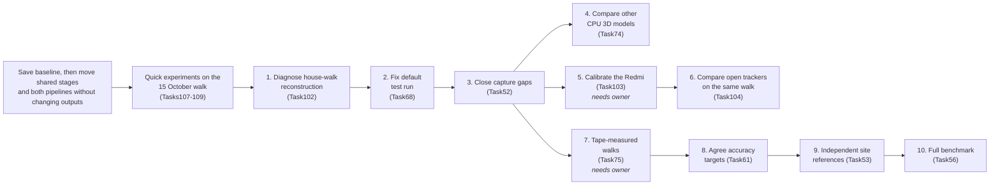

# Project plan: phone walkthrough to measured site and object count

Status as of 7 November 2026, updated the same day with a read-only probe of the phone recordings (Task106). The last experimental work before that was on 15 October 2026. On 8 November the COLMAP findings were added: the cause of the failed desk calibration, the COLMAP parts that fit ARCore's path, and a review of COLMAP run as live tracking. Later on 8 November, three papers on live reconstruction from one camera were added, with a note on combining triangulated depth with learned depth ([research/dense_surface_fusion](research/dense_surface_fusion/README.md#live-reconstruction-from-one-camera-three-earlier-systems)). Also on 8 November: Lumina, a commercial phone-capture product, was mapped step by step against open-source parts and against this project's pipeline. Four owner-supplied models were reviewed (LingBot-Map, SLAM3R, ArtiFixer, World-from-Motion). The owner set a new rule: find the best method first, then work out phones. A first CPU test of LingBot-Map on the 15 October walk followed (Task128).

This document gives the whole picture in one place: the aim, what has been achieved, what was tried and ruled out, the strategy, what is already on the market, the main barriers and the next steps. It is written to be read on its own. Links point to the evidence behind each statement.

Updated 9 November 2026 with [SceneView and Open3Dmap reuse choices](research/products/sceneview_open3dmap_review_2026-11-09.md#reuse-and-licence-decisions-9-november-2026). The recommendation is to start the shared-pipeline refactor next, then resume method trials once both pipelines reproduce the baseline. Moving the Android app and finishing the repository reorganisation need not delay those trials. This is a timing recommendation, not a record of a new owner decision.

Updated 10 November 2026 with reviews of [RTAB-Map](research/camera_tracking_and_slam/rtabmap.md) and of [grouping surfaces by geometry, colour, texture and embeddings](research/surface_denoising/surface_grouping.md). Neither changes the refactor or its timing. They change what the RTAB-Map comparison holds fixed, add trials after the refactor ([order and evidence](#what-to-take-from-rtab-map-and-the-surface-grouping-review)), add content the next recording round needs and add a second research question.

Updated 11 November 2026: the shared-pipeline refactor is done. The product code is `sitescan/`, started by `python -m apps.cli`; the root README now describes the product, and this plan keeps the research story.

**Updated 12 November 2026: the product will not use ARCore (owner decision 10).**

- **Camera path:** an open visual-inertial tracker (Basalt first), running on the phone's own camera and motion sensors. The motion sensors supply metres and gravity.
- **Depth:** the project's own learned model, sized by depth triangulated along that path. Sparse points come first; dense multi-view stereo follows where the surface has texture.
- **ARCore's role now:** its recordings remain a comparison, never an input.

Open route B becomes the only route, and calibrating the Redmi becomes the critical path. A review of open templates and of what `sitescan/` must change is in [research/visual_inertial_odometry/depth_without_arcore_2026-11-12.md](research/visual_inertial_odometry/depth_without_arcore_2026-11-12.md). Results recorded before this date that used ARCore stand as recorded.

**Later on 12 November: the parts that replace ARCore are built** ([DESIGN 7.15](DESIGN.md#715-removing-arcore-five-changes)). `sitescan/` reads a tracker's trajectory and a phone calibration, triangulates sparse and dense depth along the path (`sitescan/triangulate/`), and sizes learned depth by it, chosen by name in both pipelines. ARCore stays the default and its outputs are unchanged. On the TUM desk fixture, with motion-capture poses standing in for the tracker, rooms sized only by triangulation sat a median 6–9 cm from the Kinect surface, against 3 cm when sized by the Kinect itself ([trial](research/experiments/triangulation/README.md)). Nothing has run on a phone recording yet: that needs the Redmi calibration and Basalt's trajectory (Tasks 103 and 104).

**Also 12 November: density-based outlier filters checked on the triangulated 15 October room.** The owner saw sparse points outside the room in the point view. After the clean-up, no point lacks a neighbour within 5.6 cm, because fusion writes one point per 2 cm voxel and a stray sheet is as dense as a wall. Standard filters (statistical, radius, DBSCAN, local outlier factor) therefore have nothing to remove at that scale. Statistical outlier removal at Open3D's tutorial setting would cut 32,353 points of real edge. At 20 cm, 3,450 points have under a tenth of the median neighbour count, and 2,694 sit in line-shaped neighbourhoods. Whether these are the strays is not yet checked by eye. The streaks come from frames sized 10–25% off, so a per-frame consistency check before fusion is the fix for the cause ([research/surface_denoising](research/surface_denoising/README.md#density-based-outlier-filters-on-the-triangulated-room-12-november-2026)).

## Contents

- [The aim](#the-aim)
- [Status at a glance](#status-at-a-glance)
- [What has been achieved](#what-has-been-achieved)
- [What was tried and ruled out](#what-was-tried-and-ruled-out)
- [Strategy and direction](#strategy-and-direction)
- [What is on the market](#what-is-on-the-market)
- [Current barriers](#current-barriers)
- [Next steps](#next-steps)
- [Decisions needed](#decisions-needed)
- [Where the detail is](#where-the-detail-is)

## The aim

FYLD suggested three research areas. This project takes on two and treats the third as a goal running through both:

1. **Measure a worksite from a first-person phone walkthrough.** Produce a 3D model in metres, so sizes, areas and distances can be read off.
2. **Count distinct objects** such as cones and barriers. An object that leaves the camera view and comes back must be counted once, not twice. FYLD noted that SAM (Meta's Segment Anything Model) works for this but is too heavy.
3. **Deploy to edge devices.** FYLD uses MLflow and BentoML in the cloud today and has no plan for edge devices. Here, "edge" means the phone or a computer near it.

The work is split into six layers, each built and tested alone with known-correct inputs before being connected:

| Layer | Question it answers |
|---|---|
| 1. Camera capture | Can the phone deliver images, timings, motion sensors and calibration to a PC? |
| 2. Depth | How far away is each pixel, in metres? |
| 3. Camera position | Where was the camera, and which way did it point, in each frame? |
| 4. Surface reconstruction | Can depth and camera positions be joined into one 3D model in metres? |
| 5. Mapping and area | What are the site's dimensions and area, and which parts were never seen? |
| 6. Objects and counting | Which objects are present, where are they in 3D, and how many distinct ones are there? |

Building the layers separately means a bad result can be traced to the layer that caused it.

## Status at a glance

| Layer | Status | Best result so far | Next |
|---|---|---|---|
| 1. Capture | **Working on the Redmi phone, through ARCore** | One 39.9 s house walk: 1,194 frames at 29.9 fps, zero reported drops, motion sensors at 424 Hz, streamed to the PC | A capture mode without ARCore (plain Camera2, exposure and focus locked); calibration recordings; longer walks |
| 2. Depth | **Working, shape-limited; sized by ARCore today** | Learned depth resized each frame to ARCore's measured depth and tracked points. Surface error 8–16 cm even with perfect camera positions. Turned upright, it agrees with ARCore's measured depth to a median 5.8% on the 15 October walk (Task109) | Size it with depth triangulated along the open tracker's path instead of ARCore depth, near and far; turn frames upright in the live processor (Task112) |
| 3. Camera position | **Open trackers working on public data; ARCore on the phone, to be replaced** | Live CPU tracking: 12.8–39 mm error on public recordings. Basalt 0.146 m over a 146 m walk with one camera and motion sensors (TUM-VI). ARCore tracked 100% of 891 frames on a 15 s Redmi walk | Calibrate the Redmi (Task103); run Basalt on the recorded Redmi walks against ARCore's path (Task104); then tape-measured walks (Task75) |
| 4. Surface | **Working on the 15 October walk, with clean-up; far surfaces echo** | 7.8 mm on a synthetic room with supplied inputs. On the 15 October walk the room build drops stale depth (Task116), then runs a visibility vote and keeps the largest pieces (Task126): 554,067 of 676,855 points kept. Depth agrees with ARCore's tracked points within 5% up to 3 m but is about 15% too near beyond, which repeats doors as layers (Task117). The 14 October house walk had no usable phone depth | Size surfaces with points triangulated along the open tracker's path, then dense multi-view stereo. LingBot-Map (Task128, CPU) got far depth closer in the median but twice as scattered; its default setting still needs a GPU test |
| 5. Mapping and area | **Built, not scored** | Bird's-eye map and areas computed. Accuracy unknown | Needs independent measurements |
| 6. Objects and counting | **Early trial; overcounts when live** | 11 of 11 sightings correctly matched on a desk recording. Live replay of a public recording counts 14–15 chairs where far fewer exist | Fix after geometry; needs a labelled inventory |

**Whole system:** the PC replays the house walk at 1.58 updates per second on the CPU, above the required minimum of 1 per second. No result has yet been scored against an independent measurement of a real site.

## What has been achieved

All numbers are measured in this project unless marked as a vendor or author claim. Results before 14 October are on public recordings on a desktop CPU.

### Early October: six layers built and connected

- Each layer has a written input and output format and at least one working method. The full six-layer run first completed on 30 frames of a public desk recording on 7 October.
- A point surface built from 9 views of a synthetic room, with supplied depth and camera positions, sits **7.8 mm** on average from the room's reference model.
- Object detection found 4 of 5 reference cups. Rules using 3D position matched all 11 reviewed sightings to the right object. A cup that left view and returned came back **20 mm** from where it was first seen.

### 7–14 October: finding the right design

- **Learned depth gets the shape right and the size wrong.** Depth Anything V2 reads 1.34–1.41 times too far, and its size factor jumps between 0.86 and 2.09 from frame to frame. Fusing those frames makes walls appear several times.
- **A few measured points fix the size.** Fitting each frame's scale to about 50 known points works as well as using every pixel. Twenty metric readings across a whole walk give a camera path within 1.15 times the best possible.
- **The old tracker was the weak link.** It missed by 112 mm on the desk recording, against 16–18 mm for published methods. Camera paths from images alone (COLMAP, offline) reached **11.9–34 mm**. Desk improved to 15.2 mm with its published lens calibration, once a COLMAP limit that had rejected it was raised (8 November).
- **Live tracking on the CPU works.** ORB-SLAM3 and stella_vslam, run one frame at a time, reached 12.8 and 17.1 mm on the TUM xyz recording, at 5–12 ms per frame.
- **Live processing on the PC works.** It updates the surface, map and object counts 1.2–1.9 times per second on public recordings, on the CPU.

### 14–15 October: the real phone

- **ARCore runs on the Redmi Note 11 Pro.** On a 15 s indoor walk it tracked every one of 891 frames at 4.9 ms per update and streamed 29 fps with camera positions to the PC over Wi-Fi.
- **One capture app records everything every method needs.** It saves lossless grey images, colour JPEGs, raw motion sensors, camera settings and ARCore's position and depth. It queues to phone storage and streams to the PC, resuming after a dropped connection. It passes 30 phone-side tests, and the PC side passes 317 tests.
- **A full house walk was captured and replayed.** 1,194 frames, 225 MB, 63 PC updates at 1.58 per second.
- **A calibration pipeline is ready.** On a public dataset it reproduces the published camera-to-sensor calibration to 0.014°, 1.0 mm and 0.13 ms. It has not been run on the Redmi yet.
- **Open-source trackers that use motion sensors were compared** on a public dataset: Basalt 0.146 m, OKVIS2 0.505 m, Kimera-VIO lost tracking, OpenVINS 0.064 m (OpenVINS is GPL, so reference only).
- **An interactive 3D viewer** shows the house-walk surface, coloured by height. It is a display of the surface, not a photo-realistic model.
- **ARCore's terms were read clause by clause.** Nothing found forbids a commercial product, and no fee is stated. Conditions include a displayed notice, a privacy policy and a clause excluding uses where failure "could lead to death, personal injury, or environmental damage". This is not legal advice.

### 7–8 November: the 15 October walk, clean-up, and whole-map methods

- **Stale phone depth put one cushion in two places.** 9 of 147 ARCore depth maps were 4.35–4.42 s older than their images. The room build now skips depth more than 0.1 s old, which removed the second copy (Task116).
- **Doors repeat as layers because far surfaces are sized by guesswork.** ARCore's confident depth has a median of 1.58 m and 95% of it is under 2.54 m. Beyond 3 m, fused depth is about 15% too near and varies from frame to frame (Task117).
- **Upright images give better learned depth.** The phone records portrait walks on their side. Turning frames upright lowered the median depth error against ARCore depth by 27%, from 0.080 to 0.058 (Task109).
- **The room build has a clean-up stage.** A visibility vote drops surface that other frames see straight through, then only the 50 largest connected pieces are kept. On the 15 October walk this removed 122,788 of 676,855 points in 2.6 s on the CPU (Tasks 120–126).
- **A commercial product uses the same design.** Lumina (8 November review) captures on an iPhone and processes on a PC, as this project does. It is ahead in two places that are not algorithms: LiDAR depth, and care at capture (locked exposure, a live coverage view, depth limits). It also refines poses after capture. This project is ahead on live processing and on objects. Lumina's own roadmap puts phones without LiDAR, and Android, in 2027 ([comparison](research/gaussian_splatting/lumina_open_source_parts.md#how-this-projects-pipeline-compares-8-november-2026)).
- **A product already builds metric scenes from phones without LiDAR.** SpAItial Echo-3 (released 27 October 2026, reviewed 8 November) turns a few minutes of iPhone video into a splat scene at real-world scale in the cloud, and generates the areas the capture missed. It is not live, publishes no method or accuracy, forbids reverse engineering, and may train on uploaded scans. The open models nearest to it are YoNoSplat and AnySplat (MIT), which predict a splat scene from a set of frames in one pass on a GPU; YoNoSplat also takes the phone's poses. There is no iPhone to try Echo-3 with, and splat scenes are deferred (owner decision 9) ([note](research/products/e2e_product_research/10_spaitial_echo3/README.md)).
- **One open model produces the target output from plain video.** LingBot-Map's demo maps a 25,000-frame multi-room walk from above, with the walked camera path through it. Its depth placed along its own path covers layers 2–4 at once. It lacks metres, clean-up and objects, which are parts this project already has ([note](research/feed_forward_3d/lingbot_map.md)).
- **LingBot-Map on the 15 October walk, on the CPU (Task128).** It ran on every third frame with a 16-frame window, a quarter of its default, to stay under an 18 GB RAM limit; the default window needs about 24 GB on the CPU. It took 50 minutes (0.09 frames per second, 8 threads). One size per walk works: sizes fitted to ARCore's path and to its tracked points agree within 3%. Its camera path follows ARCore's to 0.118 m RMSE over a 6.7 m walk. Its depth medians are within 5% of ARCore's tracked points from 1 to 4 m, including 3–4 m, where the room build is 14–16% too near. But its spread is about twice as wide, beyond 4 m it is 40% too near, and from above the room is blurrier than the cleaned room build. The small window understates it; a fair test needs the GPU or the spare laptop ([experiment](research/experiments/lingbot_map/README.md)).

### 12 November: the product drops ARCore

The owner decided the product should not rely on ARCore (decision 10). A same-day review looked for open code that already joins visual-inertial tracking, learned depth and triangulated depth, and checked how much of `sitescan/` assumes ARCore ([note](research/visual_inertial_odometry/depth_without_arcore_2026-11-12.md)). Sources were read; nothing was run.

- **No permissive project does the whole chain on a phone CPU, but every part exists.**
  - **OKVIS2-X** (BSD-3, ETH, 2025) is the closest whole-chain template. It joins a visual-inertial estimator, multi-view depth with an uncertainty per pixel, volumetric submaps, and feedback from the map into the estimator. Its multi-view weights derive from SimpleRecon, which is non-commercial, and its timings are on a GPU.
  - **DenseReconstructionTools** (BSD-3) is the only permissive chain found that is built on Basalt.
- **Sizing learned depth with measured points has permissive code.**
  - VI-Depth (MIT): least squares, then a learned per-pixel correction.
  - mono_depth_rescaler (MIT): a size that varies with distance.
  - Any2Full (Apache-2.0, small checkpoint released): uses the points to correct shape as well as size, the one candidate found for the 8–16 cm shape error.
- **The plane sweep must be written here.** No permissive CPU implementation was found. MIT-licensed parts cover semi-global matching, keyframe choice and searching only near the learned depth.
- **Two Android projects already work without ARCore:** DAVIO (GPL-3) and 3d-recon (AGPL-3). They are references only. 3d-recon's author reports that handheld tracking, not depth, is what failed. That puts calibration and open tracking on the Redmi on the critical path.
- **`sitescan/`'s stages can be swapped as they are; its data and pipelines cannot.**
  - The depth model, the scale fit, clean-up and mapping take arrays.
  - A frame recorded without ARCore has no pose or intrinsics, so both pipelines would skip it.
  - Fusion and object counting depend on ARCore's anchors.
  - Images are turned upright using ARCore's y-up world.
  - Five changes are needed ([DESIGN section 7.15](DESIGN.md#715-removing-arcore-five-changes)).

## What was tried and ruled out

| Tried | Outcome | Why it matters |
|---|---|---|
| Original tracker that aligns each frame to the last | Ruled out: 3–5 times worse than image-based tracking | Camera paths now come from a live tracker or ARCore |
| Learned depth as the source of real-world size | Ruled out: 1.3–1.4 times too large; areas 3–4 times too large (7.44 m² against 2.21 m²) | Size comes from measured points or motion sensors, never the depth model |
| Marigold depth model | Ruled out: best shape, but 16.6 s per frame | Set the 1 frame per second minimum for any method |
| Prompt Depth Anything (depth guided by sparse points) | Ruled out: 39–58% worse on two of three recordings | Plain resized depth stays the default |
| Depth Anything 3 Small | Ruled out for now: 15% better on synthetic data, 2–3 times worse on real recordings | Shows synthetic wins do not carry over |
| More metric readings for scale | No gain beyond about 20 | Scale needs few readings |
| Learned feature matching (ALIKED + LightGlue) | Mixed: helped one mapper, broke another | Not a free improvement |
| Two-lens stereo depth on the Redmi | Ruled out: the phone cannot record two rear cameras at once | Single-camera route only on this phone |
| Whole-clip structure from motion as the product | Ruled out by the live requirement | Kept as an offline reference. Its triangulation and bundle adjustment can still start from ARCore's path (8 November) |
| COLMAP run as a live tracker (COLMAP-SLAM, colmap-odometry) | Researched 8 November, not adopted: no real size from one camera, motion sensors not used, 5 frames per second with a GPU (authors' figures) | Its keyframe rule (wait until features have moved enough pixels) and its per-keyframe triangulate-and-adjust loop carry over |
| SLAM3R (dense points from plain video, 20+ frames per second on a GPU) | Reference only: non-commercial licence; 224 × 224 input | LingBot-Map does the same job under Apache-2.0 and also gives camera poses |
| Generative repair of splat scenes (ArtiFixer, World-from-Motion) | Not for measurement: they invent what the camera never saw, and need an 80 GB-class GPU | Possible later for viewing only, with repainted areas marked as unobserved |
| A photo-realistic splat scene as the measured record | Not adopted: splats are trained to look right from the captured views, not to be the right shape | The fused surface stays the record. The owner deferred splat scenes as a viewing layer on 8 November and expects not to use them |
| Feed-forward splat models (YoNoSplat, AnySplat, WorldMirror) and SpAItial Echo-3 | Deferred on 8 November: they make splat scenes, which do not serve object dimensions. Echo-3 needs an iPhone, and none is available | Reference only; YoNoSplat (MIT, takes ARCore poses) is the one to try if splats are ever wanted |
| ARCore as the product's camera path, depth and size reference | Dropped by the owner on 12 November (decision 10): closed source, Google can change or withdraw it, depth reaches only about 2.5 m, and its terms exclude safety-critical uses | Poses come from an open visual-inertial tracker, size from triangulated depth and the motion sensors. ARCore's recorded poses and depth stay as a comparison on recordings |
| Two separate phone apps | Replaced by one capture app | One recording feeds every method |
| Processing on the phone | Deferred by the owner | The PC processes until a method is chosen |
| GPU methods (learned SLAM, splat training, COLMAP's PatchMatch stereo, LingBot-Map at full speed) | Not allowed for now. On 8 November the owner reserved this PC's GPU for another project until its paper is finished; a spare laptop can take essential checks. GPU methods stay in view: the owner's rule is best method first | The most accurate published trackers stay untested. Multi-view stereo itself does not need a GPU: Mobile3DRecon ran it on a phone CPU |

## Strategy and direction

### Owner decisions in force

1. **Capture first.** The phone records; the PC receives, stores and processes. Processing on the phone comes later, inside the same app.
2. **Live.** The deployed system must update at least once per second. Offline methods are references only.
3. **CPU only, for now.** This PC's GPU is busy with the owner's other project until its paper is finished; then this project can use it. A spare RTX 4060 laptop takes essential GPU checks, run from experiment files committed to git and their results pulled back here (8 November).
4. **Licences.** GPL code such as ORB-SLAM3 may be used to score accuracy, not to ship.
5. **Compare reconstructions first.** Before scoring dimensions, compare the 3D models different methods build from the same walk.
6. **Best method first, phones later (8 November).** Judge a method first by how close its output is to the target, a measured multi-room map with the walked camera path. Then break the best one into its parts, and only then work out how it gets onto a phone. Live updates and running on the phone stay the end goal, not a filter for research.
7. ~~**ARCore depth stays the size reference (8 November).**~~ Superseded on 12 November by decision 10.
8. ~~**The refactor in DESIGN.md comes next (8 November),** before further experiments.~~ Done on 11 November.
9. **Object dimensions are what counts (8 November).** The result that matters is the dimensional accuracy of objects that YOLO detects and places in 3D. A reconstruction method is judged by how well it supports that. Photo-realistic splat scenes and better splatting models are deferred and will probably not be used; the splat notes stay as references. No iPhone is available, so iPhone-only products (Echo-3, Lumina, RoomPlan) cannot be tried here. (Numbered 7 until 12 November, when a duplicate number was fixed.)
10. **No ARCore in the product (12 November).**
    - **Camera path:** an open visual-inertial tracker running on the phone's own camera and motion sensors. Basalt (BSD-3) is the first candidate. The motion sensors supply metres and gravity.
    - **Depth:** the project's own learned model, sized by depth triangulated along that path. Sparse points come first, then dense multi-view stereo where the surface has texture.
    - **Per-phone settings:** each supported phone model needs its camera and motion-sensor calibration.
    - **ARCore's role now:** its recorded poses and depth serve only as a comparison on recordings. They never feed the product, and no new method may depend on them.
    - **Reasons:** ARCore is closed source, Google can change or withdraw it, its depth reaches only about 2.5 m, and its terms exclude uses where failure could cause injury.
    - **What this changes:** route A below is retired, and open route B is the product route.

### The design the evidence supports

1. **Camera path from a live open tracker.** A visual-inertial tracker (Basalt first) running on the phone's calibrated camera and motion sensors, which supply metres and gravity. Not ARCore (decision 10).
2. **Real-world size from measured depth and the motion sensors.** Measured depth means depth triangulated along the tracker's path: its own landmarks, sparse points triangulated between frames 0.3–1 m apart, then dense multi-view stereo. Never from a learned depth model's own metres.
3. **Learned depth only for dense shape,** sized every frame to the triangulated depth, and used where triangulation has no answer, such as blank walls.
4. **Objects placed in the same 3D space,** so a returning object is matched by position plus appearance and counted once.

The remaining accuracy limit is the depth model's shape, 8–16 cm on average, and its size wherever there is no measured depth. Until 12 November ARCore depth supplied size up to about 2.5 m; without ARCore, triangulation must supply it near and far. Triangulating depth between frames along the camera path is the untried next step, and it does not need a GPU. Mobile3DRecon (2020) ran multi-view stereo on one core of a 2018 phone CPU at 48 ms per keyframe. Published live systems combine triangulated depth with learned depth: triangulation where there is texture and enough camera movement, learned depth on blank surfaces. The planned order is sparse points triangulated along the tracker's path as sizing targets, then dense stereo fused where it is confident ([note](research/dense_surface_fusion/triangulation_and_learned_depth.md); open code for each step in the [12 November review](research/visual_inertial_odometry/depth_without_arcore_2026-11-12.md#the-parts-by-step-of-the-plan)).

A candidate that replaces items 1–3 at once was tested. LingBot-Map predicts each frame's camera pose and depth from plain video, using earlier frames as context. It gives no metres, but one best fit with size to ARCore's camera path supplies them for the whole walk: on the 15 October walk that size held to within 3% (Task128). With the small window the CPU allows, its depth was less consistent from frame to frame than the room build's, so it does not yet replace items 2–3. The test at its default window is pending a GPU.

Lumina's design adds one lesson at capture: fix the data before it is recorded. A coverage view that counts a surface as covered only once measured depth (now triangulated depth) has reached it would send the walker closer to far doors and walls. Those surfaces would then be sized by measured depth instead of the fallback guess that causes the echoes.

### The route to a product

Until 12 November there were two routes. Decision 10 retired route A.

| Route | What it uses | Strength | Risk | Status |
|---|---|---|---|---|
| A. ARCore | Google's built-in tracking and depth | Works today on the Redmi; no tracking code to maintain | Closed source; Google can change or withdraw it; safety-use clause; depth only to about 2.5 m | **Retired 12 November.** Kept only as a comparison on recordings |
| **B. Open source** | Phone camera and motion sensors, calibrated, with Basalt or similar; learned depth sized by triangulated depth | No dependency on Google; permissive licences | Needs per-phone-model calibration, clock alignment, a port to Android, and tracking that holds on handheld phones | **The product route** |

The capture app records the inputs for both routes on the same walk: Camera2 images, motion sensors and, while it still runs ARCore, ARCore's answer. So every open method can be compared with ARCore on existing walks. The capture app opens the camera through ARCore today; a capture mode without ARCore is the next capture work.

The risks of route B are now the project's main risks. The two Android projects that already work without ARCore, DAVIO and 3d-recon, both describe tracking and calibration as the hard part, not depth ([review](research/visual_inertial_odometry/depth_without_arcore_2026-11-12.md#whole-chain-templates)).

### Where this project can add something new

The market review (next section) found the two halves of the brief sold separately. Measured 3D from phone video is a crowded market. Counting each object once is solved for vehicles using GPS. **No product or open project was found that counts each object once from a walking Android phone without a laser sensor, for street works.** That is the clearest gap. Two other possible contributions are a measured trade-off between counting cost and counting accuracy, and tracing final errors back to the layer that caused them.

A narrower question came out of the 10 November grouping review. Can surfaces matched across views reduce far-depth error and duplicate objects on ordinary phone captures, keep small real objects, and still update once a second? It is a hypothesis. Each ingredient is published: colour and normal clustering, embeddings attached to surfaces, persistent 3D objects and region-specific depth scale. A methods claim would need a new estimator or decision rule that beats that work. An applied claim could rest on the dataset, the controlled comparisons and the measured limits ([review](research/surface_denoising/surface_grouping.md#what-could-support-a-paper-or-ip-claim)).

Counting depends on stable 3D positions. About half of the live overcount came from learned depth moving large objects between views, which placed the same object just past the 0.35 m matching distance. So fixing the reconstruction (the current focus) also serves the counting goal.

## What is on the market

Sources: a product search on 5 October 2026 ([products](research/products/e2e_product_research/README.md)), an edge hardware review on 2 October ([edge products](research/products/edge_products/README.md)) and a tracking methods review on 14 October ([SLAM review](research/camera_tracking_and_slam/sota_slam_review_2026-10-14.md)). On 8 November a phone-to-splat pipeline review added Lumina and the open-source parts of its pipeline ([research/gaussian_splatting](research/gaussian_splatting/lumina_open_source_parts.md)), and LingBot-Map and SLAM3R ([feed-forward 3D](research/feed_forward_3d/README.md)). Accuracy figures are vendor or author claims; nothing in this section was installed or tested. The search is now a month old and US-weighted, so UK street-works tools may be missing.

### Commercial products

| Product | Measures | Counts each object once | Ordinary Android, no laser | Notes |
|---|---|---|---|---|
| SkyeBrowse | Yes | No | Yes (records only; server processes) | Closest commercial match to measuring from phone video. Claims centimetre accuracy |
| Polycam | Yes | No | Yes, photo mode | Room sizes and wall areas; claims 2% accuracy |
| Reconstruct, OpenSpace, Matterport | Yes | No or partly | Mostly 360 cameras or laser | Construction and property walkthroughs |
| PIX4Dcatch | Yes | No | Partly | Adds a satellite positioning receiver for centimetre accuracy; sold for trenches and utility work |
| Apple RoomPlan | Yes | Partly | **No:** iPhone with laser sensor | Only finished product that measures and places objects together on a phone. Indoors, 16 furniture types |
| ViaSight ZoneSure | No method published | Partly | Yes | Nearest product for the same objects: checks road-works cones and signs from a vehicle-mounted phone, against US rules |
| Xweather RoadAI, Gaist, Blyncsy | Road condition | **Yes, by GPS** | Vehicle cameras | Counting once at road scale, not walking pace |
| Scaniverse, KIRI Engine | Partly | No | Yes | Photo-realistic models on the phone; viewing, not measuring |
| Lumina 3D and Lumina Studio | Partly: distances, areas, floor plans; accuracy not published | No | **No:** iPhone with LiDAR; Android planned for 2027 | The phone captures images, LiDAR depth and poses with a live coverage view; a Windows PC with an NVIDIA GPU trains a photo-realistic splat scene. Same phone-captures, PC-processes split as this project |
| SpAItial Echo-3 | Claimed metric; accuracy not published | No | **No:** iPhone only, but no LiDAR needed; Android "coming soon" | A few minutes of iPhone video becomes a splat scene at real-world scale in the cloud, with missed areas generated. Free first month; the terms forbid reverse engineering |
| FYLD video risk assessment | No | No | Yes | The product this research would plug into |

### Open-source and research

| Project | What it does | What is missing |
|---|---|---|
| IGGT (2026, MIT licence) | Ordinary video in; 3D model with separate objects out | Large GPU; indoor only; real-world scale not checked |
| ConceptGraphs | 3D map of objects, matching sightings by position plus appearance | Needs depth and camera positions supplied; the same rule this project tests |
| CountVid (Oxford, 2026) | Counts distinct objects in video from a text prompt | 2D only; the best open counting baseline to compare against |
| RTAB-Map (BSD-3-Clause core; reviewed 10 November) | Phone 3D mapping with drift correction; its ARCore app runs on Android. It also accepts camera poses from outside, so it can map from our recorded ARCore poses | No objects. Not yet run on our recordings or the Redmi. Better poses do not fix depth placed at the wrong distance ([review](research/camera_tracking_and_slam/rtabmap.md)) |
| LingBot-Map (2026, Apache-2.0) | Plain video in; camera pose and depth for each frame as frames arrive; its demo maps a 25,000-frame multi-room walk | No metres, no loop closure, no objects; built for an NVIDIA GPU (12 frames per second on an RTX 4090). On this project's walk, on the CPU with a small window: path within 0.12 m of ARCore's, depth scattered (Task128) |
| Splat trainers and depth-guided training (Brush, gsplat, DN-Splatter) | A photo-realistic scene from posed images; DN-Splatter holds the shape with phone depth | A GPU in practice; for viewing rather than measuring |
| Google's ARCore ML sample | Detects objects on the phone and pins them in 3D with ARCore | No duplicate removal or counting |
| SceneView (Apache-2.0; reviewed 9 November) | Android SDK plus demo code for metric ML-depth fitting, room fusion, coverage, object lifting and merging across views | No measurements on our Redmi; much of the scanning code is internal demo code; furniture labels and a room-review pass do not establish our live counting requirement |
| Open3Dmap (CC BY-NC 4.0; reviewed 9 November) | Android capture-quality checks, Firebase/COLMAP workflow and SplatJSON metadata | Noncommercial root terms, missing referenced trainer files, labelled synthetic COLMAP fallback, no demonstrated metric constraint or object counter in the reviewed flow |

### State of the art in camera tracking

| Family | Typical accuracy on the TUM benchmark (published) | Hardware |
|---|---|---|
| Learned and foundation-model SLAM (DROID-SLAM, MASt3R-SLAM) | 16–20 mm | GPU |
| Classic feature SLAM (ORB-SLAM3, stella_vslam) | 1.5–2.5 times the learned error; live on CPU | CPU |
| Phone platform tracking (ARCore, ARKit) | No benchmark figures; one study puts phones over 10 cm | Built into the phone |

This project's own CPU runs (12.8–39 mm) match the classic family. On Android, ARCore solves camera and motion-sensor timing out of the box; without it (decision 10), the project solves timing and calibration itself, with tools already checked on public data ([learning chapter 12](learning/12_rebuilding_arcore.md)).

The reference text for the field is the SLAM Handbook (Carlone, Kim, Barfoot, Cremers and Dellaert, eds.; a 669-page pre-publication draft, read 7 November). It confirms this project's design: camera plus motion sensors for the path and scale, TSDF fusion for noisy depth. It also supplies a benchmark: a good visual-inertial system drifts less than 1% of the distance walked. It never mentions phones, ARCore or ARKit, so phone-specific problems remain this project's to solve.

### Edge hardware

Stereo camera kits such as Stereolabs ZED with a Jetson computer build live 3D maps. NVIDIA reports 2.63 mesh updates per second on its robot platform. These are extra hardware to carry, and no ordinary phone product was found that does the same from its own cameras.

### What this means

- Measuring a site from phone video can be bought. This project's layered pipeline is still useful as a way to score those products and to find where error comes from.
- Counting each object once, on an ordinary Android phone, for street works, is the gap worth targeting.
- Expect "why not buy SkyeBrowse or ViaSight?". The answer must name what they do not do.
- The closest open match to depth, camera path and map together is LingBot-Map. What it lacks (metres, clean-up, objects) are parts this project already has, so it may replace the middle of the pipeline rather than the whole of it.
- SceneView is an implementation reference for the Android route, including object merging. Compare the relevant methods before writing equivalents. Its source does not establish better reconstruction or counts on our data. Open3Dmap remains a workflow reference rather than a candidate core; [reuse terms and limits](research/products/sceneview_open3dmap_review_2026-11-09.md#reuse-and-licence-decisions-9-november-2026) determine what can transfer.

Cheap checks the market review proposed, none run yet: score one capture through SkyeBrowse or Polycam against a reference; run CountVid and IGGT on the same recording as this project's counter; build the ARCore ML sample on the Redmi; ask ViaSight whether ZoneSure counts or measures on foot.

## Current barriers

1. **The house-walk reconstruction is poor.** A probe on 7 November found two causes that are confirmed conditions, though their effect is not yet measured:
   - *No phone depth.* All 44 ARCore depth maps in the 14 October walk are empty, with timestamps 4–39 s older than their frames. So every scale in that model came from tracked points or was carried over. Why the phone sent empty maps is unknown (Task111).
   - *Sideways images.* The phone was in portrait for 90–99% of both recorded walks. The camera sensor is mounted at 90°, and images reach the depth model unrotated. Task109 measured the harm on the 15 October walk: turning frames upright lowers the median depth error against ARCore depth by 27%. Task112 will turn frames upright in the live processor.

   Two suspects remain untested: the conversion between ARCore's and the depth code's axis conventions, and ARCore's 83 path corrections (with the first reference point's record missing). The baseline map's dominant plane is nearly vertical and its highest point is 6.0 m inside a house, which points at an axis or scale fault. A second walk from 15 October (822 frames, never documented until now) has 144 usable depth maps and becomes the test walk. Since decision 10 (12 November), the ARCore suspects (empty depth maps, axis conventions, path corrections) matter only for using ARCore as a comparison. The sideways-image finding holds for any tracker.
2. **No independent ground truth.** Every comparison so far is one estimate against another. Tape-measured walks and a surveyed object inventory need someone on site.
3. **The Redmi is not calibrated, and the product now depends on calibration.** The open-source trackers need a camera-to-sensor calibration. That needs a video of a printed target and about 3 hours of the phone at rest. The SLAM Handbook calls target calibration "cumbersome" where non-experts use a system at scale; calibration estimated during use is easier but less accurate. FYLD field workers would not calibrate their phones. Without ARCore (decision 10), the project must calibrate each supported phone model once, ship those numbers as ARCore does, and measure how much calibration during use absorbs differences between phones of one model. Calibrating the Redmi (Task103) is now on the critical path.
4. **Capture gaps.** 17 frames lack an ARCore record and one lacks camera settings. Only one 40 s walk exists. Long walks, battery, heat, outdoors and stairs are untested. The phone's 30-frame memory buffer could overflow if storage writes fall behind. The capture app also gives the walker no feedback: it shows no coverage and does not lock exposure or white balance (it does fix focus). Lumina does both.
5. **The default test run skips 10–11 of 28 test folders.** A passing default check proves less than it appears to.
6. **No agreed accuracy targets.** Without them, no result can be called good enough.
7. **Constraints that cap accuracy.** CPU only and a live requirement rule out the most accurate published methods for now. They do not rule out multi-view stereo, which has run live on a phone CPU (Mobile3DRecon). The CPU limit is temporary: the GPU becomes available when the owner's other project finishes. Meanwhile LingBot-Map ran on the CPU at 0.09 frames per second with a quarter of its default window, against 12 per second on an RTX 4090 at the default, so CPU runs measure quality, not speed.
8. **Moving people and vehicles are untested.** Every recording is of a static scene. The SLAM Handbook and three papers supplied on 7 November treat moving objects as a main way tracking fails. The next recording round should include people moving through the scene (Task52).
9. **Far surfaces echo, and the live processor has no clean-up yet.** The offline room build now has a clean-up stage: a visibility vote, then the 50 largest pieces (Task126). Door echoes remain, because they come from sizing beyond ARCore's reach (Task117), which clean-up cannot fix. The live processor still fuses without clean-up; the vote's cost grows with frames × points (2.41 s for 134 frames). Before the clean-up, on the 15 October walk the floor was a band about 30 cm thick and anything within about 0.5 m of the camera smeared. Learned depth gives edge pixels a depth between the near object and the wall behind (*flying pixels*), and indoor rooms have such edges everywhere. The owner's target scenes are indoor with surfaces under about 10 m, but fusion stops at 4.0 m and ARCore depth reaches about 2.5 m. Without ARCore depth (decision 10), triangulation must supply size at every distance, not only beyond 2.5 m. Sources, the trials (Tasks 120–126) and the owner's chosen settings are in [research/surface_denoising](research/surface_denoising/README.md).
10. **Open tracking on a handheld phone is unproven here.** Basalt has run only on TUM-VI, whose camera has a global shutter and whose motion sensors are wired to the camera's trigger. The Redmi has a rolling shutter, a fixed but unverified focus, and clocks that agree only to within a few milliseconds. The one open Android project that tracks without ARCore (3d-recon) reports that handheld tracking is "not yet reliable enough for everyday use", with start-up, drift and recovery after tracking loss as the open problems. Task104 measures this on the Redmi's own walks.

## Next steps

**Update, 12 November: the order after decision 10.** These trials replace ARCore's parts one at a time, keeping ARCore's recorded answer beside each as a comparison. Each trial changes one thing and is scored on the same inputs as the one before. Items 1 and 2 need no new recordings and can start now. Items 3 and 4 wait for owner recordings. The open code for each item is named in the [12 November review](research/visual_inertial_odometry/depth_without_arcore_2026-11-12.md#the-parts-by-step-of-the-plan).

1. **Let `sitescan/` take poses and intrinsics from outside the recording** ([DESIGN 7.15](DESIGN.md#715-removing-arcore-five-changes), change 1). *Built 12 November, with changes 2–5; the live path's upright images and grid scale are not yet done.*
   - Convert the tracker's world to gravity-up at the reader, so that turning images upright keeps working.
   - ARCore stays the default source, so the golden outputs must not change.
   - Give the live path the room build's upright images and grid scale; both hold for any tracker (step 3 of the 11 November list).
2. **Build the triangulation stage on public data.** *Built 12 November in `sitescan/triangulate/` and scored on the TUM desk fixture, not yet on a visual-inertial recording. It triangulates in NumPy with hloc's 4 px epipolar check rather than through pycolmap, so it can move to the phone. Weighted, outlier-checked fits that vary with distance are `scale.fit_power`. Basalt's own landmarks are not yet used.*
   - Sparse triangulation with known poses: pycolmap, with hloc's pose-based match checks.
   - Basalt's own landmarks.
   - Sizing of learned depth with weighted, outlier-checked fits that vary with distance.
   - Score poses on TUM-VI room1, where Basalt already runs. Score surfaces on a recording with a scanned room, for example EuRoC's Vicon rooms (Leica scan). That download and its terms are not yet checked.
3. **Calibrate the Redmi (Task103).** Needs a target video and about 3 hours of the phone at rest.
4. **Basalt on the recorded Redmi walks (Task104),** scored against ARCore's path as a comparison. The v2 walks already hold the motion sensors.
5. **The 15 October room on Basalt's poses.**
   - First with ARCore depth, so only the pose source changes.
   - Then sized by triangulated depth with ARCore depth removed.
6. **Any2Full-S against Depth Anything V2** on the same frames and the same triangulated points.
7. **Dense plane sweep.** First a polar-rectification check with OpenCV's SGM. Then Census costs and SGM over inverse depth, searching near the sized learned depth. *The Census and SGM sweep near the sized learned depth is built (`Triangulator.dense`); on the fixture its median error was 1.4–6.9% on five of six frames. The polar-rectification check was skipped.*
8. **A capture mode without ARCore:** Camera2, with exposure, white balance and focus locked. It must exist before the next recording round (Tasks 52, 53 and 75). Needs owner approval for the app change.
9. **Tape-measured walks (Task75),** scoring the open tracker and its surfaces, with ARCore beside them.
10. **When a GPU is free:** Depth Anything 3 given Basalt's poses, and OKVIS2-X as a whole-chain comparison.

The SceneView scale-support and RTAB-Map trials below keep their place after item 5. Their measured input becomes triangulated depth instead of ARCore depth.

**Update, 11 November: steps 1 and 2 below are done.** Every stage and both pipelines live in `sitescan/`, with outputs unchanged ([DESIGN section 15](DESIGN.md#status-11-november-2026)). Step 3 is next. The ordered list is also in the root README's [Plan](README.md#plan).

**Timing recommendation, 9 November: start the shared-pipeline refactor next.** The owner put the refactor before new experiments on 8 November and has now reopened its timing. The source review is enough to identify useful parts; another whole-system benchmark is not a prerequisite to moving the code we already intend to keep. Follow [DESIGN.md section 11](DESIGN.md#11-migration-plan) through its baseline and shared-pipeline checks. Do not wait for all open experiments or for a full Android port.

1. **Save today's answer.** Identify the source state, dependencies, models, exact commands and outputs for both pipelines. Preserve the local household recording outside git. Run the relevant existing tests explicitly because default discovery is incomplete. A baseline check that fails must be understood before that stage moves.
2. **Move the shared chain without changing its answers.** Extract the adopted stages and connect both the live and room pipelines. Keep the current detector as an experimental reference with its licence status explicit. Do not add SceneView algorithms, switch models or change frame selection in the same move. Structural cleanup ends when both pipelines reproduce their saved outputs within recorded tolerances and live replay still meets 1 update/s.
3. **Resume trials on that shared chain.** First bring the live path up to the room build's established upright-image, grid-scale and fresh-depth behaviour, one measured change at a time. Then compare scale-support rejection and a bounded hold of the last scale; keep the far-depth triangulation trial. Compare surface-based object association once the geometry is stable and the inventory is labelled. The RTAB-Map and surface-grouping trials join this list in the order given below. Each trial uses the same inputs and changes one method.
4. **Finish interfaces and phone work when they have a caller.** The CLI, receiver, viewer and Android folder move remain in the migration plan. They do not block source-data trials after the shared-pipeline check passes. Capture feedback precedes the next recording round; LiteRT and a different fusion engine wait for a measured need to process on the phone.

This replaces the blanket idea that every migration phase must finish before any experiment can resume. Read-only research and collecting independent measurements can continue throughout. Nobody changes a stage's old implementation while it is being moved.

### What to take from SceneView and Open3Dmap

| Candidate | Proposed use and order | Acceptance evidence |
|---|---|---|
| SceneView scale-support checks and expiring scale hold | First new method comparison after live/room behaviour is aligned. Keep our metric-depth model and grid fit as controls; inverse-depth affine fitting belongs to a separate model trial | Held-out error, unsupported/far-depth coverage, scale jumps and abstentions on the 14 and 15 October sessions; reject stale-depth regressions |
| SceneView object lifting and shared-surface association | After geometry and labels. Use the same detections first, so a detector change cannot explain the result | Duplicate counts and merges of distinct objects, plus 3D box error where independently measured; associations must refer to the current map revision |
| SceneView depth-intake counters and capture guidance | Before the next phone recording round | A walker sees when depth is absent, old or unsupported; only observed coverage contributes to the coverage display |
| SceneView LiteRT Small depth and bounded Kotlin fusion | Later Android implementation references; do not replace our anchor-corrected fusion during the Python move | Same-input parity, sustained Redmi timing, heat, memory and coverage lost at the memory limit |
| SceneView's YOLOX-Tiny path | Candidate permissive detector comparison, separate from association tests | Exact code/weight/conversion terms checked, then target-class recall, count quality and runtime against the current detector |
| Open3Dmap quality scoring and metadata fields | Learn the workflow; implement any needed fields with our existing code and independently licensed upstream tools | Preserve session v2 timing, intrinsics, depth and pose revisions; do not adopt its backend or copy/translate its noncommercial app code |

SceneView's Apache-2.0 code can be adapted with the required licence, attribution, modification and applicable NOTICE handling. Downloaded models, assets and ARCore remain separate dependencies. Open3Dmap's root licence is noncommercial; a statement that SplatJSON is MIT does not relicense its app. Our existing YOLO26x/Ultralytics route also has unresolved AGPL/commercial terms. Resolve those or choose a separately licensed detector before proprietary deployment; moving the code does not resolve its licence. The [research decision note](research/products/sceneview_open3dmap_review_2026-11-09.md#reuse-and-licence-decisions-9-november-2026) holds the primary sources and the limits of each choice.

### What to take from RTAB-Map and the surface-grouping review

Both reviews (10 November) read sources only; nothing was installed or run. The order below puts far depth first, because that is where the doors repeat. A trial waits until something can score it.

| Candidate | Proposed use and order | Acceptance evidence |
|---|---|---|
| RTAB-Map's mapping, fed our recordings | Since decision 10, the product question uses Basalt's poses and triangulated sizing; the ARCore runs below remain comparisons. Give it the same frames, depth, calibration and ARCore poses as the room build, so only the mapping changes (run B). Then raw ARCore depth in place of learned depth (run C), then RTAB-Map's own tracking (run D). Running its ARCore app on the Redmi is a separate, later check, because the app captures depth its own way. It lives in `research/experiments/` with its own C++ build ([proposed runs](research/camera_tracking_and_slam/rtabmap.md#proposed-controlled-comparison)) | On a return-to-start walk: error against tape-measured distances, missing coverage, false loop closures, repeated surfaces, update delay and memory. Better poses alone do not fix doors placed at the wrong distance |
| Region-aware depth scale (published July 2025) | A control beside the 8 × 6 grid and beside far-depth triangulation. It fits one scale per wall or object region from the same measured readings (ARCore's until 12 November, triangulated ones after), so it can only help where a region reaches from measured depth into unmeasured depth. Triangulation adds new readings at every distance, so it stays the main sizing trial. The segmentation model it needs counts toward its cost | Held-out error and coverage by distance band against the grid, at one update per second or better |
| Surfaces matched across views, used to correct depth | After triangulation, which supplies the far-range metric evidence the correction needs. Keep each frame's patch with its rays, time and anchor; correct the depth; rebuild. Recheck matches when ARCore revises its path. Labelling four door layers as one door, or averaging them, leaves the geometry wrong | Far-surface error and repeated layers fall while coverage is kept; incorrect joins counted separately |
| Geometry and colour grouping in clean-up | Beside the largest-pieces filter, once a labelled set of small objects exists. Without labels its main benefit, keeping small real objects, cannot be scored | Which YOLO objects survive clean-up, and their 3D dimensions; false fragments kept; time against today's 2.6 s clean-up |
| Texture and learned embeddings | Last, and only if the cheaper cues leave a measured matching gap. An embedding suggests a match; two identical cones still need two IDs | The matching errors they fix, against their full extraction cost |

**What the next recording round must contain.** None of these trials can be scored on the walks recorded so far. Owner recording time is on the critical path, so the next round (Tasks 52, 53 and 75) should capture, in the same sessions:

- a walk that returns to its start point;
- two or more identical objects, seen together and apart;
- a few small objects;
- tape-measured distances, some under 2.5 m and some between 3 and 8 m.

This adds to the moving people already planned for that round.

**Depth source (owner, 8 November; replaced 12 November).** On 8 November ARCore's depth was kept as the size reference. Decision 10 replaced that on 12 November: size now comes from depth triangulated along the open tracker's path. LingBot-Map showed a better depth shape is possible: its depth, sized per frame by ARCore, had 38% lower error than Depth Anything V2 on the same frames. But it needs a 1.16 B-parameter model on a GPU. The open question is whether a mobile-friendly depth model gives a similar gain. Candidates must run on a phone or CPU at one frame per second or better, may use several frames or sparse measured depth as input, and are scored by the same per-frame test. The 12 November review names three permissive candidates: Any2Full-S, which uses the sparse points to correct shape; Distill-Any-Depth-Small; and MoGe-2 ViT-S ([review](research/visual_inertial_odometry/depth_without_arcore_2026-11-12.md#the-depth-model-on-the-phone), [LingBot-Map parts note](research/feed_forward_3d/lingbot_map_how_it_works.md), [depth research](research/depth_estimation/README.md)).

Tasks are in [task_list/open](task_list/open/). The dependency diagram below was proposed on 15 October and revised on 7 November. It describes the research work after the shared-pipeline check above, rather than delaying the refactor until those tasks finish.

| Phase | Tasks | Output | Needs from the owner |
|---|---|---|---|
| 0. Shared-pipeline refactor | **Done, 11 November** | All stages and both pipelines in `sitescan/`; the full 15 October room and the golden fixture outputs unchanged; live replay speed unchanged under the same load ([DESIGN section 15](DESIGN.md#status-11-november-2026)) | Behaviour trials, starting with live's upright images, grid scale and fresh-depth rule |
| 1. Diagnose | 107, 108, 109, 102, 68 | Replay of the 15 October walk; a surface from phone depth alone; the measured effect of sideways images; tested causes for the poor house-walk model; a test run that covers every test folder | Confirm the proposed experiment settings |
| 1a. Surface clean-up and far sizing | 120–126 done; next not yet a task | Task120 trial: a visibility vote cut surface in seen-through space by 53-80%; masks and near-first weights made it worse. Task126 put the vote and a largest-pieces filter in the room build. Next: clean-up in the live processor, checked on ICL; far sizing that varies with distance. Candidate for far sizing (8 November): real-size points triangulated with COLMAP from frames taken at different spots along the camera path (Basalt's since decision 10; ARCore's recorded path only as a comparison), first offline in the room build. Then dense multi-view stereo between keyframes about 0.6 m apart, as Mobile3DRecon ran on a phone CPU, fused where it is confident ([note](research/dense_surface_fusion/triangulation_and_learned_depth.md)). Density-based outlier filters were checked on the triangulated room on 12 November and find nothing at the 2 cm fusion scale. A 20 cm density or line-shape rule is the candidate if the points it flags turn out to be the visible strays ([findings](research/surface_denoising/README.md#density-based-outlier-filters-on-the-triangulated-room-12-november-2026)) | None; target scenes set as indoor, under about 10 m (8 November) |
| 1b. Capture checks from recordings | 110 (111 deferred) | How much of each walk hides scale, which matters as much for an open tracker. Why the 14 October ARCore depth is empty (Task111) no longer affects the product after decision 10 | Confirm the motion thresholds |
| 1c. Whole-map candidate | 128 done (CPU, 16-frame window) | LingBot-Map on the 15 October walk: path within 0.118 m RMSE of ARCore's; depth medians within 5% from 1 to 4 m but twice the spread of the room build, and 40% too near beyond 4 m; a blurrier map. On the GPU, after removing an all-true attention mask that blocked PyTorch's fast kernels and three memory fixes, 100 frames ran at 1.27 frames per second with a 48-frame window. On those frames the larger window barely changed the depth scatter against the CPU run, so the small window is not the main limit. The owner judged its map no better than the cleaned room build. Used as a part, its depth sized per frame by ARCore had 38% lower error than Depth Anything V2 on the same 72 frames, and its confidence marks its worst pixels ([how it works and its parts](research/feed_forward_3d/lingbot_map_how_it_works.md)). Next: a room build with LingBot-Map's depth in place of Depth Anything V2 | A GPU slot of about 5 minutes for the whole walk |
| 1d. Lessons from Lumina | Not yet tasks | A coverage view and an exposure and white-balance lock in the capture app. A known-pose COLMAP export, which also lets COLMAP refine the tracker's path on the CPU. A folder of laptop experiment files, synced through git, for essential GPU checks | Approve the capture-app changes; say when a laptop check is worth running |
| 1e. SceneView comparisons | Not yet tasks | Scale-support/expiry comparison first; capture diagnostics before new recordings; shared-surface object association after stable geometry and labelled counts. Android depth/fusion and a YOLOX comparison remain later candidates | Scope each trial after the shared-pipeline check; no new models or SDK installed |
| 1f. RTAB-Map and surface grouping | Not yet tasks | RTAB-Map's mapping fed our recorded frames, depth and ARCore poses, then raw ARCore depth, then its own tracking. Region-aware scale as a control beside the grid and triangulation; depth correction from surfaces matched across views after triangulation; colour grouping in clean-up once small objects are labelled; embeddings last ([order and evidence](#what-to-take-from-rtab-map-and-the-surface-grouping-review)) | The next recording round's added scene content; scope each trial after the shared-pipeline check |
| 1g. Remove ARCore from the chain (decision 10) | Not yet tasks | The five code changes in [DESIGN 7.15](DESIGN.md#715-removing-arcore-five-changes); a triangulation stage developed on public visual-inertial data; the 15 October room on Basalt's poses; Any2Full-S; the dense plane sweep. Order in [Next steps](#next-steps) | Approve a capture mode without ARCore; Redmi calibration recordings (Task103) |
| 2. Complete the capture | 52, 103 | A capture mode without ARCore; missing metadata filled; a longer walk and a 60 s rest; a Redmi calibration; the scene content the RTAB-Map and grouping trials need (a return-to-start walk, identical and small objects, near and far tape distances) | New recordings, a printed target video and a 3-hour rest recording |
| 3. Compare methods on the same walk | 74, 104 | ARCore, open trackers and other CPU 3D models compared on identical frames, with CPU cost | Nothing beyond phase 2 |
| 4. Measure real accuracy | 75, 61, 53 | Open-tracker and surface error against tape measures on three marked loops, with ARCore's error beside it; agreed targets; a sealed reference set | Access to measured routes and site; accuracy targets |
| 5. Full benchmark | 56 | Measurement and count errors, full timing and peak memory, on the same sessions | Phases 1–4 |
| 6. On the phone | 57 (deferred) | Chosen methods ported into the capture app | Method choice from phase 5 |

Counting work resumes once 3D positions are stable and an independently labelled inventory exists.

## Decisions needed

1. **Accuracy targets.** What error in metres, area and count is acceptable for a site check?
2. **Owner recording time.** Calibration recordings, longer walks and measured routes are on the critical path.
3. **GPU.** Deferred by the owner on 8 November: this PC's GPU is reserved for another project until its paper is finished, and a spare RTX 4060 laptop can take essential checks. Multi-view stereo, the most promising fix for the 8–16 cm shape error, no longer waits on this decision: Mobile3DRecon ran it on a phone CPU. Learned SLAM, splat training and LingBot-Map at full speed still need a GPU.
4. **The capture app's ARCore mode.** The app opens the camera through ARCore today. There are two choices once a mode without ARCore exists:
   - keep the ARCore mode only to make comparison recordings, until the open route matches or beats it on tape-measured walks (Task75);
   - remove ARCore from the app straight away.

   The recommendation is to keep it for comparison only, because it is the one second opinion available on the same walk.
5. **Market refresh.** The product search is a month old. Rerun it, and run the cheap checks against SkyeBrowse, Polycam and CountVid, before any proposal to FYLD.
6. **Order of work.** Keep reconstruction first, or bring a counting prototype forward because counting is the clearest market gap. The recommendation is to keep reconstruction first, because unstable 3D positions caused the live overcount.
7. **A refinement pass after the walk.** Lumina shows a live preview, then refines poses after capture. Would a short pass after the walk be acceptable, as long as the live view keeps updating at least once per second?
8. **Phone models to support.** Without ARCore's per-phone calibration, the project calibrates each supported phone model once (a target video and a long rest recording). Which models, and who records them?
9. **Public test data.** Download a public visual-inertial recording with a scanned room, for example EuRoC's Vicon rooms, so the triangulation stage can be scored before the Redmi is calibrated? Its terms are not yet checked.

Answered on 8 November: a photo-realistic splat scene as an output is not wanted for now (owner decision 9).

Answered on 12 November: the product route is open source only; ARCore is retired from the product (owner decision 10).

## Where the detail is

| Topic | Document |
|---|---|
| Full project description and results | [README.md](README.md) |
| Task board, order and dispositions | [task_list/README.md](task_list/README.md) |
| Findings in date order | [learning/10_findings_timeline.md](learning/10_findings_timeline.md) |
| Phone capture and the house walk | [research/experiments/01_camera_capture_delivery/README.md](research/experiments/01_camera_capture_delivery/README.md) |
| Live and room pipelines on the PC | [sitescan/pipelines/README.md](sitescan/pipelines/README.md); dated results in [research/evaluation/results.md](research/evaluation/results.md) |
| Open-source trackers and calibration | [research/experiments/open_vio/README.md](research/experiments/open_vio/README.md) |
| Products and open projects | [research/products/e2e_product_research/README.md](research/products/e2e_product_research/README.md) |
| Tracking methods review | [research/camera_tracking_and_slam/sota_slam_review_2026-10-14.md](research/camera_tracking_and_slam/sota_slam_review_2026-10-14.md) |
| SLAM Handbook and supplied SLAM links | [research/camera_tracking_and_slam/slam_handbook.md](research/camera_tracking_and_slam/slam_handbook.md), [research/camera_tracking_and_slam/slam_links_review_2026-11-07.md](research/camera_tracking_and_slam/slam_links_review_2026-11-07.md) |
| COLMAP lessons, its parts that fit ARCore's path, COLMAP run as live tracking | [research/structure_from_motion/colmap.md](research/structure_from_motion/colmap.md), [research/camera_tracking_and_slam/colmap_based_slam.md](research/camera_tracking_and_slam/colmap_based_slam.md) |
| Floating and doubled surfaces; surface clean-up | [research/dense_surface_fusion/README.md](research/dense_surface_fusion/README.md), [research/surface_denoising/README.md](research/surface_denoising/README.md) |
| Lumina's phone-to-splat pipeline, its open-source parts, and how this project's pipeline compares | [research/gaussian_splatting/lumina_open_source_parts.md](research/gaussian_splatting/lumina_open_source_parts.md), [research/products/e2e_product_research/09_lumina/README.md](research/products/e2e_product_research/09_lumina/README.md) |
| SpAItial Echo-3, its terms, and the open models that predict a splat scene in one pass | [research/products/e2e_product_research/10_spaitial_echo3/README.md](research/products/e2e_product_research/10_spaitial_echo3/README.md), [research/feed_forward_3d/feed_forward_splats.md](research/feed_forward_3d/feed_forward_splats.md) |
| LingBot-Map and SLAM3R: 3D from plain video as it arrives; the CPU test | [research/feed_forward_3d/lingbot_map.md](research/feed_forward_3d/lingbot_map.md), [research/feed_forward_3d/slam3r.md](research/feed_forward_3d/slam3r.md), [research/experiments/lingbot_map/README.md](research/experiments/lingbot_map/README.md) |
| Live reconstruction from one camera (Mobile3DRecon and two earlier systems); combining triangulated and learned depth | [research/dense_surface_fusion/README.md](research/dense_surface_fusion/README.md#live-reconstruction-from-one-camera-three-earlier-systems), [research/dense_surface_fusion/triangulation_and_learned_depth.md](research/dense_surface_fusion/triangulation_and_learned_depth.md) |
| Depth and orientation probe, 7 November | [research/experiments/01_camera_capture_delivery/README.md](research/experiments/01_camera_capture_delivery/README.md#depth-and-orientation-probe-7-november-2026-task106) |
| Dropping ARCore: open templates, parts for each step, and what `sitescan/` must change (12 November) | [research/visual_inertial_odometry/depth_without_arcore_2026-11-12.md](research/visual_inertial_odometry/depth_without_arcore_2026-11-12.md), [DESIGN section 7.15](DESIGN.md#715-removing-arcore-five-changes) |
| ARCore terms and open replacement | [research/phone_ar_platforms/arcore_commercial_terms.md](research/phone_ar_platforms/arcore_commercial_terms.md), [research/phone_ar_platforms/arcore_open_replacement.md](research/phone_ar_platforms/arcore_open_replacement.md) |
| RTAB-Map as a mapping baseline; grouping surfaces by geometry, colour, texture and embeddings | [research/camera_tracking_and_slam/rtabmap.md](research/camera_tracking_and_slam/rtabmap.md), [research/surface_denoising/surface_grouping.md](research/surface_denoising/surface_grouping.md) |
| SceneView/Open3Dmap parts, reuse terms and refactor timing | [research/products/sceneview_open3dmap_review_2026-11-09.md](research/products/sceneview_open3dmap_review_2026-11-09.md), [design transfer rules](DESIGN.md#713-learning-from-sceneview-and-open3dmap) |
| Learning material from first principles | [learning/README.md](learning/README.md) |
