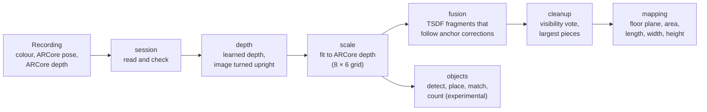

# sitescan: room measurements and object counts from a phone walk

A person walks through a room with an Android phone running the capture app. The phone
records colour images, its own camera path from ARCore (Google's phone tracking library)
and ARCore's raw depth, and sends them to a PC. The PC turns the recording into:

1. a cleaned 3D surface of the room in metres;
2. its floor area, length, width and height;
3. counts of the objects seen (experimental; it overcounts).

It runs either **live**, updating at least once a second while the recording arrives, or
**offline** on a saved recording, which gives a cleaner room. Everything runs on the CPU.

This repository started as research. The adopted method now lives in one package,
`sitescan/`, with the experiments that chose it kept beside it. For the research story,
results and decisions, read the [project plan](PROJECT_PLAN.md). For the code design, read
[DESIGN.md](DESIGN.md). New to 3D vision? The [learning chapters](learning/README.md) explain
each part from first principles.

## Contents

- [What it gives today](#what-it-gives-today)
- [How it works](#how-it-works)
- [Install](#install)
- [Run it](#run-it)
- [Walkthrough notebook](#walkthrough-notebook)
- [Repository map](#repository-map)
- [Tests](#tests)
- [Future work](#future-work)
- [Licences and data](#licences-and-data)
- [Function index](#function-index)
- [Terms used](#terms-used)

## What it gives today

| Output | Result so far | Limit |
|---|---|---|
| Room surface (offline) | 15 October walk of a home, Redmi Note 11 Pro: 134 frames fused into 676,855 points; clean-up kept 554,067 in 51 s | No independent measurement of the room exists yet, so its accuracy is unscored |
| Room measures | 6.35 × 3.30 m, 13.8 m² observed area, from the same walk | Same: no tape-measured reference yet |
| Live updates | 1.58 updates per second on the 14 October walk (63 updates, no gap over 1 s); 1.61–1.90 on public recordings | The map is recomputed over the whole surface each update, so a large room will cross one second |
| Surface accuracy (control) | 46–52 mm mean distance to the reference model of the public ICL living room, with the true camera path standing in for ARCore | Not a phone result |
| Object counts | Detected, placed in 3D and matched | Overcounts: 51 identities on a public desk recording with far fewer objects |

All results, with dates and commands, are in [evaluation/results.md](evaluation/results.md).

## How it works



| Stage | What it does, in one line | Detail |
|---|---|---|
| Session | Reads the recording, checks every record, converts poses once to one convention | [sitescan/session](sitescan/session/README.md) |
| Depth | Depth Anything V2 Metric Indoor Small predicts depth for every pixel; right shape, wrong scale | [sitescan/depth](sitescan/depth/README.md) |
| Scale | Multiplies learned depth by the median ratio to ARCore's confident depth, per cell of an 8 × 6 grid | [sitescan/scale](sitescan/scale/README.md) |
| Fusion | Averages scaled depth into volumes of 10 keyframes, each tied to an ARCore anchor, so ARCore's path corrections move the surface without re-fusing | [sitescan/fusion](sitescan/fusion/README.md) |
| Cleanup | Drops points that other views see through, then keeps the 50 largest connected pieces | [sitescan/cleanup](sitescan/cleanup/README.md) |
| Mapping | Finds the dominant plane and measures the surface on a grid laid on it | [sitescan/mapping](sitescan/mapping/README.md) |
| Objects | YOLO26x boxes, placed at the median depth inside the box, matched to objects of the same class within 0.35 m | [sitescan/objects](sitescan/objects/README.md) |

Two orchestrators call these stages ([sitescan/pipelines](sitescan/pipelines/README.md)). The
**room build** uses every frame with fresh ARCore depth and cleans the room once at the end.
The **live processor** takes the newest frame once per update and keeps the last scale when a
frame has no depth. Neither contains a method of its own.

## Install

Windows, from the repository root, with [uv](https://docs.astral.sh/uv/):

```powershell
uv sync --all-extras
```

This builds `.venv` from `uv.lock` (Python 3.12, CPU-only PyTorch). Weights stay out of git:
put them in `models/` as listed in [models/manifest.toml](models/manifest.toml)
(Depth Anything V2 Metric Indoor Small; YOLO26x for objects).

## Run it

```text
.venv/Scripts/python.exe -B -m apps.cli room   --session <recording> --out <new folder>
.venv/Scripts/python.exe -B -m apps.cli replay --session <recording> --out <new folder>
.venv/Scripts/python.exe -B -m apps.cli live   --port 8766 --out <new folder>
```

`room` writes `surface.ply`, `raw_surface.ply`, `frames.npz` and `summary.json` with the
measurements. `replay` and `live` write `updates.jsonl`, `surface.ply` and `summary.json`.
`live` receives from the capture app on the local network; type the address it prints into
the app. Options and outputs: [apps/README.md](apps/README.md).

A 20-frame public test recording is committed, so the room build runs on a fresh clone with
only the depth weights added:

```text
.venv/Scripts/python.exe -B -m apps.cli room --session tests/fixtures/tum_desk_20 --out outputs/desk
```

It prints 51,962 cleaned points and a 4.45 × 3.15 m map.

## Walkthrough notebook

[notebooks/00_sitescan_walkthrough.ipynb](notebooks/00_sitescan_walkthrough.ipynb) runs each
orchestrator on the committed test recording, then repeats its steps one stage call at a time,
with a picture after each step, and checks that the unwrapped steps give the same numbers.

## Repository map

| Folder | Holds |
|---|---|
| [`sitescan/`](sitescan/README.md) | The product: one folder per stage, `pipelines/` for the two orchestrators, `io.py` for writing results |
| [`apps/`](apps/README.md) | The command line and the phone receiver; no method code |
| [`notebooks/`](notebooks/README.md) | The walkthrough notebook |
| [`tests/`](tests/README.md) | Product tests, the golden-output check and the committed test recording |
| [`evaluation/`](evaluation/README.md) | Scoring against references, stand-in recordings, the layer-by-layer runner and [measured results](evaluation/results.md) |
| [`experiments/`](experiments/README.md) | Every trial, adopted or rejected, each with its README as the evidence record |
| [`research/`](research/README.md) | Source reviews by topic |
| [`learning/`](learning/README.md) | Chapters from first principles |
| [`tools/`](tools/README.md) | Developer tools: the check runner, the function index, demo-page builders |
| [`models/`](models/README.md) | Model weights (local) and their manifest (tracked) |
| [`task_list/`](task_list/README.md) | One record per piece of work |
| [`archive/`](archive/README.md) | Retired code and documents, read only |
| `data/`, `outputs/`, `third_party/` | Local only, not in git |

## Tests

```text
.venv/Scripts/python.exe -B -m pytest                        product lane, about 10 s
.venv/Scripts/python.exe -B -m pytest -m golden              both orchestrators on the test recording
.venv/Scripts/python.exe -B -m pytest -c pytest-full.ini     everything, about 1,600 tests, 6.5 min
```

The golden check compares every output number with the saved outputs in
`tests/fixtures/tum_desk_20_golden.json`. See [tests/README.md](tests/README.md).

## Future work

In order. Each item changes one thing and is measured against the current output before it
is kept; the saved golden outputs are updated only when a change is adopted.

1. **Give live the room's rules.** Turn live images upright before depth (AbsRel against ARCore depth fell from 0.080 to 0.058 for the room), scale with the 8 × 6 grid, and drop stale ARCore depth. One checked change at a time.
2. **Make far depth trustworthy.** Reject scale fits with too little support and let a held scale expire; trial far-depth triangulation from ARCore's tracked points, with region-aware scale as its control. ARCore depth rarely reaches past 2.5 m, and doorways repeat beyond it.
3. **Measure the room against the truth.** Record a walk that returns to its start, with tape-measured distances under 2.5 m and between 3 and 8 m, two or more identical objects and a few small ones. Without this no accuracy number exists for the phone.
4. **Fix object overcounting.** A matching distance that grows with object size and distance from the camera, then placement from a segmentation mask instead of the box median, scored against a counted inventory of a real room.
5. **Keep the live map under a second.** Keep each finished fragment's thinned points instead of re-thinning the whole surface every update.
6. **Frame selection.** Group similar frames and send only the sharpest of each group to depth and fusion, as an off/on experiment (DESIGN.md section 7.12).
7. **RTAB-Map mapping and surface grouping.** Feed RTAB-Map the same frames, depth and poses so only the mapping changes; trial geometry-and-colour grouping beside the largest-pieces filter once small objects are labelled.
8. **A depth model that runs on the phone.** LingBot-Map's depth, scaled by ARCore, had 38% lower error than Depth Anything V2 on the same frames but needs a 1.16-billion-parameter model on a GPU. Search for a model that runs at one frame per second on a phone or CPU.
9. **One record type end to end.** Switch both orchestrators from wire records to `session.frames()`. This changes anchor axes, so the fused grid moves in floating point; it needs its own golden check.
10. **Finish the move.** Put the Android app in `android/`; move the receiver's tests and the fake phone into `tests/`; move the dataset readers that `evaluation/` borrows from `experiments/` into `evaluation/`; turn `tools/demos` into `apps/viewer` once a viewer reads only pipeline outputs.
11. **Clear the licences.** Settle Ultralytics' AGPL-3.0 or commercial terms, or replace the detector (an Apache-2.0 YOLOX path is a candidate), before any proprietary use.
12. **Run stages on the phone.** Port a stage only with a parity test against the Python version on the same frames. Build a web API only when something will call it.

## Licences and data

- ARCore is Google's SDK under its own terms; the capture app uses it on the phone only.
- The YOLO26x detector loads through Ultralytics (AGPL-3.0 or commercial), unresolved for proprietary use. Depth Anything V2 Small is Apache-2.0.
- GPL tools such as ORB-SLAM3 appear only in experiments, as accuracy references.
- The committed test recording is made from the public TUM RGB-D desk sequence (CC BY 4.0).
- Household recordings, papers and model weights never enter git.

## Function index

Every public function and class in `sitescan/` and `apps/`, with its arguments and a link to
its code. Generated by `python -B -m tools.function_index`; a test fails if it is out of date.

<!-- function-index:start -->

**`sitescan.cleanup.__init__`**

| Function | What it does |
|---|---|
| [`Cleaned(voted, kept)`](sitescan/cleanup/__init__.py#L13) (class) | Input-order masks: points the vote kept, and points kept after the piece filter too. |
| [`clean_room(points, views, *, cell, keep, min_points)`](sitescan/cleanup/__init__.py#L20) | Visibility vote, then keep the largest pieces of what the vote left. |

**`sitescan.cleanup.pieces`**

| Function | What it does |
|---|---|
| [`largest_pieces(points, cell, keep, min_points)`](sitescan/cleanup/pieces.py#L11) | A mask of points in the largest pieces meeting the minimum point count. |

**`sitescan.cleanup.vote`**

| Function | What it does |
|---|---|
| [`measurements(points, views)`](sitescan/cleanup/vote.py#L12) | Per-view camera depths and measured depths at rounded colour pixels. |
| [`vote_tallies(points, views, *, margin_m, margin_share, min_depth_m)`](sitescan/cleanup/vote.py#L32) | Weighted support and see-through opposition for each point, in input order. |
| [`visibility_vote(points, views)`](sitescan/cleanup/vote.py#L52) | Keep points with support at least equal to see-through opposition. |

**`sitescan.depth.model`**

| Function | What it does |
|---|---|
| [`metres(encoded, units_per_metre)`](sitescan/depth/model.py#L16) | Float64 camera-plane metres and a mask of finite, positive pixels. |
| [`infer(image, *, processor, model, torch, device, max_depth_m)`](sitescan/depth/model.py#L23) | Depth and validity on the RGB image's pixel grid from loaded model components. |
| [`load_model(checkpoint, *, threads, device, max_depth_m)`](sitescan/depth/model.py#L42) | An RGB-to-depth callable, loading local processor and weights once. |
| [`predict(model, image, pose)`](sitescan/depth/model.py#L66) | Depth and validity on the recorded grid, using upright input when pose is given. |

**`sitescan.depth.orientation`**

| Function | What it does |
|---|---|
| [`upright(image, turns)`](sitescan/depth/orientation.py#L8) | The recorded array rotated clockwise by the requested quarter turns. |
| [`recorded(image, turns)`](sitescan/depth/orientation.py#L13) | The upright array restored to its recorded pixel grid. |
| [`quarter_turns(world_from_camera_cv)`](sitescan/depth/orientation.py#L18) | Clockwise turns that bring image down closest to world down. |
| [`turned_camera(world_from_camera_cv, intrinsics, size, turns)`](sitescan/depth/orientation.py#L26) | Pose, intrinsics and dimensions for the rotated pixel grid. |

**`sitescan.fusion.fragments`**

| Function | What it does |
|---|---|
| [`Fragments(*, voxel_m, keyframes_per_fragment)`](sitescan/fusion/fragments.py#L24) (class) | Volumes, extracted surfaces and current anchors retained between frames. |
| [`Fragments.set_anchor(keyframe, world_from_anchor)`](sitescan/fusion/fragments.py#L38) | Store the current anchor transform used to place a fragment in the world. |
| [`Fragments.integrate(depth_m, colour, intrinsics, world_from_camera, keyframe)`](sitescan/fusion/fragments.py#L42) | Fuse one scaled depth image relative to its fragment's placing anchor. |
| [`Fragments.placing_anchor(keyframe)`](sitescan/fusion/fragments.py#L72) | The current transform of the anchor placing this keyframe's fragment. |
| [`Fragments.surface()`](sitescan/fusion/fragments.py#L77) | World surface points in fragment order, following current anchor corrections. |
| [`Fragments.colours()`](sitescan/fusion/fragments.py#L94) | RGB values from 0 to 1 in the same order as surface points. |
| [`Fragments.frames_per_fragment()`](sitescan/fusion/fragments.py#L101) | Integrated-frame counts keyed by fragment ID. |

**`sitescan.io`**

| Function | What it does |
|---|---|
| [`write_cloud(path, points, colours)`](sitescan/io.py#L9) | A PLY point cloud, with RGB colours from 0 to 1 when given. |
| [`write_json(path, record, indent)`](sitescan/io.py#L19) | A JSON record, UTF-8. |
| [`write_timeline(path, frames)`](sitescan/io.py#L24) | Each fused frame's camera, sampled learned-depth points with colours, and ARCore depth points. |

**`sitescan.mapping.footprint`**

| Function | What it does |
|---|---|
| [`onto_plane(chunk, point, normal)`](sitescan/mapping/footprint.py#L12) | Signed height and projected world points on the reference plane. |
| [`signed_axes(axes)`](sitescan/mapping/footprint.py#L18) | Axes oriented so each largest-magnitude component is positive. |
| [`grid_shape(coordinates, cell_size_m)`](sitescan/mapping/footprint.py#L23) | Grid origin coordinates and shape, retaining the existing allocation limit. |
| [`fill_grid(cells, heights, shape, band_m)`](sitescan/mapping/footprint.py#L36) | Observed cells, plane-band cells and the highest signed height per cell. |
| [`footprint(points, plane, up, *, cell_size_m, band_m)`](sitescan/mapping/footprint.py#L49) | A plane-aligned grid of observed area, dimensions and signed surface heights. |

**`sitescan.mapping.plane`**

| Function | What it does |
|---|---|
| [`ransac(points, rng, *, inlier_distance_m, iterations)`](sitescan/mapping/plane.py#L14) | The candidate point and normal with the largest sampled plane support. |
| [`scatter_axes(reference, relative)`](sitescan/mapping/plane.py#L36) | Centre and principal axes of points given relative to a reference point. |
| [`fit_dominant_plane(points, *, inlier_distance_m, iterations, sample_size, seed)`](sitescan/mapping/plane.py#L46) | The dominant sampled plane, refitted on all of its inliers. |

**`sitescan.mapping.site`**

| Function | What it does |
|---|---|
| [`measure_site(surface, cameras, *, cell_size_m, inlier_distance_m, iterations, sample_size, seed, min_points)`](sitescan/mapping/site.py#L17) | Area, extent and height measurements, or a reason to skip the surface. |

**`sitescan.mapping.types`**

| Function | What it does |
|---|---|
| [`Plane(point, normal, inlier_fraction, source)`](sitescan/mapping/types.py#L9) (class) | A point, normal and measured support for the reference plane. |
| [`Footprint(plane, basis, grid_origin, cell_size_m, observed, on_plane, max_height_m, point_count)`](sitescan/mapping/types.py#L19) (class) | Observed cells and heights on a metric plane-aligned grid. |
| [`Footprint.cell_area_m2()`](sitescan/mapping/types.py#L32) | The area covered by one square grid cell. |
| [`Footprint.observed_area_m2()`](sitescan/mapping/types.py#L37) | Area under cells containing any observed surface. |
| [`Footprint.plane_area_m2()`](sitescan/mapping/types.py#L42) | Area of cells with observations inside the reference plane band. |
| [`Footprint.length_m()`](sitescan/mapping/types.py#L47) | Extent along the first grid axis, measured at cell edges. |
| [`Footprint.width_m()`](sitescan/mapping/types.py#L52) | Extent along the second grid axis, measured at cell edges. |
| [`Footprint.unknown_area_m2()`](sitescan/mapping/types.py#L57) | Unobserved cell area within the grid rectangle. |
| [`Footprint.highest_m()`](sitescan/mapping/types.py#L62) | Largest observed signed height above the oriented reference plane. |
| [`Footprint.lowest_m()`](sitescan/mapping/types.py#L67) | Smallest observed signed height above the oriented reference plane. |

**`sitescan.objects.detect`**

| Function | What it does |
|---|---|
| [`Detection(xyxy, label, class_id, confidence)`](sitescan/objects/detect.py#L29) (class) | One box in original image pixels, with its COCO class and score. |
| [`detect(image, *, model, device)`](sitescan/objects/detect.py#L38) | Boxes found in one RGB image. |
| [`load_detector(checkpoint, *, device)`](sitescan/objects/detect.py#L51) | An RGB-to-boxes callable, loading the verified local checkpoint once. |

**`sitescan.objects.match`**

| Function | What it does |
|---|---|
| [`placed(row)`](sitescan/objects/match.py#L10) | Whether a detection has a finite 3D position. |
| [`candidates(position, class_id, tracks, max_distance_m)`](sitescan/objects/match.py#L19) | (distance, object id) for same-class objects within reach, nearest first. |
| [`assign(rows, track_ids, max_distance_m, ambiguity_margin_m)`](sitescan/objects/match.py#L31) | Shortest one-to-one assignment of rows to objects within reach. |
| [`associate_frame(detections, tracks, next_number, max_distance_m, ambiguity_margin_m)`](sitescan/objects/match.py#L68) | Match one frame's detections to counted objects; returns rows, updated objects and the next number. |

**`sitescan.objects.place`**

| Function | What it does |
|---|---|
| [`box_pixels(shape, xyxy)`](sitescan/objects/place.py#L8) | Pixels whose centres fall inside the box. |
| [`box_position(depth, valid, camera, xyxy, world_from_camera)`](sitescan/objects/place.py#L15) | World position of the coordinate-wise median of the box's valid surface points. |

**`sitescan.objects.tracks`**

| Function | What it does |
|---|---|
| [`nearest_same_class(row, tracks)`](sitescan/objects/tracks.py#L15) | Distance from a placed detection to the closest object of its class; None if either is missing. |
| [`Objects(*, max_distance_m, ambiguity_margin_m)`](sitescan/objects/tracks.py#L27) (class) | The objects counted so far. |
| [`Objects.update(detections, depth, valid, camera, world_from_camera, keyframe, anchors, frame_index)`](sitescan/objects/tracks.py#L41) | Place, match and count one frame's detections; returns one log row per detection. |
| [`Objects.counts()`](sitescan/objects/tracks.py#L76) | Objects counted so far, by class label. |

**`sitescan.pipelines.live`**

| Function | What it does |
|---|---|
| [`LiveSettings(voxel_m, keyframes_per_fragment, max_distance_m, ambiguity_margin_m)`](sitescan/pipelines/live.py#L33) (class) | Fusion voxel and fragment size, and the object matching distances. |
| [`frame_scale(learned, valid, frame, previous)`](sitescan/pipelines/live.py#L42) | (scale, source) for one frame: ARCore depth, else tracked points, else the previous scale. |
| [`LiveProcessor(depth_model, detector, settings)`](sitescan/pipelines/live.py#L56) (class) | Surface, map and counts updated from the newest frame, once per update. |
| [`LiveProcessor.add(frame, image_path)`](sitescan/pipelines/live.py#L75) | Record a received wire frame and the path of its saved colour image. |
| [`LiveProcessor.update()`](sitescan/pipelines/live.py#L92) | Process the newest pending frame; None when nothing new has arrived. |
| [`LiveProcessor.surface()`](sitescan/pipelines/live.py#L143) | The fused surface so far, in world metres. |
| [`wall_ms(record)`](sitescan/pipelines/live.py#L156) | An update's own time: the detection that runs alongside is already inside objects_wait. |
| [`summarise(records, finished, processor)`](sitescan/pipelines/live.py#L161) | Update rate, gaps, stage times and scale sources over a run. |
| [`run_live(processor, feed, out, about)`](sitescan/pipelines/live.py#L180) | Feed frames on a thread and update as often as possible until the feed ends. |

**`sitescan.pipelines.room`**

| Function | What it does |
|---|---|
| [`RoomSettings(far_m, voxel_m, piece_cell_m, supported_only)`](sitescan/pipelines/room.py#L31) (class) | Far limit and voxel for fusion, the piece-grid cell, and the supported-cells trial switch. |
| [`FusableFrame(frame, keyframe, world_from_camera, colour, depth, valid, turns, uv, target, scale)`](sitescan/pipelines/room.py#L41) (class) | One frame ready to fuse: its pose, photo, upright-predicted depth and grid scale. |
| [`Room(raw, raw_colours, cleaned, timeline, summary)`](sitescan/pipelines/room.py#L57) (class) | The fused room before and after clean-up, the per-frame timeline and the summary. |
| [`Room.surface()`](sitescan/pipelines/room.py#L67) | The cleaned surface points. |
| [`fresh_depth(frame)`](sitescan/pipelines/room.py#L72) | Whether the frame's ARCore depth was measured close enough in time to its image. |
| [`world_points(uv, z, intrinsics, world_from_camera)`](sitescan/pipelines/room.py#L77) | World positions of pixels at the given camera-plane depths. |
| [`fusable_frames(folder, model, outcome)`](sitescan/pipelines/room.py#L84) | Anchor events and the frames a room build fuses, in recording order. |
| [`vote_views(fragments, placed)`](sitescan/pipelines/room.py#L113) | (camera_from_world, intrinsics, see-through evidence) per fused frame. |
| [`timeline_entry(item, fused)`](sitescan/pipelines/room.py#L123) | A frame's camera, a sample of its fused points with colours, and a sample of its ARCore points. |
| [`build_room(folder, model, settings)`](sitescan/pipelines/room.py#L133) | Fuse every frame with fresh ARCore depth, then clean the room and measure it. |
| [`save_room(room, out)`](sitescan/pipelines/room.py#L174) | surface.ply (cleaned), raw_surface.ply, frames.npz (per-frame timeline) and summary.json. |

**`sitescan.scale.fit`**

| Function | What it does |
|---|---|
| [`pixel_rows_cols(uv, width, height)`](sitescan/scale/fit.py#L12) | Integer rows and columns of pixel positions, clipped to the image. |
| [`fit_ratio(model_depth, target_depth)`](sitescan/scale/fit.py#L17) | Median target-to-learned ratio from at least two positive, finite depth pairs. |
| [`fit_one(model, valid, uv, target, minimum)`](sitescan/scale/fit.py#L30) | One median scale for a frame, or None without enough valid target pixels. |
| [`cell_index(uv, image_size, cells)`](sitescan/scale/fit.py#L46) | Row-major grid cell IDs for colour pixels, clipped to the image bounds. |
| [`fit_grid(model, valid, uv, target, cells, fallback, *, minimum, min_cell_pixels)`](sitescan/scale/fit.py#L54) | Blended per-pixel scale, with cell medians fitted in log space. |
| [`supported_pixels(uv, shape, cells, *, min_cell_pixels)`](sitescan/scale/fit.py#L85) | Pixels in grid cells with enough measured depth samples for their own scale. |

**`sitescan.scale.targets`**

| Function | What it does |
|---|---|
| [`depth_targets(depth, camera, *, min_confidence)`](sitescan/scale/targets.py#L11) | Colour pixels and measured depths from confident ARCore depth pixels. |
| [`point_targets(points_world, points_pixel, world_from_camera)`](sitescan/scale/targets.py#L27) | Recorded pixels and camera-plane metres for tracked points in front of the camera. |
| [`fresh_depth(depth_t_ns, camera_t_ns, *, max_age_s)`](sitescan/scale/targets.py#L39) | Whether measured depth is no more than the allowed age behind the camera frame. |

**`sitescan.session.protocol`**

| Function | What it does |
|---|---|
| [`write_message(stream, header, payload)`](sitescan/session/protocol.py#L18) | Write a header and payload with their big-endian byte lengths. |
| [`read_message(stream)`](sitescan/session/protocol.py#L26) | The next message, or None when the sender closed the connection between messages. |
| [`write_ack(stream, seq)`](sitescan/session/protocol.py#L38) | Write the sequence number acknowledged by a v1 receiver. |
| [`read_ack(stream)`](sitescan/session/protocol.py#L43) | The sequence number acknowledged by a v1 receiver. |

**`sitescan.session.read`**

| Function | What it does |
|---|---|
| [`raw_header(header)`](sitescan/session/read.py#L16) | The header describing the lossless grey image saved on the host. |
| [`frame_payload(folder, header)`](sitescan/session/read.py#L24) | The saved v2 image and depth bytes, in wire order. |
| [`read_wire_session(folder)`](sitescan/session/read.py#L35) | Checked wire records for callers awaiting the pipeline migration. |
| [`camera(record)`](sitescan/session/read.py#L53) | The colour image's camera of a wire record, if it has intrinsics. |
| [`arcore_depth(depth)`](sitescan/session/read.py#L60) | A wire depth record as the shared depth type, with its own camera. |
| [`frames(folder)`](sitescan/session/read.py#L66) | Frames in file order, with RGB arrays and world_from_camera matrices. |

**`sitescan.session.replay`**

| Function | What it does |
|---|---|
| [`replay(folder, deliver, *, speed, stop, reader)`](sitescan/session/replay.py#L11) | The number of frames delivered, paced by their camera timestamps. |

**`sitescan.session.wire_v1`**

| Function | What it does |
|---|---|
| [`Depth(t_ns, depth_m, confidence, intrinsics)`](sitescan/session/wire_v1.py#L18) (class) | A checked raw-depth message with its recorded intrinsics. |
| [`Frame(seq, t_ns, sent_ms, tracking, failure, pose, intrinsics, image_jpeg, image_size, point_ids, points_world, points_pixel, points_confidence, depth, anchor_created, anchor_updates)`](sitescan/session/wire_v1.py#L28) (class) | A checked wire frame retaining JPEG bytes and ARCore quaternion poses. |
| [`world_from_camera(pose)`](sitescan/session/wire_v1.py#L73) | Camera-to-world matrix with ARCore axes: x right, y up, looking along -z. |
| [`world_from_camera_cv(pose)`](sitescan/session/wire_v1.py#L86) | World_from_camera in metres, with OpenCV camera axes in the ARCore world. |
| [`corrected_world_from_camera(frame_pose, anchor_created, anchor_now)`](sitescan/session/wire_v1.py#L91) | The frame's ARCore pose moved by its anchor's correction. |
| [`project(pose, intrinsics, points_world)`](sitescan/session/wire_v1.py#L100) | Pixels of world points seen from the recorded ARCore pose and intrinsics. |
| [`check_session(header)`](sitescan/session/wire_v1.py#L108) | A checked v1 session-start header. |
| [`parse_depth(header, payload)`](sitescan/session/wire_v1.py#L118) | Checked depth and confidence arrays from the binary message tail. |
| [`parse_points(points, pose, intrinsics)`](sitescan/session/wire_v1.py#L138) | Checked tracked-point rows, including their agreement with the camera projection. |
| [`parse_arcore(record, depth_payload)`](sitescan/session/wire_v1.py#L151) | Checked camera, tracked points, depth and anchor fields from an ARCore record. |
| [`parse_frame(header, payload)`](sitescan/session/wire_v1.py#L182) | A checked v1 frame record from its header and its JPEG and depth bytes. |

**`sitescan.session.wire_v2`**

| Function | What it does |
|---|---|
| [`Frame(n, camera_t_ns, camera, grey, arcore_t_ns, device_pose, texture_intrinsics)`](sitescan/session/wire_v2.py#L47) (class) | A decoded v2 wire message; camera timestamps use the Camera2 clock. |
| [`Frame.wall_ms()`](sitescan/session/wire_v2.py#L59) | The wall-clock send time from the wire envelope, in milliseconds. |
| [`ImuBatch(n, t_ns, sensor, values, bias)`](sitescan/session/wire_v2.py#L65) (class) | Recorded inertial samples and Android bias estimates on the device clock. |
| [`check_session_id(session)`](sitescan/session/wire_v2.py#L75) | A session id of 1-80 letters, digits, underscores or hyphens. |
| [`check_queued(header, kind)`](sitescan/session/wire_v2.py#L84) | The envelope every queued message shares: type, version, session id and message number. |
| [`check_hello(header)`](sitescan/session/wire_v2.py#L97) | A checked hello message: the session id and the phone, camera, clock and settings info. |
| [`parse_images(header, payload)`](sitescan/session/wire_v2.py#L117) | Lossless grey, JPEG bytes and the remaining depth bytes from a frame message. |
| [`parse_arcore(record, payload)`](sitescan/session/wire_v2.py#L150) | ARCore fields including device pose, or absent fields for camera-only recordings. |
| [`parse_frame(header, payload)`](sitescan/session/wire_v2.py#L183) | Checked frame message retaining the wire fields for existing callers. |
| [`parse_imu(header, payload)`](sitescan/session/wire_v2.py#L209) | A checked batch of gyroscope or accelerometer samples, 36 bytes each. |
| [`check_telemetry(header)`](sitescan/session/wire_v2.py#L229) | A checked telemetry envelope with all phone counters present. |
| [`check_end(header)`](sitescan/session/wire_v2.py#L236) | A checked end envelope with counts and the final phone clock reading. |
| [`stream_stats(times)`](sitescan/session/wire_v2.py#L247) | Sample count, rate and gap counts, or None for fewer than two timestamps. |

**`sitescan.types`**

| Function | What it does |
|---|---|
| [`Camera(fx, fy, cx, cy, width, height)`](sitescan/types.py#L9) (class) | Pinhole intrinsics and image dimensions, in pixels. |
| [`ArcoreDepth(t_ns, depth_m, confidence, camera)`](sitescan/types.py#L21) (class) | Camera-plane depth in metres and confidence from 0 to 255. |
| [`Frame(seq, t_ns, image, camera, pose, depth, point_ids, points_world, points_pixel, points_confidence, anchor_created, anchor_updates, tracking, failure, arcore_t_ns)`](sitescan/types.py#L31) (class) | RGB image and OpenCV camera poses in the recording's world, in metres. |

**`apps.cli`**

| Function | What it does |
|---|---|
| [`add_room_options(parser)`](apps/cli.py#L36) | The options every room build shares; trial scripts add their own. |
| [`room_parser(description)`](apps/cli.py#L46) | A parser with the room options, for trial scripts that build rooms their own way. |
| [`parse_room_args(parser, argv)`](apps/cli.py#L51) | Parsed options, refusing an output folder that already exists. |
| [`add_live_options(parser)`](apps/cli.py#L59) | The options the replay and live verbs share. |
| [`room(args)`](apps/cli.py#L69) | Build, save and summarise the room for the room verb. |
| [`live(args)`](apps/cli.py#L77) | Run the live processor on a replayed or received recording; returns the run summary. |
| [`listen(folder, port, on_frame)`](apps/cli.py#L98) | Receive one capture session, passing each saved frame on, until the app ends it. |
| [`main(argv)`](apps/cli.py#L108) | The command line: room, replay or live. |

**`apps.receiver.capture_receiver`**

| Function | What it does |
|---|---|
| [`Session(folder, info)`](apps/receiver/capture_receiver.py#L62) (class) | One session folder on the PC: stores messages in order and knows the last one held with no gap. |
| [`Session.open(root, hello, *, host_ms)`](apps/receiver/capture_receiver.py#L87) | The stored session named in a hello message, resumed, or a new one. |
| [`Session.hello(hello, *, host_ms)`](apps/receiver/capture_receiver.py#L109) | Record a reconnecting hello that matches this session. |
| [`Session.store(header, payload, *, host_ms)`](apps/receiver/capture_receiver.py#L118) | Stores one message; returns the parsed frame for frame messages, else None. Raises ValueError to refuse. |
| [`Session.summary()`](apps/receiver/capture_receiver.py#L185) | Counts, gaps and timing of what the session stored. |
| [`Receiver(root, *, port, host, on_frame)`](apps/receiver/capture_receiver.py#L223) (class) | Accepts phone connections on their own threads; sessions survive dropped connections and PC restarts. |
| [`Receiver.start()`](apps/receiver/capture_receiver.py#L238) | Start accepting connections on a background thread. |
| [`Receiver.wait(timeout)`](apps/receiver/capture_receiver.py#L243) | The folder of the next session whose end message has been stored. |
| [`Receiver.wait_reports(count, timeout)`](apps/receiver/capture_receiver.py#L247) | The next `count` check reports the app has sent. |
| [`Receiver.close()`](apps/receiver/capture_receiver.py#L251) | Stop listening and close open phone connections. |
| [`addresses()`](apps/receiver/capture_receiver.py#L350) | This PC's IPv4 addresses, the one on the default route first. |
| [`main()`](apps/receiver/capture_receiver.py#L363) | Receive recordings until stopped. |

<!-- function-index:end -->

## Terms used

| Term | Meaning |
|---|---|
| AbsRel | Mean absolute relative error: the average of \|predicted − true\| / true |
| Anchor | A point ARCore keeps and corrects over time; each fragment is stored relative to one |
| ARCore | Google's phone tracking library: camera path, tracked points and raw depth |
| Fragment | One TSDF volume holding the frames of 10 keyframes, tied to an anchor |
| Golden output | A saved result from known-good code that a rewrite must reproduce |
| Orchestrator | Code that decides which stages run, on which frames, in what order; also called a pipeline |
| Piece | A set of filled 3D grid cells that touch each other; small pieces are floating debris |
| Scale | The factor that turns learned depth into metres |
| TSDF | Truncated signed distance function: a voxel grid that averages many depth maps into one surface |
| Visibility vote | Drop a point when the views that see through it outweigh the views that see it there |
