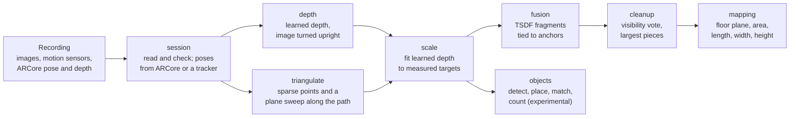

# sitescan: room measurements and object counts from a phone walk

A person walks through a room with an Android phone running the capture app. The phone
records colour and grey images, its motion sensors and, for now, the camera path and raw
depth from ARCore (Google's phone tracking library). It sends them to a PC, which turns the
recording into:

1. a cleaned 3D surface of the room in metres;
2. its floor area, length, width and height;
3. counts of the objects seen (experimental; it overcounts).

It runs either **live**, updating at least once a second while the recording arrives, or
**offline** on a saved recording, which gives a cleaner room. Everything runs on the CPU.

**The product is replacing ARCore (owner decision 10, 12 November 2026).** The camera path
will come from an open visual-inertial tracker, Basalt first. Real size will come from depth
triangulated along that path. The code that reads a tracker's path and triangulates depth is
built, and a setting chooses it. ARCore stays the default until a trial on a phone recording
replaces it. [Replacing ARCore](#replacing-arcore) gives the state of each part.

This repository started as research. The adopted method lives in one package, `sitescan/`.
The experiments that chose it live under `research/`. The [project plan](PROJECT_PLAN.md)
holds the research story, results and decisions. [DESIGN.md](DESIGN.md) holds the code
design. The [learning chapters](learning/README.md) explain each part from first principles.

## Contents

- [What it gives today](#what-it-gives-today)
- [How it works](#how-it-works)
- [Replacing ARCore](#replacing-arcore)
- [Install](#install)
- [Run it](#run-it)
- [Where outputs go](#where-outputs-go)
- [Walkthrough notebook](#walkthrough-notebook)
- [Code map](#code-map)
- [Refactor status](#refactor-status)
- [Plan](#plan)
- [Tests](#tests)
- [Licences and data](#licences-and-data)
- [Function index](#function-index)
- [Terms used](#terms-used)

## What it gives today

| Output | Result so far | Limit |
|---|---|---|
| Room surface, sized by ARCore depth (offline) | 15 October walk of a home, Redmi Note 11 Pro: 134 frames fused into 676,855 points; clean-up kept 554,067 in 51 s | No independent measurement of the room exists yet, so its accuracy is unscored |
| Room measures | 6.35 × 3.30 m, 13.8 m² observed area, from the same walk | Same: no tape-measured reference yet |
| Room sized by triangulation (offline) | Same walk, with ARCore's path standing in for a tracker and no ARCore depth read: 725 frames fused, 37 skipped for a scale jump, 1,137,969 points. On the 124 frames both rooms fused, 74% agree with ARCore's scale within 10% and 95% within 20% | Walls smear outwards where frames are sized 10–25% off. Scored only against the ARCore room |
| Triangulated sizing on public data | TUM desk recording, motion-capture path standing in for a tracker: rooms sized only by triangulation sat a median 6.3–9.0 cm from the Kinect surface, against 3.0–3.2 cm when sized by the Kinect itself | 20 frames; the Kinect reference is itself noisy |
| Live updates | 1.58 updates per second on the 14 October walk (63 updates, no gap over 1 s); 1.61–1.90 on public recordings | The map is recomputed over the whole surface each update, so a large room will cross one second |
| Surface accuracy (control) | 46–52 mm mean distance to the reference model of the public ICL living room, with the true camera path standing in for ARCore | Not a phone result |
| Object counts | Detected, placed in 3D and matched | Overcounts: 51 identities on a public desk recording with far fewer objects |

All results, with dates and commands, are in [research/evaluation/results.md](research/evaluation/results.md).
The triangulation results are in [research/experiments/triangulation](research/experiments/triangulation/README.md).

## How it works



| Stage | What it does | Detail |
|---|---|---|
| Session | Reads the recording and checks every record. Poses come from ARCore's record or, given a trajectory file and a phone calibration, from an open tracker; the tracker's world is turned so up is +y | [sitescan/session](sitescan/session/README.md) |
| Depth | Depth Anything V2 Metric Indoor Small predicts depth for every pixel of the image turned upright. The shape is right; the scale is wrong | [sitescan/depth](sitescan/depth/README.md) |
| Triangulate | Sparse: ORB corners matched against the three newest usable keyframes and triangulated from the known poses. Dense: a plane sweep (Census matching and semi-global smoothing) against two keyframes, searching near the scaled learned depth | [sitescan/triangulate](sitescan/triangulate/README.md) |
| Scale | Turns learned depth into metres from measured targets: one median ratio per cell of an 8 × 6 grid, or a power curve whose scale changes with distance | [sitescan/scale](sitescan/scale/README.md) |
| Fusion | Averages scaled depth into volumes of 10 keyframes, each tied to an anchor, so path corrections move the surface without re-fusing | [sitescan/fusion](sitescan/fusion/README.md) |
| Cleanup | Drops points that other views see through, then keeps the 50 largest connected pieces of at least 5,000 points | [sitescan/cleanup](sitescan/cleanup/README.md) |
| Mapping | Finds the dominant plane and measures the surface on a grid laid on it | [sitescan/mapping](sitescan/mapping/README.md) |
| Objects | YOLO26x boxes, placed at the median depth inside the box, matched to objects of the same class within 0.35 m | [sitescan/objects](sitescan/objects/README.md) |

**Scale sources.** Each frame is scaled by the first source in a list that has enough
targets. The list is a setting, `--scale-sources`:

| Name | Targets | Used by default in |
|---|---|---|
| `arcore_depth` | ARCore's confident raw depth | Room build; first choice in live |
| `tracked_points` | ARCore's tracked points | Live, when a frame has no ARCore depth |
| `sparse` | Points triangulated along the path | Neither yet |
| `dense` | Plane-sweep depth | Neither yet |

**Two orchestrators** call these stages ([sitescan/pipelines](sitescan/pipelines/README.md)).
Neither contains a method of its own.

- The **room build** fuses every frame that has a scale source. It drops ARCore depth more
  than 0.1 s older than its image and fits the 8 × 6 grid. With `--max-scale-jump 1.25` it
  skips a frame whose scale is more than 1.25 times off the median of the last 15 fused
  frames. It cleans the room once, at the end.
- The **live processor** takes the newest frame once per update. It fits one scale per
  frame and keeps the last scale when a frame has none. It does not yet turn images upright,
  fit the grid or clean the surface; those are [next steps](#plan).

## Replacing ARCore

The owner decided on 12 November 2026 that the product will not depend on ARCore (decision
10). ARCore is closed source, Google can change or withdraw it, its depth reaches only about
2.5 m, and its terms exclude uses where failure could cause injury. Its recordings stay as a
comparison and never feed the product.

| ARCore gives today | Replacement | State on 12 November |
|---|---|---|
| Camera path | Basalt (BSD-3), a visual-inertial tracker on the phone's camera and motion sensors. It runs as its own program; `sitescan` reads its trajectory file | Reader built. Basalt scored 0.146 m error over a 146 m walk on the public TUM-VI recording with one camera. Not yet run on a Redmi walk, because it needs the calibration |
| Camera intrinsics and the camera's place on the phone | A per-phone calibration from a printed-target video and a long rest recording (Kalibr), read as JSON | The calibration tools reproduce TUM-VI's published values to 0.014°, 1.0 mm and 0.13 ms. The Redmi is not calibrated (Task103) |
| Which way is up | The tracker's world, turned at the reader so up is +y | Built |
| Real size: raw depth to about 2.5 m, tracked points | Depth triangulated along the path: sparse points, then a dense plane sweep | Built in `sitescan/triangulate`; results in [What it gives today](#what-it-gives-today) |
| Anchors that it corrects over time | One anchor per second from the tracker's poses. A back end with loop closure would send corrections | Built. With odometry only, anchors are never corrected |
| Camera opened through ARCore in the capture app | A Camera2 mode with exposure, white balance and focus locked | Not built; needs owner approval |

**The route to a first phone result.** Calibrate the Redmi (Task103). Run Basalt on the
recorded walks and compare its path with ARCore's (Task104). Rebuild the 15 October room on
Basalt's poses, first with ARCore depth so only the pose source changes, then sized by
triangulation alone.

**The main risks.** Basalt has only run on a recording whose camera has a global shutter and
whose motion sensors are wired to the camera's trigger. The Redmi has a rolling shutter and
clocks that agree only to within a few milliseconds. The one open Android project that
tracks without ARCore (3d-recon) reports handheld tracking as not yet reliable. Each
supported phone model needs its own calibration. On the 15 October walk, one frame in eleven
was sized more than 20% off ARCore's scale, and such frames leave streaks that clean-up
cannot remove.

ARCore stays the default source until a trial replaces it, so every change keeps today's
outputs. The ARCore-specific code is deleted once the open route is adopted.

Sources: [the 12 November review of open parts](research/visual_inertial_odometry/depth_without_arcore_2026-11-12.md),
[DESIGN section 7.15](DESIGN.md#715-removing-arcore-five-changes) (the five code changes and
how each was checked), [learning chapter 12](learning/12_rebuilding_arcore.md) (clocks,
calibration and trackers from first principles).

## Install

Windows, from the repository root, with [uv](https://docs.astral.sh/uv/):

```powershell
uv sync --all-extras
```

This builds `.venv` from `uv.lock` (Python 3.12, CPU-only PyTorch). Weights stay out of git:
put them in `models/` as listed in [models/manifest.toml](models/manifest.toml)
(Depth Anything V2 Metric Indoor Small; YOLO26x for objects).

## Run it

```text
.venv/Scripts/python.exe -B -m apps.cli room   --session <recording> --label <label>
.venv/Scripts/python.exe -B -m apps.cli replay --session <recording> --label <label>
.venv/Scripts/python.exe -B -m apps.cli live   --port 8766 --label <label>
```

`room` writes `surface.ply`, `raw_surface.ply`, `voted_surface.ply`, `frames.npz` and
`summary.json` with the measurements. `replay` and `live` write `updates.jsonl`,
`surface.ply` and `summary.json`. `live` receives from the capture app on the local network;
type the address it prints into the app. Options and outputs: [apps/README.md](apps/README.md).

To pose a saved recording by a tracker and size it by triangulation:

```text
.venv/Scripts/python.exe -B -m apps.cli room --session <recording> --label <label> --trajectory <trajectory.txt> --calibration <calibration.json> --scale-sources dense sparse --max-scale-jump 1.25
```

The trajectory is a text file of `time x y z qx qy qz qw` lines (TUM format). Basalt writes
the motion sensors' pose in a world with z up, which are the defaults
(`--trajectory-of imu --trajectory-up 0 0 1`). `research/experiments/open_vio/calibration/to_sitescan.py`
converts a Kalibr calibration into the JSON `--calibration` reads.

A 20-frame public test recording is committed, so the room build runs on a fresh clone with
only the depth weights added:

```text
.venv/Scripts/python.exe -B -m apps.cli room --session tum-desk-20 --label first-try
```

It prints 51,962 cleaned points and a 4.45 × 3.15 m map.

## Where outputs go

Every run writes one folder: `outputs/<recording>/<tool>/<yyyymmdd-hhmm>_<label>/`.

- **Recording:** a short name from [recordings.toml](recordings.toml), such as `redmi-20261015-0939` (device, date, start time) or `tum-desk-20`. `--session` takes the name or a folder.
- **Tool:** what ran, such as `room`, `replay`, `live`, `compare`, `trajectory` or a trial's name.
- **Label:** one to four lowercase words joined by hyphens, saying what is different, such as `sweep-jump125`. Leave out task numbers, `v2` and `final`; the time orders runs.

Each run folder holds `run.json`: the command, every setting, the options typed, the git commit with any uncommitted code changes (saved as `source.diff`), the runs it read, its status and its headline numbers. Pages and screenshots made from a run go in its `pages/` and `screens/` folders. A run is never overwritten.

`python -B -m tools.runs` lists runs, newest first. `--recording`, `--tool`, `--grep <label text>`, `--where setting=value` and `--latest` filter the list. `--index` writes `outputs/index.html`, which links every run's pages and screenshots and lists any folder that does not follow the layout.

## Walkthrough notebook

[notebooks/00_sitescan_walkthrough.ipynb](notebooks/00_sitescan_walkthrough.ipynb) runs each
orchestrator on the committed test recording, then repeats its steps one stage call at a time,
with a picture after each step, and checks that the unwrapped steps give the same numbers.

## Code map

`sitescan/` is about 3,500 lines of Python: eight stage folders, `pipelines/`, and three
shared modules (`types.py`, `io.py`, `runs.py`).

| To change | Look in |
|---|---|
| Reading a recording; the wire formats | [sitescan/session/read.py](sitescan/session/read.py), [wire_v2.py](sitescan/session/wire_v2.py), [wire_v1.py](sitescan/session/wire_v1.py); the format is specified in [phone_session_v2.md](research/experiments/01_camera_capture_delivery/phone_session_v2.md) |
| Poses from a tracker file; a phone calibration | [sitescan/session/trajectory.py](sitescan/session/trajectory.py) |
| Shared records: `Frame`, `Camera`, `MeasuredDepth`, `Trajectory`, `Calibration` | [sitescan/types.py](sitescan/types.py) |
| Learned depth; turning images upright | [sitescan/depth/model.py](sitescan/depth/model.py), [orientation.py](sitescan/depth/orientation.py) |
| Triangulated depth | [sitescan/triangulate/window.py](sitescan/triangulate/window.py) (keyframes), [sparse.py](sitescan/triangulate/sparse.py), [sweep.py](sitescan/triangulate/sweep.py), [geometry.py](sitescan/triangulate/geometry.py) |
| Scale targets by name | [sitescan/pipelines/targets.py](sitescan/pipelines/targets.py), [sitescan/scale/targets.py](sitescan/scale/targets.py) |
| Scale fits | [sitescan/scale/fit.py](sitescan/scale/fit.py) (one ratio, 8 × 6 grid), [curve.py](sitescan/scale/curve.py) (power curve) |
| Fusion | [sitescan/fusion/fragments.py](sitescan/fusion/fragments.py) |
| Clean-up | [sitescan/cleanup/vote.py](sitescan/cleanup/vote.py), [pieces.py](sitescan/cleanup/pieces.py) |
| Measurements | [sitescan/mapping/site.py](sitescan/mapping/site.py), [plane.py](sitescan/mapping/plane.py), [footprint.py](sitescan/mapping/footprint.py) |
| Objects | [sitescan/objects/](sitescan/objects/README.md): `detect.py`, `place.py`, `match.py`, `tracks.py` |
| Room build; live processor | [sitescan/pipelines/room.py](sitescan/pipelines/room.py), [live.py](sitescan/pipelines/live.py) |
| Writing results; run folders | [sitescan/io.py](sitescan/io.py); [sitescan/runs.py](sitescan/runs.py), [tools/runs.py](tools/runs.py) |
| Command line; phone receiver | [apps/cli.py](apps/cli.py); [apps/receiver/capture_receiver.py](apps/receiver/capture_receiver.py) |
| Android capture app | [research/experiments/01_camera_capture_delivery/capture/](research/experiments/01_camera_capture_delivery/capture/) |
| Running Basalt and other trackers; calibration | [research/experiments/open_vio/vio/run.py](research/experiments/open_vio/vio/run.py); [research/experiments/open_vio/calibration/](research/experiments/open_vio/calibration/README.md) |
| Room viewer pages | [tools/demos/capture_scene.py](tools/demos/capture_scene.py) |
| Rejected clean-up filters | [research/experiments/surface_cleanup/](research/experiments/surface_cleanup/README.md) |
| Scoring against references | [research/evaluation/](research/evaluation/README.md) |

| Folder | Holds |
|---|---|
| [`sitescan/`](sitescan/README.md) | The product: one folder per stage, `pipelines/` for the two orchestrators, `io.py` for writing results, `runs.py` for run folders |
| [`apps/`](apps/README.md) | The command line and the phone receiver; no method code |
| [`notebooks/`](notebooks/README.md) | The walkthrough notebook |
| [`tests/`](tests/README.md) | Product tests, the golden-output check and the committed test recording |
| [`research/`](research/README.md) | Everything outside the product. Source reviews by topic sit at its top level |
| [`research/experiments/`](research/experiments/README.md) | Every trial, adopted or rejected, each with its README as the evidence record |
| [`research/evaluation/`](research/evaluation/README.md) | Scoring against references, stand-in recordings, the layer-by-layer runner and [measured results](research/evaluation/results.md) |
| [`learning/`](learning/README.md) | Chapters from first principles |
| [`tools/`](tools/README.md) | Developer tools: the check runner, the function index, the run lister, demo-page builders |
| [`models/`](models/README.md) | Model weights (local) and their manifest (tracked) |
| [`data/`](data/README.md) | Public datasets (local) and their acquisition records (tracked) |
| [`mobile_deployments/`](mobile_deployments/README.md) | Phone app builds (local) and how to install them |
| [`task_list/`](task_list/README.md) | One record per piece of work |
| `outputs/`, `third_party/` | Local only, not in git |

`sitescan/` and `apps/` never import from `research/`. The first prototype and retired
documents left the tree on 12 November 2026; they are kept at commit `d064d5f`
([archive README](https://github.com/jkind9/FYLD_research/blob/d064d5f/archive/README.md)).

## Refactor status

The refactor moved the adopted method out of the experiments into one package with the same
answers. [DESIGN.md](DESIGN.md) sections 11 and 15 hold the plan and the checks.

**Done.**

| Date | What moved or changed | Check |
|---|---|---|
| 9 November | Baseline at commit `d859867`; `pyproject.toml` and `uv.lock`; the committed test recording and its saved outputs; session, depth, scale, fusion, clean-up and mapping moved into `sitescan/` | Saved outputs and the full 15 October room (554,067 points) unchanged after each stage |
| 10 November | One environment, `.venv`, built by `uv sync`; four other environments removed | Default and golden tests pass in `.venv` |
| 11 November | Objects stage; both orchestrators in `sitescan/pipelines/`; `apps/cli.py` and `apps/receiver/`; `src/` dissolved into `sitescan/` and `research/`; this README, the function index and the walkthrough notebook | Full room reproduces every summary number of the baseline; live replay 1.23 against 1.24 updates per second for the old code under the same load |
| 12 November | `experiments/` and `evaluation/` moved under `research/`; `archive/` left git | Imports and links repointed; the moves are their own commit |
| 12 November | The five changes that take ARCore out of the chain: tracker poses, measured depth with a source, scale sources by name, the triangulation stage, anchors from keyframes | Every room and live number identical to the run made just before the changes |
| 12 November | One output layout, `outputs/<recording>/<tool>/<yyyymmdd-hhmm>_<label>/`, with `run.json` and `tools.runs` | Tests in `tests/test_sitescan_runs.py` and `tools/tests/test_runs.py` |

**Still open.**

- **Live behaviour.** The live processor does not yet turn images upright, fit the 8 × 6
  grid, drop stale depth or clean the surface. Each is a behaviour change, checked on its own.
- **One record type.** Both orchestrators still read wire records and place fragments with
  anchors in ARCore's camera axes. Switching to `session.frames()` moves the fused grid in
  floating point, so it needs its own golden check.
- **Folders.** The Android app moves to `android/`. The receiver's tests and fake phone move
  into `tests/`. `research/evaluation/` still borrows dataset readers from
  `research/experiments/`. `tools/demos` becomes `apps/viewer` once a viewer reads only
  pipeline outputs.
- **ARCore removal, not yet built.** The tracker inside the package, lens undistortion,
  Basalt's own landmarks as scale targets, and a rectified-stereo check of the plane sweep.
- **Run folders.** 32 research scripts still take `--out` instead of `--label`. Model hashes
  are not yet in `run.json`. About 41 older output folders on another PC need moving into the
  layout.
- **Golden lane on this PC.** It fails on map areas and plane normals that differ from the
  machine that saved them. The numbers matched this machine's own run before and after the
  ARCore changes.

## Plan

The full plan, with evidence for every step, is in [PROJECT_PLAN.md](PROJECT_PLAN.md). Each
step changes one thing and is measured against the current output before it is kept. The
saved golden outputs change only when a change is adopted.

**Owner decisions in force.**

| # | Decision |
|---|---|
| 1 | Capture first: the phone records, the PC receives and processes. Processing on the phone comes later, in the same app |
| 2 | Live: the deployed system updates at least once a second. Offline methods are references |
| 3 | CPU only for now. This PC's GPU is reserved for another project; a spare laptop takes essential GPU checks (8 November) |
| 4 | GPL code such as ORB-SLAM3 may score accuracy, never ship |
| 5 | Compare the 3D models methods build from the same walk before scoring dimensions |
| 6 | Best method first, phones later (8 November) |
| 9 | Object dimensions are what counts. Photo-realistic splat scenes are deferred (8 November) |
| 10 | No ARCore in the product: an open visual-inertial tracker, size from triangulated depth, one calibration per supported phone model (12 November) |

Decision 7 (ARCore depth as the size reference) was replaced by decision 10. Decision 8 (do
the refactor first) is done.

**Next, in order.**

| # | Step | State | Waits on |
|---|---|---|---|
| 1 | Give live the room build's rules: upright images (median depth error against ARCore 0.080 to 0.058 on the room), the 8 × 6 grid, the stale-depth rule, then the visibility vote | Not started (Task112) | Nothing |
| 2 | Find why some frames' plane-sweep scale is 20% or more off; try the power fit there; add a per-frame consistency check before fusion | Not started | Nothing |
| 3 | Check whether a 20 cm density or line-shape rule picks out the strays left in the triangulated room ([findings](research/surface_denoising/README.md#density-based-outlier-filters-on-the-triangulated-room-12-november-2026)) | Measured, not yet viewed | Nothing |
| 4 | Score the triangulation stage on a public visual-inertial recording with a scanned room, such as EuRoC's Vicon rooms | Not started | Owner: download and terms |
| 5 | Calibrate the Redmi (Task103) | Tools ready | Owner: a printed-target video and about 3 hours of the phone at rest |
| 6 | Run Basalt on the recorded Redmi walks, compared with ARCore's path (Task104) | Tracker built in WSL | Step 5 |
| 7 | Rebuild the 15 October room on Basalt's poses: first with ARCore depth, then sized by triangulation alone | Pipeline ready | Step 6 |
| 8 | Any2Full-S against Depth Anything V2 on the same frames and triangulated points; it uses the points to correct shape as well as scale | Not started | Nothing |
| 9 | A capture mode without ARCore: Camera2, with exposure, white balance and focus locked | Not started | Owner approval of the app change |
| 10 | The next recording round: a walk that returns to its start, tape-measured distances under 2.5 m and between 3 and 8 m, two or more identical objects, a few small objects, people moving (Tasks 52, 53, 75) | Not started | Owner time on site; step 9 |

**After the geometry holds.**

- **Fix object overcounting.** A matching distance that grows with object size and distance
  from the camera, then placement from a segmentation mask instead of the box median,
  scored against a counted inventory of a real room.
- **Keep the live map under a second.** Keep each finished fragment's thinned points instead
  of re-thinning the whole surface every update.
- **Frame selection.** Group similar frames and send only the sharpest of each group to depth
  and fusion, as an off/on experiment (DESIGN.md section 7.12).
- **RTAB-Map mapping and surface grouping.** Feed RTAB-Map the same frames, depth and poses so
  only the mapping changes. Trial geometry-and-colour grouping beside the largest-pieces
  filter once small objects are labelled.
- **A depth model that runs on the phone.** LingBot-Map's depth, scaled per frame, had 38%
  lower error than Depth Anything V2 on the same frames but needs a 1.16-billion-parameter
  model on a GPU. Candidates for one frame per second on a phone: Any2Full-S,
  Distill-Any-Depth-Small and MoGe-2 ViT-S ([review](research/visual_inertial_odometry/depth_without_arcore_2026-11-12.md#the-depth-model-on-the-phone)).
- **Clear the licences.** Settle Ultralytics' AGPL-3.0 or commercial terms, or replace the
  detector (an Apache-2.0 YOLOX path is a candidate), before any proprietary use.
- **Run stages on the phone.** Port a stage only with a parity test against the Python version
  on the same frames. The tracker joins as an Android build of Basalt or as a process fed by
  the receiver (DESIGN.md section 13, decision 8).
- **When a GPU is free.** Depth Anything 3 given Basalt's poses; OKVIS2-X as a whole-chain
  comparison; LingBot-Map at its default window.

**Main barriers.**

1. No independent ground truth: every comparison so far is one estimate against another.
2. The Redmi is not calibrated, and the product now depends on calibration.
3. Open tracking on a handheld phone is unproven here.
4. Frames sized wrongly by triangulation leave streaks and smeared walls.
5. No agreed accuracy targets, so no result can be called good enough.
6. Every recording is of a static scene; moving people and vehicles are untested.

**Decisions needed from the owner.**

1. Accuracy targets in metres, area and count.
2. Recording time: calibration recordings, longer walks and measured routes are on the
   critical path.
3. Whether the capture app keeps an ARCore mode for comparison recordings (recommended) or
   drops it at once.
4. Which phone models to support, and who records their calibrations.
5. Whether to download a public visual-inertial recording with a scanned room (step 4).
6. Whether a short refinement pass after the walk is acceptable, as long as the live view
   keeps updating once a second.
7. A market refresh before any proposal to FYLD; the product search is from 5 October.
8. Order of work: reconstruction first (recommended, since unstable 3D positions caused the
   live overcount) or a counting prototype first.

**Open tasks** ([task_list/open](task_list/open/)):

| Task | Title |
|---|---|
| 52 | Finish capture metadata coverage and sustained Redmi checks |
| 53 | Collect independent scene measurements and object identities |
| 56 | Benchmark complete walkthrough accuracy, time and memory |
| 61 | Record remaining field acceptance and reference decisions |
| 68 | Include all maintained test suites in the default check |
| 74 | Compare remaining CPU 3D models on the recorded Redmi walk |
| 75 | Measure Redmi camera-path drift and physical distance error |
| 102 | Diagnose the Redmi reconstruction on the same recorded walk |
| 103 | Measure Redmi camera and motion-sensor calibration from owner recordings |
| 104 | Compare open trackers and surfaces on the same Redmi walk |
| 108 | Fuse ARCore raw depth along the ARCore path on the 15 October walk |
| 110 | Find motions that hide scale in the recorded walks |
| 111 | Find why the 14 October walk saved empty ARCore depth |
| 112 | Turn portrait frames upright before the live depth model |

## Tests

```text
.venv/Scripts/python.exe -B -m pytest                        product lane, about 10 s
.venv/Scripts/python.exe -B -m pytest -m golden              both orchestrators on the test recording
.venv/Scripts/python.exe -B -m pytest -c pytest-full.ini     everything, about 1,600 tests, 6.5 min
```

The golden check compares every output number with the saved outputs in
`tests/fixtures/tum_desk_20_golden.json`. See [tests/README.md](tests/README.md).

## Licences and data

- ARCore is Google's SDK under its own terms. The capture app uses it on the phone only, and the product is dropping it (owner decision of 12 November 2026). The open tracker, Basalt, is BSD-3-Clause.
- The YOLO26x detector loads through Ultralytics (AGPL-3.0 or commercial), unresolved for proprietary use. Depth Anything V2 Small is Apache-2.0.
- GPL tools such as ORB-SLAM3 and OpenVINS appear only in experiments, as accuracy references.
- The committed test recording is made from the public TUM RGB-D desk sequence (CC BY 4.0).
- Household recordings, papers and model weights never enter git.

## Function index

Every public function and class in `sitescan/` and `apps/`, with its arguments and a link to
its code. Generated by `python -B -m tools.function_index`; a test fails if it is out of date.

<!-- function-index:start -->

**`sitescan.cleanup.__init__`**

| Function | What it does |
|---|---|
| [`Cleaned(voted, kept)`](sitescan/cleanup/__init__.py#L19) (class) | Input-order masks: points the vote kept, and points kept after the piece filter too. |
| [`clean_room(points, views, *, cell, keep, min_points)`](sitescan/cleanup/__init__.py#L26) | Visibility vote, then keep the largest pieces of what the vote left. |

**`sitescan.cleanup.pieces`**

| Function | What it does |
|---|---|
| [`piece_ranks(points, cell, neighbours)`](sitescan/cleanup/pieces.py#L11) | Each point's piece rank (0 is the largest touching piece) and every piece's point count, largest first. |
| [`largest_pieces(points, cell, keep, min_points)`](sitescan/cleanup/pieces.py#L39) | A mask of points in the largest pieces meeting the minimum point count. |

**`sitescan.cleanup.vote`**

| Function | What it does |
|---|---|
| [`measurements(points, views)`](sitescan/cleanup/vote.py#L12) | Per-view camera depths and measured depths at rounded colour pixels. |
| [`vote_tallies(points, views, *, margin_m, margin_share, min_depth_m)`](sitescan/cleanup/vote.py#L32) | Weighted support and see-through opposition for each point, in input order. |
| [`visibility_vote(points, views)`](sitescan/cleanup/vote.py#L52) | Keep points with support at least equal to see-through opposition. |

**`sitescan.depth.model`**

| Function | What it does |
|---|---|
| [`metres(encoded, units_per_metre)`](sitescan/depth/model.py#L16) | Float64 camera-plane metres and a mask of finite, positive pixels. |
| [`infer(image, *, processor, model, torch, device, max_depth_m)`](sitescan/depth/model.py#L23) | Depth and validity on the RGB image's pixel grid from loaded model components. |
| [`load_model(checkpoint, *, threads, device, max_depth_m)`](sitescan/depth/model.py#L42) | An RGB-to-depth callable, loading local processor and weights once. |
| [`predict(model, image, pose)`](sitescan/depth/model.py#L66) | Depth and validity on the recorded grid, using upright input when pose is given. |

**`sitescan.depth.orientation`**

| Function | What it does |
|---|---|
| [`upright(image, turns)`](sitescan/depth/orientation.py#L8) | The recorded array rotated clockwise by the requested quarter turns. |
| [`recorded(image, turns)`](sitescan/depth/orientation.py#L13) | The upright array restored to its recorded pixel grid. |
| [`quarter_turns(world_from_camera_cv)`](sitescan/depth/orientation.py#L18) | Clockwise turns that bring image down closest to world down. |
| [`turned_camera(world_from_camera_cv, intrinsics, size, turns)`](sitescan/depth/orientation.py#L26) | Pose, intrinsics and dimensions for the rotated pixel grid. |

**`sitescan.fusion.fragments`**

| Function | What it does |
|---|---|
| [`Fragments(*, voxel_m, keyframes_per_fragment)`](sitescan/fusion/fragments.py#L24) (class) | Volumes, extracted surfaces and current anchors retained between frames. |
| [`Fragments.set_anchor(keyframe, world_from_anchor)`](sitescan/fusion/fragments.py#L38) | Store the current anchor transform used to place a fragment in the world. |
| [`Fragments.integrate(depth_m, colour, intrinsics, world_from_camera, keyframe)`](sitescan/fusion/fragments.py#L42) | Fuse one scaled depth image relative to its fragment's placing anchor. |
| [`Fragments.placing_anchor(keyframe)`](sitescan/fusion/fragments.py#L72) | The current transform of the anchor placing this keyframe's fragment. |
| [`Fragments.surface()`](sitescan/fusion/fragments.py#L77) | World surface points in fragment order, following current anchor corrections. |
| [`Fragments.colours()`](sitescan/fusion/fragments.py#L94) | RGB values from 0 to 1 in the same order as surface points. |
| [`Fragments.frames_per_fragment()`](sitescan/fusion/fragments.py#L101) | Integrated-frame counts keyed by fragment ID. |

**`sitescan.io`**

| Function | What it does |
|---|---|
| [`write_cloud(path, points, colours)`](sitescan/io.py#L9) | A PLY point cloud, with RGB colours from 0 to 1 when given. |
| [`write_json(path, record, indent)`](sitescan/io.py#L19) | A JSON record, UTF-8. |
| [`write_timeline(path, frames)`](sitescan/io.py#L24) | Each fused frame's camera, sampled learned-depth points with colours, and ARCore depth points. |

**`sitescan.mapping.footprint`**

| Function | What it does |
|---|---|
| [`onto_plane(chunk, point, normal)`](sitescan/mapping/footprint.py#L12) | Signed height and projected world points on the reference plane. |
| [`signed_axes(axes)`](sitescan/mapping/footprint.py#L18) | Axes oriented so each largest-magnitude component is positive. |
| [`grid_shape(coordinates, cell_size_m)`](sitescan/mapping/footprint.py#L23) | Grid origin coordinates and shape, retaining the existing allocation limit. |
| [`fill_grid(cells, heights, shape, band_m)`](sitescan/mapping/footprint.py#L36) | Observed cells, plane-band cells and the highest signed height per cell. |
| [`footprint(points, plane, up, *, cell_size_m, band_m)`](sitescan/mapping/footprint.py#L49) | A plane-aligned grid of observed area, dimensions and signed surface heights. |

**`sitescan.mapping.plane`**

| Function | What it does |
|---|---|
| [`ransac(points, rng, *, inlier_distance_m, iterations)`](sitescan/mapping/plane.py#L14) | The candidate point and normal with the largest sampled plane support. |
| [`scatter_axes(reference, relative)`](sitescan/mapping/plane.py#L36) | Centre and principal axes of points given relative to a reference point. |
| [`fit_dominant_plane(points, *, inlier_distance_m, iterations, sample_size, seed)`](sitescan/mapping/plane.py#L46) | The dominant sampled plane, refitted on all of its inliers. |

**`sitescan.mapping.site`**

| Function | What it does |
|---|---|
| [`measure_site(surface, cameras, *, cell_size_m, inlier_distance_m, iterations, sample_size, seed, min_points)`](sitescan/mapping/site.py#L17) | Area, extent and height measurements, or a reason to skip the surface. |

**`sitescan.mapping.types`**

| Function | What it does |
|---|---|
| [`Plane(point, normal, inlier_fraction, source)`](sitescan/mapping/types.py#L9) (class) | A point, normal and measured support for the reference plane. |
| [`Footprint(plane, basis, grid_origin, cell_size_m, observed, on_plane, max_height_m, point_count)`](sitescan/mapping/types.py#L19) (class) | Observed cells and heights on a metric plane-aligned grid. |
| [`Footprint.cell_area_m2()`](sitescan/mapping/types.py#L32) | The area covered by one square grid cell. |
| [`Footprint.observed_area_m2()`](sitescan/mapping/types.py#L37) | Area under cells containing any observed surface. |
| [`Footprint.plane_area_m2()`](sitescan/mapping/types.py#L42) | Area of cells with observations inside the reference plane band. |
| [`Footprint.length_m()`](sitescan/mapping/types.py#L47) | Extent along the first grid axis, measured at cell edges. |
| [`Footprint.width_m()`](sitescan/mapping/types.py#L52) | Extent along the second grid axis, measured at cell edges. |
| [`Footprint.unknown_area_m2()`](sitescan/mapping/types.py#L57) | Unobserved cell area within the grid rectangle. |
| [`Footprint.highest_m()`](sitescan/mapping/types.py#L62) | Largest observed signed height above the oriented reference plane. |
| [`Footprint.lowest_m()`](sitescan/mapping/types.py#L67) | Smallest observed signed height above the oriented reference plane. |

**`sitescan.objects.detect`**

| Function | What it does |
|---|---|
| [`Detection(xyxy, label, class_id, confidence)`](sitescan/objects/detect.py#L29) (class) | One box in original image pixels, with its COCO class and score. |
| [`detect(image, *, model, device)`](sitescan/objects/detect.py#L38) | Boxes found in one RGB image. |
| [`load_detector(checkpoint, *, device)`](sitescan/objects/detect.py#L51) | An RGB-to-boxes callable, loading the verified local checkpoint once. |

**`sitescan.objects.match`**

| Function | What it does |
|---|---|
| [`placed(row)`](sitescan/objects/match.py#L10) | Whether a detection has a finite 3D position. |
| [`candidates(position, class_id, tracks, max_distance_m)`](sitescan/objects/match.py#L19) | (distance, object id) for same-class objects within reach, nearest first. |
| [`assign(rows, track_ids, max_distance_m, ambiguity_margin_m)`](sitescan/objects/match.py#L31) | Shortest one-to-one assignment of rows to objects within reach. |
| [`associate_frame(detections, tracks, next_number, max_distance_m, ambiguity_margin_m)`](sitescan/objects/match.py#L68) | Match one frame's detections to counted objects; returns rows, updated objects and the next number. |

**`sitescan.objects.place`**

| Function | What it does |
|---|---|
| [`box_pixels(shape, xyxy)`](sitescan/objects/place.py#L8) | Pixels whose centres fall inside the box. |
| [`box_position(depth, valid, camera, xyxy, world_from_camera)`](sitescan/objects/place.py#L15) | World position of the coordinate-wise median of the box's valid surface points. |

**`sitescan.objects.tracks`**

| Function | What it does |
|---|---|
| [`nearest_same_class(row, tracks)`](sitescan/objects/tracks.py#L15) | Distance from a placed detection to the closest object of its class; None if either is missing. |
| [`Objects(*, max_distance_m, ambiguity_margin_m)`](sitescan/objects/tracks.py#L27) (class) | The objects counted so far. |
| [`Objects.update(detections, depth, valid, camera, world_from_camera, keyframe, anchors, frame_index)`](sitescan/objects/tracks.py#L41) | Place, match and count one frame's detections; returns one log row per detection. |
| [`Objects.counts()`](sitescan/objects/tracks.py#L76) | Objects counted so far, by class label. |

**`sitescan.pipelines.live`**

| Function | What it does |
|---|---|
| [`LiveSettings(voxel_m, keyframes_per_fragment, max_distance_m, ambiguity_margin_m, scale_sources)`](sitescan/pipelines/live.py#L37) (class) | Fusion voxel and fragment size, object matching distances, and scale sources in order. |
| [`frame_scale(learned, valid, frame, previous, sources, sparse, dense)`](sitescan/pipelines/live.py#L47) | (scale, source) for one frame: the first named source that fits, else the previous scale. |
| [`LiveProcessor(depth_model, detector, settings)`](sitescan/pipelines/live.py#L69) (class) | Surface, map and counts updated from the newest frame, once per update. |
| [`LiveProcessor.add(frame, image_path)`](sitescan/pipelines/live.py#L91) | Record a received wire frame and the path of its saved colour image. |
| [`LiveProcessor.update()`](sitescan/pipelines/live.py#L108) | Process the newest pending frame; None when nothing new has arrived. |
| [`LiveProcessor.surface()`](sitescan/pipelines/live.py#L165) | The fused surface so far, in world metres. |
| [`wall_ms(record)`](sitescan/pipelines/live.py#L188) | An update's own time: the detection that runs alongside is already inside objects_wait. |
| [`summarise(records, finished, processor)`](sitescan/pipelines/live.py#L193) | Update rate, gaps, stage times and scale sources over a run. |
| [`run_live(processor, feed, out, about)`](sitescan/pipelines/live.py#L212) | Feed frames on a thread and update as often as possible until the feed ends. |

**`sitescan.pipelines.room`**

| Function | What it does |
|---|---|
| [`RoomSettings(far_m, voxel_m, piece_cell_m, supported_only, scale_sources, scale_fit, max_scale_jump)`](sitescan/pipelines/room.py#L39) (class) | Fusion far limit and voxel, piece-grid cell, supported-cells switch, scale sources and fit. |
| [`scale_jumps(scales, new, limit)`](sitescan/pipelines/room.py#L57) | Whether `new` is more than `limit` times off the median of the recent `scales`. |
| [`FusableFrame(frame, keyframe, world_from_camera, colour, depth, valid, turns, uv, target, scale, source)`](sitescan/pipelines/room.py#L66) (class) | One frame ready to fuse: its pose, photo, upright-predicted depth and grid scale. |
| [`Room(raw, raw_colours, cleaned, timeline, summary)`](sitescan/pipelines/room.py#L83) (class) | The fused room before and after clean-up, the per-frame timeline and the summary. |
| [`Room.surface()`](sitescan/pipelines/room.py#L93) | The cleaned surface points. |
| [`fresh_depth(frame)`](sitescan/pipelines/room.py#L98) | Whether the frame's ARCore depth was measured close enough in time to its image. |
| [`world_points(uv, z, intrinsics, world_from_camera)`](sitescan/pipelines/room.py#L103) | World positions of pixels at the given camera-plane depths. |
| [`predict_frame(model, frame, pose)`](sitescan/pipelines/room.py#L110) | (colour photo, learned depth, validity), with depth predicted upright. |
| [`scaled_frame(frame, keyframe, pose, model, settings, triangulator, sparse, outcome)`](sitescan/pipelines/room.py#L116) | The frame scaled by the first source with enough targets, or None. |
| [`fusable_frames(folder, model, outcome, settings, trajectory, calibration)`](sitescan/pipelines/room.py#L162) | Anchor events and the frames a room build fuses, in recording order. |
| [`vote_views(fragments, placed)`](sitescan/pipelines/room.py#L196) | (camera_from_world, intrinsics, see-through evidence) per fused frame. |
| [`timeline_entry(item, fused)`](sitescan/pipelines/room.py#L206) | A frame's camera, a sample of its fused points with colours, and a sample of its ARCore points. |
| [`build_room(folder, model, settings, trajectory, calibration)`](sitescan/pipelines/room.py#L216) | Fuse every frame that has a scale source, then clean the room and measure it. |
| [`save_room(room, out)`](sitescan/pipelines/room.py#L274) | surface.ply (cleaned), raw_surface.ply, voted_surface.ply (after the vote, before the piece rule), |

**`sitescan.pipelines.targets`**

| Function | What it does |
|---|---|
| [`scale_targets(source, frame, pose, sparse, dense)`](sitescan/pipelines/targets.py#L35) | (colour pixels, metres, weights or None) from a named source; None if the frame lacks it. |
| [`sweep_prior(learned, valid, sparse)`](sitescan/pipelines/targets.py#L61) | Learned depth times the sparse points' scale, where the plane sweep searches; or None. |
| [`fit_scale(fit, learned, valid, uv, metres, weight, minimum)`](sitescan/pipelines/targets.py#L78) | Per-pixel scale from the named fit: "grid" (8 x 6 cell medians) or "power" (by distance). |

**`sitescan.runs`**

| Function | What it does |
|---|---|
| [`recordings(path)`](sitescan/runs.py#L27) | Recording name -> {"path": folder relative to the repository, "private": bool}. |
| [`session_path(name)`](sitescan/runs.py#L32) | The recording folder for a recording name, or the argument itself when it is a path. |
| [`recording_name(folder)`](sitescan/runs.py#L38) | The recording's short name, or its folder name when recordings.toml does not list it. |
| [`code_state(folder)`](sitescan/runs.py#L50) | The commit, whether code differs from it, and the untracked code files; writes source.diff if it does. |
| [`typed_options(argv, values)`](sitescan/runs.py#L64) | The options typed on the command line with their parsed values, except the ones that place the run. |
| [`new_run(recording, tool, label, settings, typed, *, root, inputs)`](sitescan/runs.py#L70) | Make the run's folder and write run.json with status "running"; refuses a folder that exists. |
| [`finish_run(folder, numbers, status)`](sitescan/runs.py#L90) | Record how the run ended and its headline numbers. |

**`sitescan.scale.curve`**

| Function | What it does |
|---|---|
| [`target_weights(metres, sigma_m, learned_log_sigma)`](sitescan/scale/curve.py#L16) | 1 / (learned variance + measured variance), both in log depth. |
| [`robust_inliers(x, y, k)`](sitescan/scale/curve.py#L27) | Points within k robust standard deviations of a Theil-Sen line through (x, y). |
| [`fit_power(model, valid, uv, target, weight, *, minimum)`](sitescan/scale/curve.py#L45) | Per-pixel scale exp(a) * learned ** b, so the scale can grow or shrink with distance. |

**`sitescan.scale.fit`**

| Function | What it does |
|---|---|
| [`pixel_rows_cols(uv, width, height)`](sitescan/scale/fit.py#L12) | Integer rows and columns of pixel positions, clipped to the image. |
| [`weighted_median(values, weight)`](sitescan/scale/fit.py#L17) | The median; with weights, the first value where the sorted weights reach half their sum. |
| [`fit_ratio(model_depth, target_depth, weight)`](sitescan/scale/fit.py#L26) | Median target-to-learned ratio from at least two positive, finite depth pairs. |
| [`fit_one(model, valid, uv, target, minimum, weight)`](sitescan/scale/fit.py#L42) | One median scale for a frame, weighted if weights are given; None without enough targets. |
| [`cell_index(uv, image_size, cells)`](sitescan/scale/fit.py#L60) | Row-major grid cell IDs for colour pixels, clipped to the image bounds. |
| [`fit_grid(model, valid, uv, target, cells, fallback, *, minimum, min_cell_pixels, weight)`](sitescan/scale/fit.py#L68) | Blended per-pixel scale, with cell medians fitted in log space. |
| [`supported_pixels(uv, shape, cells, *, min_cell_pixels)`](sitescan/scale/fit.py#L104) | Pixels in grid cells with enough measured depth samples for their own scale. |

**`sitescan.scale.targets`**

| Function | What it does |
|---|---|
| [`depth_targets(depth, camera, *, min_confidence)`](sitescan/scale/targets.py#L11) | Colour pixels and measured depths from confident pixels of a measured depth map. |
| [`point_targets(points_world, points_pixel, world_from_camera)`](sitescan/scale/targets.py#L27) | Recorded pixels and camera-plane metres for tracked points in front of the camera. |
| [`fresh_depth(depth_t_ns, camera_t_ns, *, max_age_s)`](sitescan/scale/targets.py#L39) | Whether measured depth is no more than the allowed age behind the camera frame. |

**`sitescan.session.protocol`**

| Function | What it does |
|---|---|
| [`write_message(stream, header, payload)`](sitescan/session/protocol.py#L18) | Write a header and payload with their big-endian byte lengths. |
| [`read_message(stream)`](sitescan/session/protocol.py#L26) | The next message, or None when the sender closed the connection between messages. |
| [`write_ack(stream, seq)`](sitescan/session/protocol.py#L38) | Write the sequence number acknowledged by a v1 receiver. |
| [`read_ack(stream)`](sitescan/session/protocol.py#L43) | The sequence number acknowledged by a v1 receiver. |

**`sitescan.session.read`**

| Function | What it does |
|---|---|
| [`raw_header(header)`](sitescan/session/read.py#L17) | The header describing the lossless grey image saved on the host. |
| [`frame_payload(folder, header)`](sitescan/session/read.py#L25) | The saved v2 image and depth bytes, in wire order. |
| [`read_wire_session(folder, trajectory, calibration)`](sitescan/session/read.py#L36) | Checked wire records, posed by ARCore or, given a trajectory, by an open tracker. |
| [`wire_records(folder)`](sitescan/session/read.py#L44) | Checked wire records in file order, as the phone recorded them. |
| [`camera(record)`](sitescan/session/read.py#L61) | The colour image's camera of a wire record, if it has intrinsics. |
| [`arcore_depth(depth)`](sitescan/session/read.py#L68) | ARCore's wire depth record as a measured depth map, with its own camera. |
| [`frames(folder, trajectory, calibration)`](sitescan/session/read.py#L75) | Frames in file order, with RGB arrays and world_from_camera matrices. |

**`sitescan.session.replay`**

| Function | What it does |
|---|---|
| [`replay(folder, deliver, *, speed, stop, reader)`](sitescan/session/replay.py#L11) | The number of frames delivered, paced by their camera timestamps. |

**`sitescan.session.trajectory`**

| Function | What it does |
|---|---|
| [`up_to_y(up)`](sitescan/session/trajectory.py#L31) | 4 x 4 rotation taking a world's up axis to +y, about the axis perpendicular to both. |
| [`nanoseconds(seconds)`](sitescan/session/trajectory.py#L44) | Exact nanoseconds from a decimal or scientific seconds string, as trackers write times. |
| [`read_tum(path, *, source, up, imu_from_camera)`](sitescan/session/trajectory.py#L49) | Tracker poses from a `time x y z qx qy qz qw` file, as camera poses in a +y-up world. |
| [`read_calibration(path)`](sitescan/session/trajectory.py#L78) | A phone calibration from its JSON file: colour camera, distortion and imu_from_camera. |
| [`pose_at(trajectory, t_ns, *, max_gap_s)`](sitescan/session/trajectory.py#L96) | world_from_camera at a time, interpolated between the poses either side. |
| [`arcore_pose(world_from_camera_cv)`](sitescan/session/trajectory.py#L122) | The wire record's pose: position and quaternion (x, y, z, w) in ARCore camera axes. |
| [`with_trajectory(records, trajectory, calibration, *, keyframe_every_s)`](sitescan/session/trajectory.py#L128) | Wire records posed by a tracker, with one new anchor every keyframe interval. |

**`sitescan.session.wire_v1`**

| Function | What it does |
|---|---|
| [`Depth(t_ns, depth_m, confidence, intrinsics)`](sitescan/session/wire_v1.py#L18) (class) | A checked raw-depth message with its recorded intrinsics. |
| [`Frame(seq, t_ns, sent_ms, tracking, failure, pose, intrinsics, image_jpeg, image_size, point_ids, points_world, points_pixel, points_confidence, depth, anchor_created, anchor_updates)`](sitescan/session/wire_v1.py#L28) (class) | A checked wire frame retaining JPEG bytes and ARCore quaternion poses. |
| [`world_from_camera(pose)`](sitescan/session/wire_v1.py#L73) | Camera-to-world matrix with ARCore axes: x right, y up, looking along -z. |
| [`world_from_camera_cv(pose)`](sitescan/session/wire_v1.py#L86) | World_from_camera in metres, with OpenCV camera axes in the ARCore world. |
| [`corrected_world_from_camera(frame_pose, anchor_created, anchor_now)`](sitescan/session/wire_v1.py#L91) | The frame's ARCore pose moved by its anchor's correction. |
| [`project(pose, intrinsics, points_world)`](sitescan/session/wire_v1.py#L100) | Pixels of world points seen from the recorded ARCore pose and intrinsics. |
| [`check_session(header)`](sitescan/session/wire_v1.py#L108) | A checked v1 session-start header. |
| [`parse_depth(header, payload)`](sitescan/session/wire_v1.py#L118) | Checked depth and confidence arrays from the binary message tail. |
| [`parse_points(points, pose, intrinsics)`](sitescan/session/wire_v1.py#L138) | Checked tracked-point rows, including their agreement with the camera projection. |
| [`parse_arcore(record, depth_payload)`](sitescan/session/wire_v1.py#L151) | Checked camera, tracked points, depth and anchor fields from an ARCore record. |
| [`parse_frame(header, payload)`](sitescan/session/wire_v1.py#L182) | A checked v1 frame record from its header and its JPEG and depth bytes. |

**`sitescan.session.wire_v2`**

| Function | What it does |
|---|---|
| [`Frame(n, camera_t_ns, camera, grey, arcore_t_ns, device_pose, texture_intrinsics, pose_source)`](sitescan/session/wire_v2.py#L47) (class) | A decoded v2 wire message; camera timestamps use the Camera2 clock. |
| [`Frame.wall_ms()`](sitescan/session/wire_v2.py#L60) | The wall-clock send time from the wire envelope, in milliseconds. |
| [`ImuBatch(n, t_ns, sensor, values, bias)`](sitescan/session/wire_v2.py#L66) (class) | Recorded inertial samples and Android bias estimates on the device clock. |
| [`check_session_id(session)`](sitescan/session/wire_v2.py#L76) | A session id of 1-80 letters, digits, underscores or hyphens. |
| [`check_queued(header, kind)`](sitescan/session/wire_v2.py#L85) | The envelope every queued message shares: type, version, session id and message number. |
| [`check_hello(header)`](sitescan/session/wire_v2.py#L98) | A checked hello message: the session id and the phone, camera, clock and settings info. |
| [`parse_images(header, payload)`](sitescan/session/wire_v2.py#L118) | Lossless grey, JPEG bytes and the remaining depth bytes from a frame message. |
| [`parse_arcore(record, payload)`](sitescan/session/wire_v2.py#L151) | ARCore fields including device pose, or absent fields for camera-only recordings. |
| [`parse_frame(header, payload)`](sitescan/session/wire_v2.py#L184) | Checked frame message retaining the wire fields for existing callers. |
| [`parse_imu(header, payload)`](sitescan/session/wire_v2.py#L210) | A checked batch of gyroscope or accelerometer samples, 36 bytes each. |
| [`check_telemetry(header)`](sitescan/session/wire_v2.py#L230) | A checked telemetry envelope with all phone counters present. |
| [`check_end(header)`](sitescan/session/wire_v2.py#L237) | A checked end envelope with counts and the final phone clock reading. |
| [`stream_stats(times)`](sitescan/session/wire_v2.py#L248) | Sample count, rate and gap counts, or None for fewer than two timestamps. |

**`sitescan.triangulate.geometry`**

| Function | What it does |
|---|---|
| [`rays(uv, camera)`](sitescan/triangulate/geometry.py#L8) | N x 3 camera-axis directions through pixels, scaled so that z is 1. |
| [`project(points_world, camera, world_from_camera)`](sitescan/triangulate/geometry.py#L15) | (N x 2 pixels, N camera-plane depths) of world points seen from an OpenCV camera. |
| [`triangulate(uv_a, uv_b, camera_a, camera_b, pose_a, pose_b)`](sitescan/triangulate/geometry.py#L27) | N x 3 world points midway between the closest points of each pair of rays. |
| [`parallax(points_world, pose_a, pose_b)`](sitescan/triangulate/geometry.py#L47) | Angle in radians at each point between the rays from the two camera centres. |
| [`depth_sigma(depth_m, parallax_rad, focal_px, sigma_px)`](sitescan/triangulate/geometry.py#L57) | Standard error of a triangulated depth, in metres: z * sigma_px / (f * sin(parallax)). |
| [`epipolar_distance(uv_a, uv_b, camera_a, camera_b, pose_a, pose_b)`](sitescan/triangulate/geometry.py#L67) | Pixel distance of each point in image b from the epipolar line of its match in image a. |

**`sitescan.triangulate.sparse`**

| Function | What it does |
|---|---|
| [`Features(uv, descriptors)`](sitescan/triangulate/sparse.py#L22) (class) | ORB corners: N x 2 pixel positions and N x 32 binary descriptors. |
| [`SparseDepth(uv, depth_m, sigma_m, index)`](sitescan/triangulate/sparse.py#L30) (class) | Camera-plane depth at N feature pixels of a frame, with standard error and feature index. |
| [`detect(grey, count)`](sitescan/triangulate/sparse.py#L39) | ORB corners and descriptors of a grey image, at most `count` of them. |
| [`match(a, b, ratio)`](sitescan/triangulate/sparse.py#L47) | Indices of mutual best matches whose Hamming distance beats the second best by `ratio`. |
| [`triangulate_pair(frame, camera, pose, keyframe, keyframe_camera, keyframe_pose)`](sitescan/triangulate/sparse.py#L65) | Depth at the frame's features matched in the keyframe, for matches the poses support. |
| [`merge(depths)`](sitescan/triangulate/sparse.py#L102) | One depth per feature: the inverse-variance mean of its depths from every keyframe. |

**`sitescan.triangulate.sweep`**

| Function | What it does |
|---|---|
| [`shrink(grey, camera, scale)`](sitescan/triangulate/sweep.py#L27) | The image and its camera resized by `scale`, keeping pixel centres aligned. |
| [`census(grey, radius)`](sitescan/triangulate/sweep.py#L42) | Per-pixel bit codes: a bit per neighbour in the window, set where darker than the centre. |
| [`plane_count(camera, references, pose, prior, *, band)`](sitescan/triangulate/sweep.py#L60) | Candidates needed for neighbouring ones to land about one pixel apart in the widest keyframe. |
| [`candidate_depths(shape, prior, *, planes, near_m, far_m, band)`](sitescan/triangulate/sweep.py#L77) | planes x H x W candidate depths, nearest first. |
| [`matching_costs(grey, camera, pose, references, depths)`](sitescan/triangulate/sweep.py#L93) | planes x H x W mean Census distance to the keyframes; NaN where no keyframe sees it. |
| [`scan(costs, p1, p2)`](sitescan/triangulate/sweep.py#L127) | Semi-global path costs along the last axis: a step of one candidate costs p1, a jump p2. |
| [`aggregate(costs, p1, p2)`](sitescan/triangulate/sweep.py#L141) | Sum of path costs from left, right, top and bottom. |
| [`best_depth(aggregated, depths)`](sitescan/triangulate/sweep.py#L151) | (depth, confidence 0-255): the cheapest candidate, refined between its neighbours. |
| [`sweep_depth(grey, camera, pose, references, *, t_ns, prior, scale)`](sitescan/triangulate/sweep.py#L181) | Depth and confidence for a frame from one or more keyframes, at `scale` of the image size. |

**`sitescan.triangulate.window`**

| Function | What it does |
|---|---|
| [`Keyframe(grey, camera, pose, features)`](sitescan/triangulate/window.py#L26) (class) | A grey image with its camera, world_from_camera and features. |
| [`view_angle_deg(pose_a, pose_b)`](sitescan/triangulate/window.py#L35) | Angle between two cameras' viewing directions, in degrees. |
| [`references(window, pose, count, baseline_m)`](sitescan/triangulate/window.py#L40) | Up to `count` keyframes far enough away to triangulate and facing the same way. |
| [`Triangulator(*, keyframes)`](sitescan/triangulate/window.py#L58) (class) | Keyframes kept between frames, so each new frame is triangulated against earlier views. |
| [`Triangulator.sparse(grey, camera, pose)`](sitescan/triangulate/window.py#L65) | Depth at the frame's features from the three newest usable keyframes. |
| [`Triangulator.dense(grey, camera, pose, t_ns, prior)`](sitescan/triangulate/window.py#L90) | Plane-sweep depth from two keyframes about a tenth of the typical depth away. |

**`sitescan.types`**

| Function | What it does |
|---|---|
| [`Camera(fx, fy, cx, cy, width, height)`](sitescan/types.py#L9) (class) | Pinhole intrinsics and image dimensions, in pixels. |
| [`MeasuredDepth(t_ns, depth_m, confidence, camera, source)`](sitescan/types.py#L21) (class) | Camera-plane depth in metres, confidence from 0 to 255, and where the depth came from. |
| [`Trajectory(source, t_ns, world_from_camera)`](sitescan/types.py#L36) (class) | Camera poses from a tracker: OpenCV world_from_camera in metres, in a world with +y up. |
| [`Calibration(camera, distortion, imu_from_camera)`](sitescan/types.py#L45) (class) | One phone's colour camera, lens distortion and camera pose in the motion sensors' frame. |
| [`Frame(seq, t_ns, image, camera, pose, depth, point_ids, points_world, points_pixel, points_confidence, anchor_created, anchor_updates, tracking, failure, arcore_t_ns, pose_source)`](sitescan/types.py#L54) (class) | RGB image and OpenCV camera poses in the recording's world, in metres. |

**`apps.cli`**

| Function | What it does |
|---|---|
| [`add_room_options(parser)`](apps/cli.py#L43) | The options every room build shares; trial scripts add their own. |
| [`add_run_options(parser)`](apps/cli.py#L53) | Where the run goes: outputs/<recording>/<tool>/<yyyymmdd-hhmm>_<label>/. |
| [`room_parser(description)`](apps/cli.py#L59) | A parser with the room options, for trial scripts that build rooms their own way. |
| [`parse_room_args(parser, argv, tool)`](apps/cli.py#L64) | Parsed options with `out`, the new run folder, made and recorded; `tool` defaults to the verb. |
| [`add_pose_options(parser)`](apps/cli.py#L81) | Options that pose a saved recording by an open tracker instead of ARCore. |
| [`tracker_poses(parser, args)`](apps/cli.py#L92) | (trajectory, calibration) from the command line; either may be None. |
| [`add_live_options(parser)`](apps/cli.py#L105) | The options the replay and live verbs share. |
| [`room(args, trajectory, calibration)`](apps/cli.py#L117) | Build, save and summarise the room for the room verb. |
| [`live(args, trajectory, calibration)`](apps/cli.py#L127) | Run the live processor on a replayed or received recording; returns the run summary. |
| [`listen(folder, port, on_frame)`](apps/cli.py#L150) | Receive one capture session, passing each saved frame on, until the app ends it. |
| [`main(argv)`](apps/cli.py#L160) | The command line: room, replay or live. |

**`apps.receiver.capture_receiver`**

| Function | What it does |
|---|---|
| [`Session(folder, info)`](apps/receiver/capture_receiver.py#L62) (class) | One session folder on the PC: stores messages in order and knows the last one held with no gap. |
| [`Session.open(root, hello, *, host_ms)`](apps/receiver/capture_receiver.py#L87) | The stored session named in a hello message, resumed, or a new one. |
| [`Session.hello(hello, *, host_ms)`](apps/receiver/capture_receiver.py#L109) | Record a reconnecting hello that matches this session. |
| [`Session.store(header, payload, *, host_ms)`](apps/receiver/capture_receiver.py#L118) | Stores one message; returns the parsed frame for frame messages, else None. Raises ValueError to refuse. |
| [`Session.summary()`](apps/receiver/capture_receiver.py#L185) | Counts, gaps and timing of what the session stored. |
| [`Receiver(root, *, port, host, on_frame)`](apps/receiver/capture_receiver.py#L223) (class) | Accepts phone connections on their own threads; sessions survive dropped connections and PC restarts. |
| [`Receiver.start()`](apps/receiver/capture_receiver.py#L238) | Start accepting connections on a background thread. |
| [`Receiver.wait(timeout)`](apps/receiver/capture_receiver.py#L243) | The folder of the next session whose end message has been stored. |
| [`Receiver.wait_reports(count, timeout)`](apps/receiver/capture_receiver.py#L247) | The next `count` check reports the app has sent. |
| [`Receiver.close()`](apps/receiver/capture_receiver.py#L251) | Stop listening and close open phone connections. |
| [`addresses()`](apps/receiver/capture_receiver.py#L350) | This PC's IPv4 addresses, the one on the default route first. |
| [`main()`](apps/receiver/capture_receiver.py#L363) | Receive recordings until stopped. |

<!-- function-index:end -->

## Terms used

| Term | Meaning |
|---|---|
| AbsRel | Mean absolute relative error: the average of \|predicted − true\| / true |
| Anchor | A pose that may be corrected later: a point ARCore keeps and corrects, or a tracker's keyframe pose. Each fragment is stored relative to one |
| ARCore | Google's phone tracking library: camera path, tracked points and raw depth |
| Basalt | An open visual-inertial tracker (BSD-3-Clause), the first candidate to replace ARCore's camera path |
| Calibration | One phone's camera intrinsics, lens distortion and the camera's pose relative to the motion sensors |
| Fragment | One TSDF volume holding the frames of 10 keyframes, tied to an anchor |
| Golden output | A saved result from known-good code that a rewrite must reproduce |
| Keyframe | A frame kept for later use: as an anchor for fusion, or as a reference view for triangulation |
| Orchestrator | Code that decides which stages run, on which frames, in what order; also called a pipeline |
| Piece | A set of filled 3D grid cells that touch each other; small pieces are floating debris |
| Plane sweep | Dense depth from several posed images: try many depths per pixel and keep the one where the images agree best |
| Scale | The factor that turns learned depth into metres |
| Scale source | Where a frame's measured targets come from: `arcore_depth`, `tracked_points`, `sparse` or `dense` |
| Trajectory | A tracker's camera poses over time, read from a TUM-format text file |
| Triangulation | Placing a point in 3D from where it appears in two or more images whose camera poses are known |
| TSDF | Truncated signed distance function: a voxel grid that averages many depth maps into one surface |
| Visibility vote | Drop a point when the views that see through it outweigh the views that see it there |
| Visual-inertial odometry (VIO) | Following the camera by combining its images with gyroscope and accelerometer readings, which give metres and gravity |
